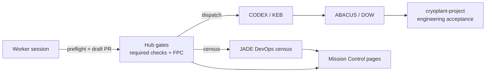

# Pipeline Automation Hub — federation routing, JADE census and Mission Control

<!-- markdownlint-disable MD001 MD013 MD022 MD029 MD031 MD032 MD033 MD040 MD060 -->

[](https://github.com/GBOGEB/pipeline-automation-hub/actions/workflows/zero-test-gate-guard.yml)
[](https://github.com/GBOGEB/pipeline-automation-hub/actions/workflows/jade-devops-census.yml)
[](https://github.com/GBOGEB/pipeline-automation-hub/actions/workflows/golden-thread.yml)
[](LICENSE)

> **The Hub routes work across the GBOGEB federation, measures it (JADE census, GOGREEN, First-Pass Closure) and shows it in Mission Control — it dispatches and correlates evidence, it never accepts engineering results.**

## At a glance

| | |
|---|---|
| **Domain** | Federation routing and dispatch, CI/DevOps census of the JADE repositories, merge-admission gates and the Mission Control pages, plus a bounded legacy PPTX/Excel document pipeline |
| **EPICs carried here** | **U-series** CI and workstation follow-ups ([#1246](https://github.com/GBOGEB/pipeline-automation-hub/issues/1246), [#1204](https://github.com/GBOGEB/pipeline-automation-hub/issues/1204), [#1202](https://github.com/GBOGEB/pipeline-automation-hub/issues/1202)) · **PINOTAGE P10** scaling ([#1234](https://github.com/GBOGEB/pipeline-automation-hub/issues/1234)–[#1238](https://github.com/GBOGEB/pipeline-automation-hub/issues/1238)) · **W305 First-Pass Closure** ([#304](https://github.com/GBOGEB/pipeline-automation-hub/issues/304), [#336](https://github.com/GBOGEB/pipeline-automation-hub/issues/336)) · **GOGREEN** ([#529](https://github.com/GBOGEB/pipeline-automation-hub/issues/529), [#1136](https://github.com/GBOGEB/pipeline-automation-hub/issues/1136)) · **CODE PURPLE** Mission Control ([#718](https://github.com/GBOGEB/pipeline-automation-hub/issues/718), [#604](https://github.com/GBOGEB/pipeline-automation-hub/issues/604)) · **Grand Missions** GM-I..V ([#188](https://github.com/GBOGEB/pipeline-automation-hub/issues/188), [#308](https://github.com/GBOGEB/pipeline-automation-hub/issues/308)) |
| **Owner and decision authority** | Repository owner **GBOGEB**: admission to `master`, gate downgrades and every external grant. No agent, bot or CI verdict holds this authority. |
| **Role in the federation** | The *dispatcher and scoreboard*: `worker → Hub → CODEX/KEB → ABACUS/DOW → cryoplant`. It routes requests and correlates exact source/head/output digests. |
| **Owns** | Level-1 routing kernel, JADE DevOps census and Actions metrics, CI/CD DAG and Kahn wave view, First-Pass Closure gate, GOGREEN gates, MAROON ledger, Mission Control pages, workstation and thread tooling, the legacy PPTX metadata and Excel schedule engines |
| **Does not own** | QPS engineering SSOT and release identity (cryoplant-project) · semantic provenance and federation contracts (CODEX) · the DMAIC runtime and CI repair at source (ABACUS) · numerical methods (gg_MATH) |
| **Status snapshot** | `master@78435da`, read 15 November 2026 — 65 open issues, 34 open PRs. [Details ↓](#6-status-and-open-gates) |

**New here?** Read [§1](#1-why-the-hub-exists--bios) (2 min), then the route that matches you:

| I want to… | Open this first |
|---|---|
| See every Mission Control page in one place | [GoGreen launcher](mission-control/gogreen/launcher/index.html) ([how to open it](mission-control/gogreen/launcher/README.md#open-the-pages)) |
| Understand routing and authority | [BIOS](#1-why-the-hub-exists--bios) and [`LEVEL1.md`](LEVEL1.md) |
| Know why my PR is blocked | [Status and open gates](#6-status-and-open-gates) and [First-Pass Closure](docs/W305_FIRST_PASS_CLOSURE_GATE.md) |
| Build a metric, page, gate or tool | [`AGENTS.md`](AGENTS.md) first, then `python scripts/preflight_overlap.py <terms>` |
| Read the JADE census | [JADE_TEMPLE project](mission-control/jade_temple/README.md) and the [CI/CD DAG](mission-control/jade_temple/site/cicd_dag.html) |
| Run the PPTX or Excel pipeline | [Run it locally](#7-run-it-locally) |

## 1. Why the Hub exists — BIOS

**B — Baseline.** `master` is the default branch. There is no tagged release; the Level-1 state lives in [`level1/ssot.json`](level1/ssot.json) and the mission register in [`mission-control/OFFICIAL_MISSION_REGISTER_v1.yaml`](mission-control/OFFICIAL_MISSION_REGISTER_v1.yaml).

**I — Identity and integrity.** Every census, gate and page names the exact head SHA it read. Dated Mission Control pages are frozen views of their date, not live fleet truth or hosted Pages.

**O — Orchestration with ownership.** One owner per metric ([AGENTS.md L4](AGENTS.md)): check with `preflight_overlap.py`, then import the owner's function instead of copying it. Wave claims in [`.waves/WAVE_CLAIMS.yaml`](.waves/WAVE_CLAIMS.yaml) are rolled up by CODEX.

**S — Safety and source-qualified status.** Never merge on red ([L1](AGENTS.md)): fix the gate input, or downgrade the gate in its own reviewed PR. A stage that collects zero tests fails. Routing and receipt completeness never become engineering acceptance; `authority_transfer` stays disabled.

**Who uses it:**

| Reader | Comes for | Leaves with |
|---|---|---|
| External visitor | What the Hub is and how the federation is wired | This page and the [launcher](mission-control/gogreen/launcher/index.html) |
| Agent session | The next owned, unduplicated task | A preflight result, one-concern branch, draft PR |
| Federation peer | Census, wave roll-up input, dispatch receipts | A pinned Hub SHA and its receipts |
| Owner | Admission and gate decisions | A PR with an exact-head FPC receipt and green required checks |

**Where authority lives:** [`AGENTS.md`](AGENTS.md) (working rules and metric ownership) · [`LEVEL1.md`](LEVEL1.md) and [`level1/`](level1/) (routing kernel) · [`governance/branch_protection/`](governance/branch_protection/) · [`mission-control/quality/FIRST_PASS_CLOSURE_POLICY_v1.json`](mission-control/quality/FIRST_PASS_CLOSURE_POLICY_v1.json) · [`.waves/WAVE_CLAIMS.yaml`](.waves/WAVE_CLAIMS.yaml).

## 2. From source to decision

1. **Preflight**: `scripts/preflight_overlap.py` checks `master` and open PR diffs for an existing owner.
2. **Branch early, one concern**: push after the first commit, open a draft PR against `master`.
3. **Census**: the JADE DevOps census and Actions metrics re-read the five JADE repositories at one SHA.
4. **Gate**: the required checks on `master` plus the First-Pass Closure receipt for the exact head (§6).
5. **Dispatch**: Level-1 routes accepted work to CODEX, ABACUS or cryoplant and records the receipt.
6. **Show**: Mission Control pages project the result, dated and SHA-bound.
7. **Owner admits**; the census reads `master` back before the next wave.

## 3. What is inside

| Block | Native source | Input → output | Boundary |
|---|---|---|---|
| Level-1 routing kernel | [`level1/`](level1/), [`LEVEL1.md`](LEVEL1.md) | Worker receipts → dispatch decisions and digests | Routing readiness, not engineering truth |
| JADE DevOps census | [`mission-control/jade_temple/devops/`](mission-control/jade_temple/devops/) (`census.py`, `actions_metrics.py`) | GitHub API reads of the JADE repos → census JSON and readings | Read-only measurement |
| CI/CD DAG and waves | [`mission-control/jade_temple/site/build_cicd_dag.py`](mission-control/jade_temple/site/build_cicd_dag.py) | Workflow policy → DAG, crosswalk and page | Declared architecture |
| First-Pass Closure gate | [`scripts/first_pass_closure_gate.py`](scripts/first_pass_closure_gate.py), [W305 doc](docs/W305_FIRST_PASS_CLOSURE_GATE.md) | PR head, runs, reviews → pass / hold | Needs a completed Codex review on the exact head |
| GOGREEN | [`mission-control/gogreen/`](mission-control/gogreen/) | Fleet runs and outcomes → required gate, scale dock, launcher | Evidence of runs, not of correctness |
| MAROON ledger | [`mission-control/maroon/`](mission-control/maroon/) | Security repair routing and fold-backs | Routes repairs; fixes land in the owning repo |
| QPS TRIAGE ULTRA | [`mission-control/qps-triage-ultra/`](mission-control/qps-triage-ultra/) | Telemetry, DMAIC, PCA/BT, burn-down views | No second QPS SSOT |
| Workstation and threads | [`tools/workstation/`](tools/workstation/), [`tools/threads/`](tools/threads/) | Local audit, restack, transcript recovery | Owner's PC; not CI evidence |
| Legacy PPTX pipeline | [`scripts/run_processing.py`](scripts/run_processing.py), probe [`qps/m09/`](qps/m09/) | `.pptx` → hash, filename metadata, template Markdown twin, receipts | Does **not** parse slide text, tables, images or semantics |
| Excel schedule engine | [`excel_schedule_engine/`](excel_schedule_engine/README.md) | Workbook tables → CSV/XLSX, manifest, schedule dashboard | Decision support; the workbook stays the source |
| Recursive DOC / RTM | [`recursive_doc_engine/`](recursive_doc_engine/), [`rtm_pipelines/`](rtm_pipelines/README.md) | Document blocks → build index; RTM integration | Index and provenance only |
| Next.js app | [`app/`](app/) | Legacy UI and API surfaces | UI claims follow the bounded pipeline above |

## 4. Where the Hub sits in the federation

| Neighbour | Keeps | Interface with the Hub |
|---|---|---|
| [CODEX](https://github.com/GBOGEB/CODEX) | KEB semantic provenance, federation contracts, wave roll-up | Receives routed work; rolls up Hub wave claims |
| [ABACUS](https://github.com/GBOGEB/ABACUS) | DOW/DMAIC runtime, CI repair at source | Census target; receives dispatched runtime work |
| [cryoplant-project](https://github.com/GBOGEB/cryoplant-project) (private) | QPS engineering SSOT and release identity | End of the dispatch chain; accepts or rejects |
| [gg_MATH](https://github.com/GBOGEB/gg_MATH) | Numerical methods | Pinned provider ([#1203](https://github.com/GBOGEB/pipeline-automation-hub/issues/1203)) |
| [GEMINI](https://github.com/GBOGEB/GEMINI) | Input sanity, landing-page pilot | Owner of the landing skeleton this page follows |

## 5. Process diagrams

Declared architecture, not a run receipt.



Interactive views: [CI Spine explorer](docs/ci-spine/explorer.html) (frozen 28–29 Oct 2026) and the [CI/CD DAG](mission-control/jade_temple/site/cicd_dag.html). GitHub shows HTML as source; clone and open them locally.

## 6. Status and open gates

**Snapshot: `master@78435da`, read 15 November 2026.** Rows point at live owners; open the link for the current position.

| Gate | Status | What would close it |
|---|---|---|
| `master` protection | **Two rulesets**: PR required, linear history, Copilot code review; required checks *validate-ultra-control*, *canonical-self-test-and-mutation*, *GOGREEN required gate*, *Launcher outputs current and tests*, *frozen-head-census*, *CodeQL*, and *First-Pass Closure Gate*. Second-ruleset clean-up open in [#1159](https://github.com/GBOGEB/pipeline-automation-hub/issues/1159). | Owner disposition of #1159, read back from the rulesets |
| Codex review budget | Quota exhausted since 9 Nov; FPC needs an exact-head review. Tiering decision [#1245](https://github.com/GBOGEB/pipeline-automation-hub/issues/1245); waiver bootstrap [#1172](https://github.com/GBOGEB/pipeline-automation-hub/pull/1172) open | Owner decision on #1245 |
| `master` red | [#1157](https://github.com/GBOGEB/pipeline-automation-hub/issues/1157): CODE PURPLE live census and GOGREEN token census failing | Both workflows green on `master` |
| GOGREEN fan-out | [#1136](https://github.com/GBOGEB/pipeline-automation-hub/issues/1136): PR-side fan-out cancels most runs | Cancellation scoped; re-check recorded |
| CI collection parity | [#1204](https://github.com/GBOGEB/pipeline-automation-hub/issues/1204): re-census all 5 JADE repos at one SHA | Census run and reading committed |
| Machine-local pulses | [#1199](https://github.com/GBOGEB/pipeline-automation-hub/issues/1199): scheduled pulses call scripts that exist on one PC only | Scripts landed in `tools/` or retired |
| MAROON | [#1246](https://github.com/GBOGEB/pipeline-automation-hub/issues/1246) P1 watch; routing [#1232](https://github.com/GBOGEB/pipeline-automation-hub/pull/1232) open | Watch landed; ledger runs on Windows |
| Workflow estate | 212 workflow YAML files at this snapshot | [`governance/ci_spine/`](governance/ci_spine/) kept current |

## 7. Run it locally

Python **3.12** is the main CI leg (the zero-test guard runs on 3.11). From the repository root:

```bash
pip install -r scripts/requirements.txt
python -m pytest tests -q                       # pytest.ini anchors rootdir here
python scripts/preflight_overlap.py <term> ...  # before building anything
python scripts/run_processing.py                # legacy PPTX metadata pipeline
python scripts/run_processing.py --excel-input ActiveDocs/MASTER.xlsx --excel-output-root .
```

The PPTX pipeline reads `app/public/master_input/` and writes `app/public/outputs/`; it rejects non-OpenXML files and marks filename-derived references as `UNVERIFIED_CANDIDATE`. Set `SOURCE_DATE_EPOCH` for reproducible receipts. The Next.js app starts from `app/` with its own package manager.

On Windows, start `gh` and `git push` commands with `unset GITHUB_TOKEN GH_TOKEN;` ([AGENTS.md](AGENTS.md)).

## 8. Evidence rules and non-compensation

- **Red means stop.** No merge on red; gates are fixed at the input or downgraded by the owner in their own PR.
- **Zero collected is a failure**, guarded by the Zero-Test Gate Guard.
- **Dated is frozen.** A page labelled with a date is that date's view; it never stands in for current state.
- **Routing is not acceptance.** A green Hub gate proves dispatch and receipt completeness only.
- **One owner per metric.** Duplicates are merged into the owner, never kept side by side.

## 9. Repository map and next actions

| Folder | Open it for |
|---|---|
| [`mission-control/`](mission-control/) | All Mission Control surfaces (JADE_TEMPLE, GOGREEN, MAROON, grand missions, QPS TRIAGE ULTRA) |
| [`scripts/`](scripts/) | Gates, preflight, the PPTX pipeline |
| [`tools/`](tools/) | Workstation, threads, CI and metric-atlas tooling |
| [`docs/`](docs/) | CI Spine, W305 gate design, Mission Control docs |
| [`governance/`](governance/) | Branch protection, branch hygiene, CI spine policy |
| [`federation/`](federation/) | Wave-specific federation packages |
| [`handover/`](handover/) | Session handovers and drop-ins |
| [`tests/`](tests/) | Repository test suite |

**Frozen views kept for reference** (dated, read-only): [CI Spine explorer](docs/ci-spine/explorer.html) (28–29 Oct) · [JADE N+2 burn-down](mission-control/jade_temple/site/burndown.html) (19 Oct) · [Top21 GoGREEN readiness](mission-control/jade_temple/site/green.html) (18 Oct) · [P4 SIPOC explorer](mission-control/federation-atlas/flightdeck/pulses/federation_landing_p4.html) (16 Oct) · [M2 Mission Control](docs/mission-control/m2/index.html) (15 Oct).

**Next actions** (match §6): owner decision on Codex review tiers (#1245) → `master` back to green (#1157) → JADE re-census at one SHA (#1204) → land machine-local pulse scripts (#1199) → MAROON P1 watch (#1246).

---

BIOS: Baseline · Identity · Orchestration · Safety. Admission authority: **GBOGEB**. Licence: [Apache-2.0](LICENSE) ([third-party notices](THIRD_PARTY_NOTICES.md), [security](SECURITY.md), [contributing](CONTRIBUTING.md)). Landing R2 on the [GEMINI skeleton](https://github.com/GBOGEB/GEMINI/blob/main/docs/landing/LANDING_SKELETON.md), snapshot `master@78435da`.
