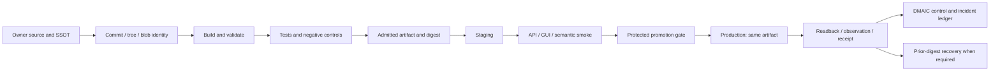

# Repository BIOS and pipeline topography

Start here for **purpose → structure → dependencies → decisions → measured results**.
This root entry extends the existing JADE owners. It is a navigation and reporting
contract, not a new scheduler or a deployment approval.

**Development view:** the [profile registry](tools/repo-bios/profiles.json) and
[report guide](tools/repo-bios/README.md#development-map-explicit-pipeline-scope-sipoc-adr-and-job-observations)
add explicit pipeline entry scopes, source-bound SIPOC cards, keyboard/clickable
Kahn job graphs, separate reported prerequisite failures/unknowns, and ADR source
declarations. Private selectors stay in a private local profile. Existing owners
retain Kahn, critical-path, metric and decision authority.

## Repository BIOS: why each repository exists

| Repository | Purpose / reason for existence | Inputs → outputs | Owning lane |
|---|---|---|---|
| [PAH](README.md) | Coordinate portfolio work and expose evidence, dependency and operational views | Source-owner receipts and work registers → Mission Control projections and controlled orchestration | Portfolio / orchestration |
| [CODEX](https://github.com/GBOGEB/CODEX) | Govern semantic provenance, validation and federation exchange | Governed source and contracts → validation receipts, semantic bridges and portal | KEB / provenance |
| [ABACUS](https://github.com/GBOGEB/ABACUS) | Provide the DOW analytical runtime and QPLANT application surfaces | Configuration and analytical inputs → analyses, application outputs and evidence | DOW / analytics |
| [cryoplant-project](https://github.com/GBOGEB/cryoplant-project) | Maintain private QPS engineering sources and their traceability | Owner sources and requirements → engineering review artifacts and dispositions | QPS engineering; private |
| [gg_MATH](https://github.com/GBOGEB/gg_MATH) | Supply reproducible mathematical kernels, uncertainty and Plotly evidence | Defined numerical inputs → validated numerical results and visual evidence | Mathematical provider |

The source owner's README and contracts govern each role. Tooling success does
not transfer engineering authority. Resolve per-function ownership between
CODEX `pca_engine` and gg_MATH before redirecting an existing consumer.

## Pipeline topography and repository wireframe



This is the delivery **reference topology**, not a claim that every repository
implements all stages. Feedback to planning belongs to the next observation
pulse; do not insert a feedback cycle into a single execution DAG.

```text
/REPO_BIOS.md                         purpose, navigation and reporting contract
/README.md                            existing repository landing
/docs/ci-spine/                       workflow / lane / source-pointer views
/mission-control/jade_temple/         canonical DAG, SIPOC, lifecycle and census
/mission-control/federation-atlas/    cross-repository process lanes
/tools/metric-atlas/                  existing analytical review views
/tools/repo-bios/                     exact-commit statistics and workflow drilldown
```

## DAG, SIPOC, lane matrix and Kahn sequence

| Need | Existing owner / view |
|---|---|
| Total, repository and orchestrator DAG; FUNCTION / SHA / OID lenses | [JADE DAG page](mission-control/jade_temple/site/cicd_dag.html), [model](mission-control/jade_temple/tools/cicd_dag.py) |
| Workflow job dependency parser | [workflows.py](mission-control/jade_temple/devops/workflows.py) |
| Kahn topological waves, unknown endpoint and cycle rejection | [lifecycle.topo_layers](mission-control/jade_temple/devops/lifecycle.py) |
| Lifecycle S0–S9 SIPOC and maturity probes | [DevOps method](mission-control/jade_temple/devops/README.md) |
| Lane matrix and input/output contracts | [CI Spine matrix](docs/ci-spine/LANE_MATRIX_TOP_VIEW_20261030.md), [process lanes](mission-control/federation-atlas/PROCESS_LANES_v1.json) |
| Source-to-view pointers | [Pointer atlas](docs/ci-spine/pointers/README.md) |
| Critical path, float and unlock leverage development | [PR #1276](https://github.com/GBOGEB/pipeline-automation-hub/pull/1276); candidate status must be re-read |
| Federation OID / schedule development | [PR #1209](https://github.com/GBOGEB/pipeline-automation-hub/pull/1209), [namespaced atlas #1259](https://github.com/GBOGEB/pipeline-automation-hub/pull/1259); candidate status must be re-read |

For every node expose its lane/owner, supplier, input, process, output, customer,
direct prerequisites, direct downstream consumers, Kahn wave, source identity,
state and next action. Distinguish:

- **Structural frontier:** no declared incoming `needs` edge.
- **Execution-ready:** prerequisites have qualified passing outputs, the trigger
  and `if` condition apply, and required authorization/resources are available.
- **Blocked:** name the actual failed/missing prerequisite and who can resolve it.
- **Unknown:** runtime evidence, dynamic expression or external dependency is
  unresolved. Absence of a declared edge never proves independence.
- **Unblocking:** show which direct consumers become eligible after this node;
  transitive descendants are potential relief, not immediately ready work.

The report below shows static dependencies and labels runtime readiness UNKNOWN.
Cross-workflow triggers, reusable calls, artifacts and external services require
the existing federation model; a workflow's job DAG alone is incomplete topology.

## ADR and OID views

ADR means an **Architecture Decision Record**: ID, problem/context, alternatives,
decision owner, proposed/accepted/superseded status, rationale, consequences,
affected DAG nodes, evidence and supersedes/superseded-by links. The report
discovers path candidates only; it never infers acceptance from a filename.
Keep a decision in the existing owner repository and link it into the DAG.

OID views retain separate identities: repository commit SHA, tree object ID,
file blob OID, job-definition SHA-256 and descriptive JADE URN. An OID is content
identity, not approval or freshness. Rebind/revalidate affected views after source
changes. The report exposes exact-commit workflow, job and ADR-source links.

## Full statistics report

[Report CLI and method](tools/repo-bios/README.md) produces JSON, Markdown and an
offline HTML drilldown for the named checkouts, reading committed Git objects.
It counts tracked files/bytes, directory wireframe, language files and physical
LOC, workflow/job counts, per-workflow upstream/downstream and Kahn waves,
decision-record path candidates and explicitly selected pipeline-entry LOC.

Include Python, R and each other detected language even when the result is zero.
Separate production/test path heuristics and generated/vendor populations before
interpreting size. LOC includes comments and blank lines; it is not complexity,
productivity, executed code, test coverage or engineering progress. Main-pipeline
entry LOC covers explicitly declared files only, not a guessed transitive closure.

**AHT stays context-qualified:** the [glossary](mission-control/v2/MC_GLOSSARY_TAXONOMY_v2.json)
identifies `AHT_STATISTICS_AND_CHECK_CONTROL_FAMILY`; source owners are CODEX
AHT control and the ABACUS statistics bridge. Do not expand it to average handling
time. Discover those owner paths in the report and keep check results UNKNOWN
until exact-source execution receipts are available.

## DMAIC metrics and KPIs: retain the as-is owners

| Dimension | As-is source / required interpretation |
|---|---|
| Define | BIOS, lane, owner, work/decision registers and explicit acceptance criteria |
| Measure | [DevOps census](mission-control/jade_temple/devops/census.py), [Actions metrics](mission-control/jade_temple/devops/actions_metrics.py): population, time window, sampling and source SHA |
| Analyze | [EVERRED](mission-control/qps-triage-ultra/p-process/everred/harvest.py), [Metric Atlas](tools/metric-atlas/README.md): recurrence, root cause, uncertainty and matched cohorts |
| Improve | Existing work register: intervention, baseline, changed source and verification |
| Control | [Rolling-5](mission-control/jade_temple/tools/rolling5.py), release/deploy receipts, regressions and source drift |

Report existing KPI values unchanged with their source/time window; missing or
stale data remain UNKNOWN. Job duration is not human effort. Keep queue time,
elapsed run time, runner minutes and incident recovery time distinct. Do not
invent a single maturity score or merge mismatched coverage denominators.

## Additional needs and development sequence

1. **Identity and scope:** named source heads, profile owners and private/public
   projection rules; never publish private paths/receipts to a public report.
2. **Baseline:** regenerate exact-commit stats; bind the current native KPI pulse
   separately. Add an explicit freshness threshold per source.
3. **Dependency completeness:** reconcile job DAGs with artifact contracts,
   reusable workflows, external services and blocking review/owner gates.
4. **Decision navigation:** qualify discovered ADR candidates with their owner,
   status and affected nodes; extend the existing OID atlas after its admission.
5. **Operational closure:** live SHA/digest parity, health/SLO thresholds, alert
   ownership, credential/configuration drift, retention, backup and restore proof.
6. **User acceptance:** authenticated hosted GUI journeys, accessibility, stale
   and empty-state behavior, and I/O schema/version/error checks.

Each slice needs a DoD (what exists) and DoV (which source-bound checks prove it).
Local report generation, native CI, eligible review and owner acceptance are
separate states. This entry grants no merge, deployment or release authority.
