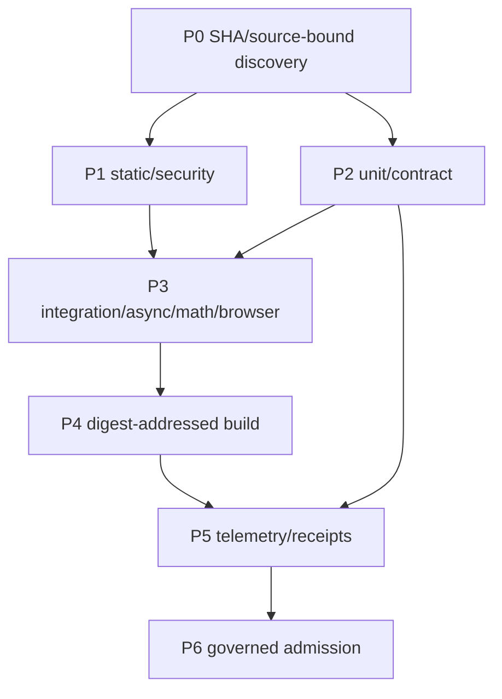

# CI bundles: DevOps lifecycle, SIPOC, DAG, CREW workstreams

**Status:** advisory/shadow pilot, source-bound, not a required check and not merge authority.
**Base:** master, initial source SHA `6f7cf145c4ebf585dbb341ba5863e77098ad36b0`.
**Owners:** JADE `workflows.py` supplies the parser and job DAG, `actions_metrics.py` owns runtime measures, GOGREEN `required_gate/ADMISSION.json` owns enforcement, `rolling5.py` historical pulses and `title_taxonomy.py` title interpretation. No duplicate metric owner is created.


## Semantic reconciliation with merged #992

The existing [merged #992 CI spine](ci-spine/README.md) owns a frozen **B00–B09 logical design**, its 17 machine edges (16 feedforward, one next-pulse feedback), full workflow/test-file source index and existing JADE/GOGREEN metric owners. The B00–B12 definitions in this pilot are a separate `jade.devops.ci_candidate` **candidate overlay**. Their short IDs have **no name-based equivalence** to #992's `ci-spine:bundle` IDs.

The [source-verified, lossless crosswalk](ci-spine/BUNDLE_B00_B09_TO_CANDIDATE_B00_B12_V1.json) records all 10 old labels/stages, exact frozen head `ca623ab...`, actual tree OID, anchor workflow blob OIDs, observed triggers, original ADMISSION dispositions, candidate overlaps, explicit coverage gaps and consumer migration holds. It preserves the old B07 **required fan-in**, which must never be confused with candidate B07 **scientific math**. Original B02 dependencies/cache lacks a dedicated candidate equivalent; original B09 next-pulse feedback is not yet represented by candidate planning edges. No approval is inferred.

The older source index reports `git_tree_oid` equal to the source **commit** SHA; GitHub's actual Git **tree** is `b1f0a6eb264ff6a409b9203fc6e7fc6773a3a4ad`. This historical #992 P2 discrepancy is exposed, not corrected by modifying an unrelated owner. An additional #992 review discrepancy between the README's old B06 dependencies and its machine DAG remains explicitly unresolved for the owner.

Other already active consumers: [#1010 RF wave](https://github.com/GBOGEB/pipeline-automation-hub/pull/1010) uses old B00–B09; [#996 authority spine](https://github.com/GBOGEB/pipeline-automation-hub/pull/996) has distinct binding ownership. This PR makes no changes to either. Until an owner approves migrations, old machine IDs, old dependency edges, actual workflow/check names and GOGREEN admission policy are unchanged.

## Lifecycle phases and execution lanes

| Phase | Lane | DevOps stage(s) | Crew / worker | Deliverable | DoD / verification |
|---|---|---|---|---|---|
| P0 Discover | L0_INTAKE | S0_PLAN / S2_BUILD | SCOUT + READER | Source-bound inventory of workflow/jobs, trigger and exact file hash | 100% enumerated in scoped checkout, UNKNOWN not PASS |
| P1 Static | L1_STATIC | S1_CODE / S4_SECURE | DOCTOR + SECURITY | Action pins, lint, permissions, dependency review | No new privilege or security-bypass |
| P2 Tests | L2_TEST | S3_TEST | CONTRACT + TESTER | Unit/contract matrix, population receipt | Collected/executed/skipped floors measured per job |
| P3 Integration | L3_INTEGRATE | S3_TEST | FEDERATION + gg_MATH + BROWSER | Replay/async/math/browser/integration partitions | Tests independently qualified; artifacts bound to SHA |
| P4 Delivery | L4_RELEASE | S5_RELEASE / S6_DEPLOY | BUILDER + DEPLOY | Build-once digest and environment admission | DP1–DP10, no deployment by shadow pilot |
| P5 Measure | L5_MEASURE | S7_OPERATE / S8_MONITOR | HISTORIAN + DAB/LLDB + METRICS | Queue/run/install/cache timing, EVERRED and matched cohorts | Authoritative producers only; denominators preserved |
| P6 Govern | L6_ADMISSION | S9_CONTROL | GOVERNOR + INDEPENDENT REVIEWER | Exact-head verification, gate receipt, disposition | Fail closed, no auto-merge |

## Planning DAG



The versioned bundle catalog also records a more granular **planning** DAG in `CI_BUNDLE_CATALOG_V1.json`; these are target dependencies, not claims that all live workflows enforce them. Work may fan out within a phase, but only a reconciled fan-in receipt may inform an existing gate.

## SIPOC trace

| ID | Supplier | Input | Process / owner | Output | Customer |
|---|---|---|---|---|---|
| SP00 | GitHub tree | Ref + exact SHA + workflow YAML | JADE `workflows.parse/analyse` | Candidate job DAG and bundle hints | MC inventory |
| SP01 | Workflow test runner | Exact SHA + selected test population | Existing test workflow / reusable CI | Executed test logs / coverage | Existing GOGREEN gate |
| SP02 | GitHub Actions API | Jobs, run attempts, queue and duration clocks | `actions_metrics.py` | Matched time cohorts | MC dashboard |
| SP03 | Source/CI receipt | Hash and historical observations | `rolling5.py`, `cicd_dag.py` | Time-bound DAG/SIPOC and provenance | Historian / QA |
| SP04 | Protected repository policy | Required contexts, eligible review, receipts | GOGREEN + owner governance | PASS / HOLD / FAIL disposition | Maintainer |

## Pilot CLI and validation

```bash
python -m unittest discover -s mission-control/jade_temple/devops/tests -p 'test_ci_bundle_inventory.py' -v
python mission-control/jade_temple/devops/ci_bundle_inventory.py --source-sha "$(git rev-parse HEAD)" --out /tmp/ci-bundle-inventory.json
```

The CLI reads workflow YAML **from the immutable Git tree at `--source-sha`**, not from working-tree files. A wrong/missing object, a nested `--root`, malformed YAML/job, dangling job `needs` or in-workflow cycle is surfaced explicitly; source errors fail closed. A dirty checkout does not contaminate the bound source. **Unclassified workflows remain UNKNOWN/advisory, not an admission PASS**. The output is local-only and no published data or gate status is silently changed.

### First-red readback / overlap disposition (28 October 2026)

- PR #997 JADE portability red was repaired by declaring UTF-8/LF. The review then identified P2 worktree/source misbinding and P2 malformed-job omission; both are repaired by Git-object scanning and job-level parse-error receipts with negative tests.
- JADE N+9 DevOps census on source `41f187f...` ran **77** scoped tests but required **89** in that same step; the **12** Actions-metrics tests are a separate step with a separate population floor. Existing PR [#977](https://github.com/GBOGEB/pipeline-automation-hub/pull/977) owns that floor correction; PR [#872](https://github.com/GBOGEB/pipeline-automation-hub/pull/872) builds on it with missing-blob safeguards. Neither should be duplicated or downgraded in this branch.
- FPC is independently FAIL on `MISSING_RECEIPT`; a green proof workflow is not a gate PASS. A valid same-head receipt and clean new-head Codex review are still required before admission.
- A subsequent N2 branch may run and artifact the full shadow census independently; it must not pretend to change GOGREEN admission classification or the pre-existing 77/89 workflow defect.

## Next disjoint worker PRs

- N1 **SCOUT / taxonomy**: compare existing `title_taxonomy.py` family identifiers to bundle IDs; propose display names while preserving required status contexts and generated recheck-name ledger.
- N2 **TESTER / zero-case**: exactly define selected, collected, executed and skipped per job, repair census floors without duplicate discovery; coordinate with pre-existing #977 and #872.
- N3 **DOCTOR / scheduling**: inspect repeated `workflow_run` wakeups, unbounded matrices and starvation; apply path filters only after GOGREEN applicability tests.
- N4 **CACHE / builder**: benchmark cold vs warm pip/uv/npm in separate compatible environments; verify lockfile and trusted cache population, never share mutable .venv across trust boundaries.
- N5 **HISTORIAN / metrics**: add matched before/after wall-clock, queue and compute-minute projections to existing `actions_metrics.py`, no second metric implementation.
- N6 **GOVERNOR / scale**: compare one pilot family across Hub, ABACUS, CODEX, gg_MATH and QPS; demand exact-head CI, independent review and owner-signed policy before any promotion.

## Explicit hold

No workflow/job renaming, GOGREEN admission ledger update, branch ruleset mutation, new privileged trigger, external dispatch, deployment or merge in this slice. Preserve `validate-ultra-control`, `canonical-self-test-and-mutation`, and `GOGREEN required gate` required check identities. Existing `AGENTS.md` L1/L4/L5/L6/L7 remain binding.
