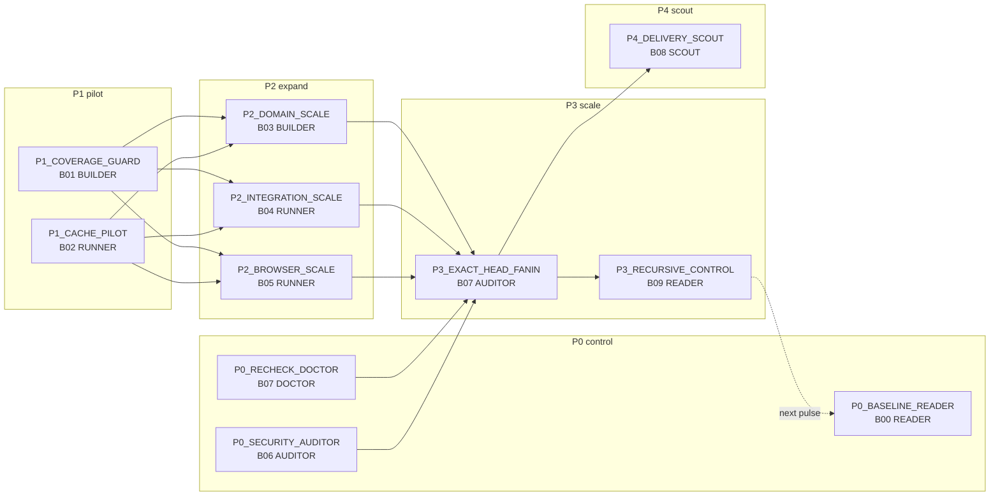

# PAH lane matrix: TOP view

A whole-system view of the pipeline-automation-hub CI matrix. It covers the RF wave lanes, how they depend on each other, what each lane produces, and the open PR queue they all feed.

- **Snapshot:** master `77bac410de6b34afa5df665608611ad9e8db5c84`, pulse taken 2026-10-30. Lane outcomes were updated 2026-10-31.
- **Live page:** [PAH lane matrix TOP view](https://claude.ai/artifact/8ZARhGevm4CD5NFWYFneka). It is private until shared.
- **Authority:** the page plans and reports only. It never dispatches work, merges, or changes a gate.

## Objective and manifest

| What | Value at this snapshot |
|---|---|
| RF goal metric | `recheck_workflow_record_share`, target 0.2 |
| Goal status | UNKNOWN until a matched T1 run is recorded |
| Admission | HOLD |
| Lanes | 11 total: 5 ON, 6 HELD |
| Open PRs | 32. None is both green and mergeable. 7 conflicted at snapshot time. |
| Shared root 1 | Master's launcher `index.html` is stale (`build_launcher.py --check` fails). This makes 16 PRs red on "Launcher outputs current" and the GOGREEN gate. #1049 owns the fix. |
| Shared root 2 | First-Pass Closure needs a Codex review on each exact head. The Codex quota is exhausted, so 31 PRs show red on it. |
| Security | 4 open code-scanning alerts. 1 high Dependabot alert, fixed by draft #1050. |
| JADE DAG (total scope) | 54 nodes, 78 edges, depth 13, 24 crosswalk edges. Coverage: 98% by OID, 43% by SHA. |

## Lane topology



The P0 and P1 lanes have no dependencies, so they can run now. The P2 lanes wait for both P1 lanes to be DONE with receipts. The fan-in waits for every P0 and P2 lane. Recursive control and the delivery scout wait for the fan-in, and recursive control feeds the next pulse back to B00.

## Per-lane narrative

Each lane lists its plan, its owner now, and its SIPOC (supplier, input, process, output, customer). Every lane's supplier is "repository-source; prior-bundle-evidence". Its customer is "downstream owner; Mission Control", except recursive control, whose customer is the next pulse.

### P0_BASELINE_READER (B00, S1_CODE, ON)
- **Owner now:** the TOP view thread.
- **Narrative:** Reads the exact source identity (commit and workflow blob OIDs) that every other lane binds to. This pulse it is the snapshot above. Next step: a matched T1 read, so the goal metric stops being UNKNOWN.
- **SIPOC:** input is commit and workflow blob OIDs. Process: pinned source identity, lint and trust. Output: `source_head_sha`, `lint_receipt`.

### P0_RECHECK_DOCTOR (B07, S3_TEST, ON)
- **Owner now:** the PR burn-down waves. The conflict burn-down is done.
- **Narrative:** Aggregates only exact-head successful required checks into HOLD or eligible. The whole queue stops here. First-Pass Closure needs a Codex review on each exact head, and the quota is exhausted. #968, #1015 and #1035 had their conflicts cleared, and are now red only on First-Pass Closure.
- **SIPOC:** input is verified B00–B06 current-head receipts. Process: aggregate eligible exact-head required predicates. Output: `HOLD_or_eligible`.

### P0_SECURITY_AUDITOR (B06, S4_SECURE, ON)
- **Owner now:** the Lane B06 session (done).
- **Narrative:** Turns open alerts into deduplicated MAROON roots. Draft #1050 bumps zod from 3.23.8 to 4.6.6 and clears Dependabot high #51, with no failing checks. Still unowned: 4 CodeQL workflow-permission alerts. The closed #1043 used to cover them.
- **SIPOC:** input is actions, dependencies and source artifacts. Process: immutable action pins, security and provenance checks. Output: `security_receipts`.

### P1_COVERAGE_GUARD (B01, S3_TEST, ON)
- **Owner now:** Lane T and the L1–L6 coverage waves.
- **Narrative:** Owns test population, coverage and negative controls across ABACUS, CODEX, gg_MATH, QPS and Mission Control.
- **SIPOC:** input is the test population and source. Process: unit tests, schema, negatives, zero-test floor. Output: `test_results`, `coverage`, `negative_matrix`.

### P1_CACHE_PILOT (B02, S2_BUILD, ON, then measured OFF)
- **Owner now:** the Lane B02 session (done).
- **Narrative:** Draft #1051 caches pip and Playwright Chromium in `taxonomy-browser-qa.yml`. T1 run 41182032603 kept full test parity and cut the warm median from 35 s to 28 s. The lane is now OFF (measured), with admission HOLD.
- **SIPOC:** input is the toolchain, lockfile and OS/ABI cache key. Process: pinned runtime and cache restore. Output: `dependency_manifest`, `cache_receipt`.

### P2_DOMAIN_SCALE (B03, S3_TEST, HELD: dependency not done)
- **Narrative:** Runs path-scoped domain suites (QPS, JADE, CREW, GoGREEN, taxonomy, GM). When released, it writes one PR touching `rf-domain-pilot.json`.
- **SIPOC:** input is changed paths, eligible suites and `dependency_manifest`. Output: `domain_receipts`.

### P2_INTEGRATION_SCALE (B04, S3_TEST, HELD: dependency not done)
- **Narrative:** Runs cross-module and cross-repository integration on one exact head. When released, it writes one PR touching `rf-integration-pilot.json`.
- **SIPOC:** input is sources and verified domain artifacts. Output: `integration_receipts`.

### P2_BROWSER_SCALE (B05, S3_TEST, HELD: dependency not done)
- **Narrative:** Runs Playwright, visual and no-network checks on frozen HTML. Read-only. The cache pilot's Chromium cache is its first input.
- **SIPOC:** input is frozen HTML and build artifacts, plus Playwright. Output: `browser_receipts`.

### P3_EXACT_HEAD_FANIN (B07, S3_TEST, HELD: dependency not done)
- **Narrative:** Joins the B00–B06 receipts of one exact head into HOLD or eligible, with no compensation between them.
- **SIPOC:** input is verified B00–B06 current-head receipts. Output: `HOLD_or_eligible`.

### P3_RECURSIVE_CONTROL (B09, S9_CONTROL, HELD: dependency not done)
- **Narrative:** Measures run and job rates, red roots, latency and maturity, and feeds them to the next pulse (B09 back to B00).
- **SIPOC:** input is live GitHub readback and receipts. Output: `history`, `burndown`, `next_pulse_issues`. Customer: the S0 next pulse.

### P4_DELIVERY_SCOUT (B08, S5_RELEASE/S6_DEPLOY, HELD: not ready by design)
- **Narrative:** Promotes one digest-bound build and verifies the served artifact. It scouts only after the fan-in.
- **SIPOC:** input is a qualified build, review and approval. Output: `deploy_receipt`.

## Where each part comes from

| Part | Canonical owner |
|---|---|
| Lanes and dependencies | `docs/ci-spine/RF_MATRIX_WAVE_v1.json` |
| ON/HELD plan | `mission-control/jade_temple/tools/rf_matrix_wave.py` (calls `lifecycle.rf_pulse_plan`) |
| SIPOC per lane | `docs/ci-spine/LOGICAL_BUNDLE_DAG_v1.json` |
| DAG and SIPOC by scope | `mission-control/jade_temple/site/cicd_dag.json` (generated by `cicd_dag.py`) |
| Run and job timing | `mission-control/jade_temple/devops/actions_metrics.py` |
| Security fix roots | `mission-control/maroon/maroon.py` |
| Merge gate | `mission-control/gogreen/required_gate/gate.py` |

## How to refresh

From a clone checked out at the master commit you want to read:

```bash
python mission-control/jade_temple/tools/rf_matrix_wave.py --source-sha <40-hex master SHA> --open-stack <open RF PRs, 0-5> --out rf_wave.json
python mission-control/jade_temple/tools/cicd_dag.py --check
python mission-control/gogreen/launcher/build_launcher.py --check
```

Read the census and the gate state at the same commit SHA, then ask Claude to rebuild the TOP view from the new output.

## Rules for every lane

- Never merge with a gate red.
- One owner per metric: import the owner's function, never copy it.
- Regenerate the launcher and JADE outputs with their tools, never by hand.
- Push right after the first commit.
- One session per worktree.
