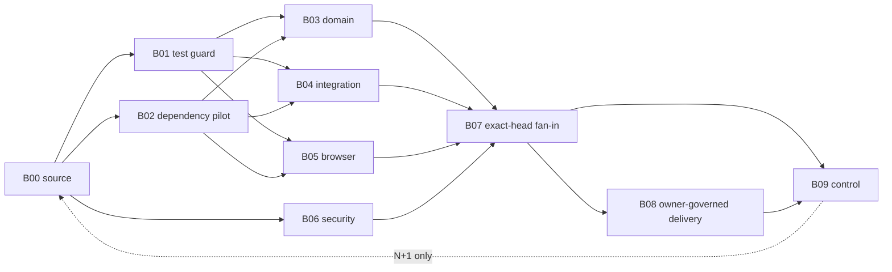

# RF matrix pulse-wave pilot — reusable read-only execution projection

**Authority:** advisory, non-dispatching. This design composes the existing JADE lifecycle owner, the source-bound B00–B09 logical DAG/SIPOC from merged PR #992, and the existing Actions Metrics owner. It does not rename CI jobs, change the admission ledger, alter GitHub permissions, lower FPC, merge PRs, launch CREW or create a second metrics engine.

## Linked implementation frontier

- Parent RF scheduler: draft PR #995; adapter PR depends on it. #995 must be independently qualified.
- Metrics test first-red: independent draft PR #998, which must be evaluated by the owner before any merge.
- Required-gate receipt selector: draft PR #994. Authentic artifact and attempt parity still need live verification.
- Separate CI authority index: draft PR #996. Read/reuse its authority classification only after merge; do not recreate it here.

## Wave matrix, SIPOC and stage ownership

| Wave | Lane | Bundle | Stage | CREW | Exit / before-after contract |
|---|---|---|---|---|---|
| P0 | Baseline reader | B00 | S1_CODE | READER | Bind T0 source/tree and denominator |
| P0 | Recheck doctor | B07 | S3_TEST | DOCTOR | Repair genuine first-red; no silent recovery suppression |
| P0 | Security auditor | B06 | S4_SECURE | AUDITOR | Verify unchanged trust boundary |
| P1 | Coverage guard | B01 | S3_TEST | BUILDER | Nonzero test count, negative matrix, no population floor decrease |
| P1 | Cache pilot | B02 | S2_BUILD | RUNNER | A/B cache setup and full test parity, trust-scoped |
| P2 | Domain, integration and browser | B03/B04/B05 | S3_TEST | BUILDER/RUNNER | All matching receipts, no skipped mandatory shards |
| P3 | Exact-head fan-in and recursive control | B07/B09 | S3_TEST/S9_CONTROL | AUDITOR/READER | Required predicates, T1 measured, new next-pulse work |
| P4 | Delivery scout | B08 | S5_RELEASE/S6_DEPLOY | SCOUT | HOLD until independent owner approval |

Machine-readable topology: RF_MATRIX_WAVE_v1.json. Source-owned SIPOC descriptions, phase edges and next-pulse feedback are loaded from LOGICAL_BUNDLE_DAG_v1.json, not duplicated. The existing lifecycle.py performs selection, dependencies, per-cluster limits and five-PR ceilings.



## RF execution interval and non-idle OFF interval

Each ON interval selects disjoint candidates only when source SHA and T0 evidence are explicit, dependencies are DONE with shaped execution receipts, clusters and global worker caps permit them, and the PR stack ceiling remains five. No check is considered passed merely because a worker or workflow was created.

The OFF interval is active work: the DOCTOR classifies first-red and produces isolated repair; the READER obtains matched sample denominators and run/job clock receipts from the existing actions_metrics owner; the AUDITOR checks source identity, outcomes, FPC, rule effectiveness and review; CREW prepares the next pulse. Feedback enters **only** the next unrolled DAG, not this pulse.

## Goal contract and actual T0

- T0 example from the source-bound 28 Oct sample: 363 GOGREEN recheck workflow-run records among 1,000 runs, 36.3%. Of those 363, 278 were cancelled. These are event records, **not** job CPU minutes, tests or accepted causal-root closures.
- Pilot target: no more than 20% recheck run-record share for a matched sample of 1,000 repository workflow runs. This is a proposed economic optimization target, not a rule or a current achievement.
- T1 requires a newer timestamp, exact source SHA, same sample method, minimum denominator and a receipt digest from the canonical producer. A matching *claimed* digest is not independently authenticated. The projection uses TARGET_REACHED_UNVERIFIED and STOP_FOR_INDEPENDENT_REVIEW; it never issues MERGE=PASS.
- Track simultaneously: workflow-run count, cancellation, job-run minutes, p50/p95 queue, setup/install clock, rerun rescues, test population/coverage, first-red recurrence and unchanged required gate verdicts. Compare T0/T1 on the same event cohort; annotate unknown or partial values.

## Repeatable read-only commands (from repo root)

```bash
HEAD=$(git rev-parse HEAD)
python mission-control/jade_temple/tools/rf_matrix_wave.py --source-sha "$HEAD" --max-parallel 6 --per-cluster 2 --open-stack 2 --out /tmp/rf-matrix-projection.json
python -m unittest discover -s mission-control/jade_temple/devops/tests -p 'test_devops_rf_matrix.py' -v
```

For bounded replay supply a JSON journal with schema jade.devops.rf-journal.v1, the exact source_sha and waves containing externally supplied per-candidate results and/or observations. Run with --journal JOURNAL.json --source-sha "$HEAD". The tool allows at most eight pulses and stops on missing evidence, blocked DAG/capacity, budget or a source-bound advisory goal. No background runner is created. Never hand-construct fictitious GitHub run IDs or treat a shaped journal as independently authenticated.

## DoD / DoV

- [ ] Source-bound exact-head 17 projection tests and seven recursive-replay tests succeed (24 authored test methods).
- [ ] Native JADE and dependent tests meet real nonzero population and branch/statement coverage floors.
- [ ] Source DAG/SIPOC hash and stage mappings resolve, with no same-pulse cycles, and no policy substitution for actual gate.
- [ ] RF parent #995 and metrics first-red #998 reach qualified state independently; no merge on red.
- [ ] Cold/warm cache pilot records comparable T0/T1 job clock and behavioral parity before promotion.
- [ ] Real T1 and 1-day/7-day follow-up verify lower amplification without loss of required-gate recovery.
- [ ] Independent review, effective ruleset, FPC exact-head receipt, outstanding thread resolution and current checks before merge.

**Scope boundary:** Mission Control is represented through canonical read-only assets and CREW role labels. No CREW worker is dispatched by this implementation; the planner returns candidates and OFF actions only.
