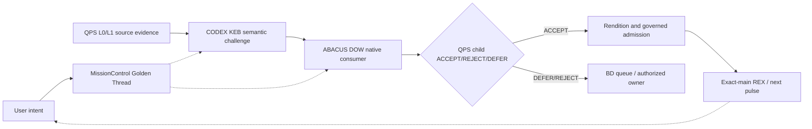

# CODE PURPLE — M2 current-main reconciliation and M3 first-pulse contract

**Observed:** 2026-10-15. **Method:** authenticated GitHub connector current PR/main readback. **Not a raw ChatGPT export.** **Authority transfer:** FALSE. **Full release:** HOLD. **QPS acceptance:** DEFER.

## What changed since the existing M2 bundle

The existing 15-intent / 20-action ledger, source-bound HTML set and session checkpoint files are PRESERVED, not rewritten as though they were new observations. This dated overlay is an append-only correction for the next reader.

| Repo / current GitHub source | Verified status on latest readback |
| --- | --- |
| MissionControl `GBOGEB/pipeline-automation-hub` | `master 6be34434568df474eab28751a098caf57f8cc6bd`; protected=false, required status checks OFF. PRs #534, #535, #536, #537, #538, #540 MERGED. |
| CODEX / KEB | `main af286034e4a5e58c2d74a043d76b4ed8bc1c7337`; protected=false. PRs #1043/#1044/#1045 MERGED. |
| QPS / Cryoplant | `main aadf42bcc6212f1b470c72f911d380148c31de11`; protected=false. #1926 MERGED. |
| ABACUS / DOW | `main 54da377cf82a358ac97903ecde0270c975b8fcc1`; protected=true flag only. #1993 OPEN head `35e1211a05346c72a7500c64aa85f8ce26afe2ea`; #2003 OPEN head `23eeba6ba01624bf1fda4dbc5c6e7095e99a9e70`. Effective required-status enforcement needs distinct readback. |

**Historical facts that stay historical:** #1043 28/32 success, #1044 30/34 success; #1045 34/34 successful PR-head jobs on dated SHA; 1,221 Ruff diagnostics in a nonblocking step, not measured unique roots. The Mycelium generated-inventory/parity root is repaired at #1045 exact head per recorded native evidence. Historical merged #1044 failures remain failures in the event history. This does not establish CURRENT-main Ruff count or current CODEX release acceptance.

**MissionControl first-red corrected historically:** Zero-Test parser #536 was merged, G1/G5 were integrated afterward. Historical G1 13/66 discovered is not authenticated acceptance; G1→G5 has one same-repository independently byte-verified replay. Authenticated CODEX→ABACUS→QPS acceptance is not established. Original #540 exact-head 19/19 adapter tests passed but the final HTML-case assertion failed and #540 merged regardless; do not relabel this as governed PASS. Current-main build/release metrics must be rerun at the actual current SHA, not inherited from PR-head evidence.

**QPS baseline, from documented earlier report only:** 70/90 formal obligations; 36/45 breadth; 34/45 depth; physical eight-file evidence byte check outstanding; #75/#943 safety/source authority not cleared by software tests. These are cohort-bound, not live reassessment.

## Recursive M2 checkpoint

- Parent M1 intent: `CP-SESSION-20261015-002`. The M2 source file retains **CP-M2-I01..I15** and **M2-A01..A20** unchanged.
- New **M2-OBS-20261015-01**: reconcile stale older #536/#534/#535 integration priorities against the latest GitHub merged state. This is an observation event, not source-user intent.
- New **M2-A21**: owner MissionControl #153; status ACTION_CANDIDATE; run native exact-main control/readback and repair the #540 HTML-assertion source check using a distinct SHA; verify generated HTML/JSON/Mermaid upload and consumer byte receipts.
- New **M2-A22**: owner MissionControl #153 plus existing external child owners; status DEFER; implement an accepted cross-repo KEB→DOW→QPS receipt join with SHA/run/job/attempt/bytes/recipient verdict. Existing same-repo G1→G5 proof is not a substitute.
- New **M2-A23**: owner GitHub repository settings, operator-only; status HOLD; establish effective required checks and eligible independent review; audit auto-merge behavior. No self-approval.
- New **M2-A24**: owner existing QPS #1379/#1398 and #75/#943; status HOLD; original physical files/hashes, authorized safety dispositions and binary publication evidence.
- New **M2-A25**: owner CODEX #1037 / ABACUS #1929; status DEFER; scope-match current Ruff/Black/isort/Bandit/Safety/governance first-red attribution and unique root closure, avoiding raw finding count inflation.
- New **M2-A26**: owner MissionControl Flight Deck; status CANDIDATE; graph HTML coverage for 6 repo pages, main, runtime/MCP/crew/Docker/LLDB/LDAB, federation, I/O preflight, burndown and actual evidence gap labels; do not publish invented worker/process/port counts.
- New **M2-A27**: owner this M2 handover; status IMPLEMENTED_SOURCE; embed chat rollover stop/continue policy, keep GitHub Markdown+JSON as handover, raw binaries unchanged, no ZIP or TAR export.

This overlay is **semantic lossless of action obligations** only; missing original ChatGPT platform turn identities and timestamps are UNKNOWN. Do not claim a transcript-level lossless export.

## Combined knowledge and execution boundary

**QPS TRIAGE / cryoplant-project** owns the physical process requirements, source evidence, engineering meaning, glossary, child ACCEPT/REJECT/DEFER and final binary release. GLOB/QTG/LM-11 establish recursive mission→wave→PR→atom lineage.

**CODEX / KEB** owns provenance/semantic exchange, registry and source challenges, Mycelium and developer/agent conventions. It can return validated knowledge receipts, not engineering approval for QPS.

**ABACUS / DOW** owns cross-source analysis, CI/error census, LDAB causal joins, coverage and renderer evidence. It can verify analytical receipt and first-red closure at native head, not accept cryoplant safety/engineering meaning.

**MissionControl** coordinates disjoint work orders, evidence discovery, LIVE → PR → native CI → actual consumer checks, and presents read-only dashboards. A status-only link, passing producer, or role label does not authenticate a recipient.

## Presentation and owner-facing I/O

Existing HTML files live in `docs/mission-control/m2/`: `index.html`, `federation.html`, `runtime.html`, `pipeline.html`, `burndown.html`, `handover.html`, and each of six repository pages (`repo-qps.html`, `repo-codex.html`, `repo-abacus.html`, `repo-missioncontrol.html`, `repo-math.html`, `repo-documents.html`). They are **static source snapshots**, not a live browser-to-GitHub API or locally connected Docker/LLDB interface. Native backend/service or connector must provide authorization and received exact-run outputs before any UI can claim executable controls.

For next actual I/O prototype, implement provider contracts for input root/exact clone SHA, selected pipeline segment, available skill registry, worker identity and environment. Testflight must refuse stale clone, lacking port/run capability and missing artifact bytes. Read-only static HTML must not offer misleading Run/Deploy/Approve controls.

## Minimal next-release burndown (gates, not % complete)

1. CODEX latest-head Ruff/root attribution; ABACUS disjoint first-red repairs; isolated safety/secret findings not waived.
2. One true KEB → DOW → QPS consumer receipt chain; exact downloaded bytes and recipient verdict.
3. QPS eight original physical files plus #75/#943 dispositions.
4. Effective branch protection/required checks and eligible independent review in EACH releasing repo.
5. Governed per-repo merge + exact-main CI/security, then L0→L3 binary/provenance/visual QA and approved outward publication.
6. Record a new comparable MIP/DMAIC/PCA/BT/LDAB wave only if denominator and source cohort are frozen, distinguishing discovered, native verified, consumer authenticated and QPS accepted.

**Do not infer release proximity from counts of already merged PRs.** There is no verified release percentage or date in the current inputs.

## Stop, checkpoint and restart (QPS chat-health-compatible)

Trigger review on 3–5 substantial pulses, source SHA drift, unresolved contradictory evidence, user-reported lag, or expanding chat content that would crowd out accurate traceability. Preserve raw observations and owner/HOLD predicates in GitHub. Stop the message once the durable source and next action are linked; do not repeat the entire handover in chat. On restart, read `M2_STATE.json` + `LOSSLESS_HANDOVER_CODE_PURPLE_M2_20261015.md` + this overlay + `RESTART_DROPIN_CODE_PURPLE_M2_20261015.md`, then obtain LIVE repo heads and CI first. Never carry forward old session's unmeasured latency or invented token use.

## Next pickup

Read these four GitHub source paths, compare to current `HEAD`, check `#153`, `#1037`, `#1929`, `#1926`, `#1993`, `#2003`, and the unrepaired native `#540` exact-head workflow. Resume earliest satisfiable P0, avoiding duplicate root ownership or PR creation. **No release or source-owner authority transfer.**
