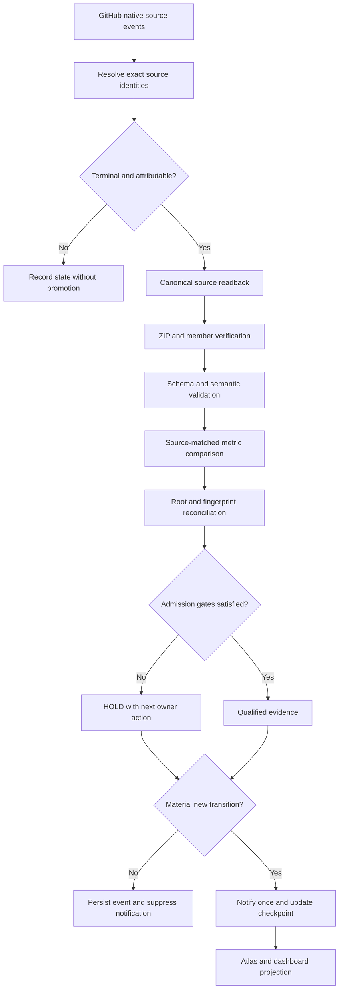

# MIP_WATCH_EVOLUTION_20261026 — watch improvement backlog

**Status: NOT IMPLEMENTED.** This is a proposed change programme derived from the behaviour and failures of the retired Federated MIP Pulse Metrics watch (reported, not re-verified). It is deliberately separate from the operational baseline in [LOSSLESS_HANDOVER_CODE_PURPLE_WATCH_N0_20261026.md](LOSSLESS_HANDOVER_CODE_PURPLE_WATCH_N0_20261026.md). Do not mark any item done because the preservation PR landed.

Before implementing an item, run `python scripts/preflight_overlap.py <terms>` and reuse the owners in `AGENTS.md`. For example, the checkpoint replay and registry already exist under `mission-control/golden-thread/`.

## 1. Pipeline: source evidence → qualification → decision → notification

The pipeline needs two kinds of correctness:

- **Execution correctness:** the test or job actually ran.
- **Interpretation correctness:** its result is attributed to the right source, population, authority and readiness state.

## 2. Seven method corrections

1. **Evidence identity is a first-class object.** PR head, synthetic merge, checkout SHA and merged-main SHA are different identities, with typed relationships between them.
2. **A green workflow is not a green release.** Each required control is a noncompensating veto.
3. **Cryptographic validity and semantic validity are separate.** The #530 verifier should validate integrity, member structure, schemas, source identity, provenance and downstream ingestion.
4. **Measurements need a population contract.** Declared scope, inclusion rules, source hashes and a comparability class.
5. **Root, fingerprint and occurrence have independent ledgers.** One 25-error test failure is not 25 roots.
6. **Estimated execution demand is not measured capacity.** Use actual runner start/end, queue wait, concurrency, billed seconds and retries.
7. **The monitor needs its own admission and stable-stop contract.** Three comparable no-change transitions mean STABLE_HOLD.

## 3. SIPOC contract

| SIPOC | Contract |
|---|---|
| Suppliers | GitHub Actions, source repository owners, security scanners, artifact publishers, signed owner decisions |
| Inputs | Exact SHAs, PRs, jobs, tests, coverage, source blobs, artifacts, governance rules, worker telemetry |
| Process | Collect → validate → attribute → compare → classify → qualify → publish |
| Outputs | Event journal, reproducible receipts, first-red queue, root ledger, comparable metrics, readiness decisions, alert decisions |
| Customers | Engineering owners, maintainers, reviewers, coding agents, QPS stakeholders, Method Atlas readers |

In a nested SIPOC, wave N's output is a qualified input to wave N+1. Retriggered actions are separate wave instances, not cycles in the execution DAG.

## 4. Backlog

| ID | Priority | Improvement | Definition of done |
|---|---|---|---|
| MIP-01 | P0 | Immutable event journal and last-qualified cursor | The same native event cannot be credited twice; history replay is deterministic |
| MIP-02 | P0 | Five-identity source binding | PR head, base, checkout, synthetic merge and merged main are distinguishable |
| MIP-03 | P0 | Semantic artifact QA | A valid ZIP with invalid JSON or the wrong producer is rejected |
| MIP-04 | P0 | Result-verdict precedence | Workflow GREEN cannot override a mandatory failed native receipt |
| MIP-05 | P0 | Canonical producer separation | #530/#531/#533 code paths cannot issue competing evidence for each other's responsibilities |
| MIP-06 | P0 | Watch and automation deduplication | One owner per monitoring lane; duplicate hourly scans retired |
| MIP-07 | P1 | Test-accounting reconciliation | JUnit headers, testcase records, skipped subtests and matrix repetitions reconcile |
| MIP-08 | P1 | Coverage cohort registry | Formal deltas need matching blobs, scope, tool and eligible opportunities |
| MIP-09 | P1 | Root/fingerprint/occurrence accounting | Repeated errors add occurrences without inflating root totals |
| MIP-10 | P1 | Native runner capacity telemetry | Queue, idle, active, execution and billed times are measurable |
| MIP-11 | P1 | Stability and notification state machine | Three comparable no-change transitions produce STABLE_HOLD suppression |
| MIP-12 | P1 | Integrated dashboard and issue burndown | Every KPI traces back to a source receipt and an owning action |
| MIP-13 | P2 | PCA/BT readiness qualification | Production use is gated by statistically eligible populations and validation |
| MIP-14 | P2 | Replay, mutation and adversarial qualification | Known-bad evidence reliably fails required controls |
| MIP-15 | P2 | Session-to-repository handover automation | Chat termination does not lose state, method or unresolved work |

## 5. Metrics registry (the watch measures itself)

| Metric | Definition | Why it matters |
|---|---|---|
| Evidence completeness | Fully qualified events / eligible reported events | Whether a GREEN claim has adequate provenance |
| Attribution yield | Attributable native first-reds / examined terminal REDs | Separates debugging progress from raw failure counts |
| Root conversion | Accepted causal roots / diagnostic fingerprints examined | Detection is not explanation |
| Root closure yield | Independently verified closed roots / same-cohort active roots | Actual burndown |
| Comparable coverage penetration | Covered / matched eligible opportunities | Real source-matched test improvement |
| Authenticated breadth | Qualified source observations / eligible census cells | Canonical federation reach |
| Semantic artifact failure rate | Rejected semantic outputs / validated artifact population | Finds valid-checksum false GREENs |
| Notification precision | Actionable new notifications / all notifications | Watch noise |
| Duplicate suppression | Unchanged repeats suppressed / repeat candidates | Monitor efficiency |
| Time to first-red | Failure start → attributable terminal diagnosis | Diagnostic latency |
| Time to closure | First attributable RED → verified repair and disposition | Engineering response |
| Runner throughput | Qualified test executions / measured runner-hour | Capacity efficiency |
| Queue amplification | Queued or retried demand / qualified distinct work | Avoids artificial fan-out growth |

Each metric needs:

- a unit, source authority, scope and time window;
- a denominator policy and missing-value semantics;
- a qualification status.

Dashboards must visually distinguish UNKNOWN, NOT APPLICABLE, NOT OBSERVED, FAILED and ZERO.

## 6. Adversarial and reverse-sequence tests

| Test | Expected result |
|---|---|
| Valid SHA-256 but corrupt JSON in the archive | Semantic validation RED |
| Two producers publish the same filename with conflicting content | Ambiguous merge rejected |
| JUnit header exceeds actual testcase records | Test-count qualification RED |
| Synthetic merge SHA presented as the exact PR head | Provenance qualification RED |
| Workflow SUCCESS with the required Ruff receipt FAILED | Admission RED |
| Required credential absent or HTTP 401 | Source visibility UNKNOWN/HOLD, not zero |
| PR head changes after test completion | Earlier result is stale for current-head admission |
| Deliberately failing required RED canary | GitHub merge blocked |
| Owner review absent despite passing CI | Independent-review gate HOLD |
| Same failure fingerprint in ten jobs | Ten occurrences; root count unchanged |
| Coverage denominator changes without blob equivalence | Temporal uplift withheld |
| PCA population changes or BT graph disconnected | Statistical promotion withheld |
| Terminal source event arrives out of order | Event-time and observation-time ordering preserved |
| Historical event replayed after restart | No duplicate alert or credit |

A monitor that fails any of these must not publish an authoritative GREEN readiness decision.

## 7. Operating modes

| Mode | Trigger | Behaviour |
|---|---|---|
| DISCOVERY | First event or a new exact source head | Resolve, inspect, baseline |
| ACTIVE QUALIFICATION | Newly attributable RED or a recovery candidate | One bounded evidence pulse; compare with the qualified predecessor |
| STABLE HOLD | Three consecutive comparable no-change transitions | Keep state; suppress repeated full reports |
| REACTIVATION | New terminal event, source SHA, credential result, owner original, gate change or matched measurement | Reopen only the affected dependency lane |

STABLE HOLD needs four distinct comparable observations. Repeated API polls, cancelled runs and old artifacts do not count.

The preferred architecture is native GitHub event-driven ingestion, with a scheduled reconciliation as fallback. It replaces several independent hourly chat watches that rediscover the same failures.
