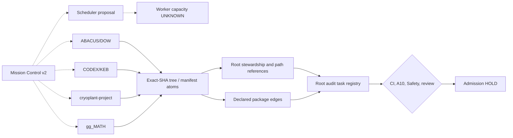
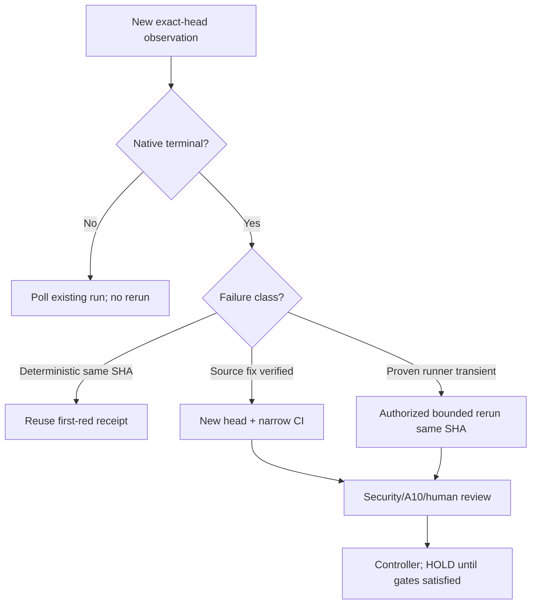

# MISSION CONTROL N11 — Top-21 Repo Structure, Root Stewardship and CI Orchestration

**Authority:** source owners retain control. This is an additive read-only projection of exact default-branch Git trees; not a new scheduler, engineering release, or issue-root closure.

## Census lineage

- Source owner: `GBOGEB/pipeline-automation-hub`, branch `feat/mission-control-top21-census-n11-20261017`; stacked on [N10 launch PR #664](https://github.com/GBOGEB/pipeline-automation-hub/pull/664).
- Scope: exactly **21 mission-selected** repositories out of a larger accessible set; not the 21 largest or a representative random sample.
- Pinned source: four `CENSUS_N11_PART01..04.json` exact-SHA, non-truncated Git trees. Historical source remains immutable.
- Full census: **26,836 tracked file atoms**, **880** tracked root files, **706** name/location-based candidates; unknown content dependencies are NOT proven.
- Root stewardship: **434** narrative, **123** scripts, **78** binary/bundles, **61** JSON/YAML manifests, **10** HTML/CSV root candidates. **44** same-stem multi-format candidate families; these are not necessarily duplicates.
- Typed graph: **716 nodes / 734 edges**. Of these, **295** declarations are pip/npm package-manifest edges, not verified runtime or CVE status.
- Issue search observed **142** open ordinary objects; this count can change without this wave closing any engineering roots.
- HHI for file volume **0.179556**; HHI for root-review candidates **0.320759**. Descriptive whole-cohort concentrations, not confidence intervals or causal predictors.

## 21-repo tracked file matrix

| Repository | Files | Python | Markdown | YAML/YML | JSON | JS | TS | PS1 | Root | Review candidates | Open issue objects* |
|---|---:|---:|---:|---:|---:|---:|---:|---:|---:|---:|---:|
| GBOGEB/ABACUS | 3624 | 1145 | 961 | 617 | 441 | 8 | 105 | 10 | 389 | 368 | 38 |
| GBOGEB/pipeline-automation-hub | 1881 | 418 | 289 | 273 | 437 | 11 | 89 | 6 | 11 | 5 | 32 |
| GBOGEB/CODEX | 2575 | 765 | 507 | 641 | 347 | 9 | 18 | 18 | 94 | 82 | 10 |
| GBOGEB/cryoplant-project | 3832 | 651 | 596 | 1803 | 343 | 26 | 30 | 27 | 7 | 3 | 56 |
| GBOGEB/gg_MATH | 153 | 71 | 18 | 44 | 15 | 0 | 0 | 0 | 2 | 1 | 1 |
| GBOGEB/ariana | 186 | 5 | 13 | 0 | 12 | 4 | 112 | 1 | 4 | 1 | 0 |
| GBOGEB/GEMINI | 88 | 23 | 21 | 16 | 13 | 0 | 0 | 1 | 10 | 3 | 2 |
| GBOGEB/DOCX_RTM_Automation | 953 | 512 | 121 | 65 | 27 | 0 | 14 | 2 | 79 | 62 | 1 |
| GBOGEB/Q_engineering_tools | 383 | 122 | 4 | 156 | 64 | 0 | 0 | 4 | 3 | 1 | 1 |
| GBOGEB/cryo_leak_rate_dashboard | 483 | 39 | 89 | 14 | 55 | 3 | 0 | 0 | 123 | 115 | 0 |
| GBOGEB/cryogenic-accelerator-workspace | 59 | 9 | 17 | 23 | 3 | 0 | 0 | 0 | 14 | 12 | 0 |
| GBOGEB/document-organization-system | 284 | 60 | 70 | 43 | 43 | 20 | 0 | 1 | 20 | 16 | 1 |
| GBOGEB/github_documentorganisatiesysteem_GBOGEB | 4 | 1 | 1 | 0 | 0 | 0 | 0 | 0 | 4 | 2 | 0 |
| GBOGEB/github-mcp-server | 588 | 0 | 46 | 23 | 8 | 0 | 11 | 0 | 18 | 8 | 0 |
| GBOGEB/docker-stacks | 287 | 99 | 45 | 29 | 3 | 0 | 0 | 0 | 16 | 4 | 0 |
| GBOGEB/yaml-grammar | 10 | 0 | 1 | 2 | 1 | 0 | 0 | 0 | 7 | 4 | 0 |
| GBOGEB/prettier | 9362 | 0 | 1022 | 390 | 111 | 4647 | 627 | 0 | 26 | 9 | 0 |
| GBOGEB/vscode-powershell | 115 | 0 | 15 | 8 | 10 | 1 | 32 | 19 | 27 | 5 | 0 |
| GBOGEB/cli | 1229 | 0 | 36 | 18 | 69 | 0 | 0 | 2 | 10 | 2 | 0 |
| GBOGEB/python-sdk | 286 | 232 | 17 | 11 | 1 | 0 | 0 | 0 | 13 | 2 | 0 |
| GBOGEB/skills | 454 | 77 | 137 | 4 | 1 | 1 | 0 | 0 | 3 | 1 | 0 |

*Issue count belongs to a moving global-search readback and is NOT a deduplicated engineering-root denominator.

## Disjoint operational DAG



Dashed arrows are DECLARED orchestration only. Solid arrows are observation/processing structure; they are not automatically causal software dependencies.

## SIPOC — repository-to-governance chain

| Supplier | Input | Process | Output | Customer |
|---|---|---|---|---|
| Repository owner | Default branch and exact Git tree SHA | Tracked file census | File-class and root atoms | Mission Control |
| CI / package owner | Manifest and native job/attempt | Parse provenance, fingerprint first-red | Declared dependency edges, reproducible failure | Source repair worker |
| Root-document steward | Filename, consumers, hyperlinks | Purpose, source/output and relocation-risk classification | KEEP / LINK / MOVE-with-replay / ARCHIVE / WAIT_OWNER | Repo owner |
| Scheduler/controller | Priority, SHA lease, root and runner capacity | Deduplicate + disjoint scheduling proposal | Bounded source-owned wave | Native runner, after authorization |
| Independent reviewer | Exact-head CI, Safety, A10, reviews and branch rules | Non-compensating admission checks | HOLD unless all obligations independently proven | Protected main |

## Execution sequence and evidence requirements

1. **W0 — Governance owner-admin**: ABACUS [issue #1860](https://github.com/GBOGEB/ABACUS/issues/1860), restore effective rule proof. Read-only actor may not mutate rulesets or certify waiver.
2. **W1 — Python CI first-red**: [ABACUS #2161](https://github.com/GBOGEB/ABACUS/pull/2161), Python marker regression and native matrix; exact-head success required. Separate from W2 source paths.
3. **W2 — B0 evidence contract**: [ABACUS #2162](https://github.com/GBOGEB/ABACUS/pull/2162), B0 collection and `defusedxml` dependency; wait for native complete run. No deterministic same-SHA reruns.
4. **W3 — Root stewardship**: parallel read-only 20-file review slices in ABACUS, cryo-leak-dashboard, CODEX, DOCX_RTM_Automation, each on distinct repo/path owner. No moves by this tranche.
5. **W4 — Dependency graph**: parse remaining declared manifests; compare package/lock resolution, CI workflow install commands, imports; do NOT infer import/runtime status from filename co-presence.
6. **W5 — Controlled migration**: only after owner disposition and source/consumer graph validation, propose separate PR with `git mv`, explicit redirects/import edits, negative tests and exact-head CI; one owner per path; never mass-move 706 candidates.

### Scheduler/retest decision



## Root-file stewardship decision tree

`root file` → identify historical source/declared consumer → check import/links/CI working directory/Pages paths → assign named owner → classify source/generated/archive/entrypoint → run baseline checks → apply path-disjoint reviewed migration → retest consumers and exact-head CI. A documentation cleanup is **not** an issue-root closure.

## Rebuild and tests

```bash
node --test mission-control/federation-atlas/central/top21/test_top21_*.cjs
node mission-control/federation-atlas/central/top21/top21_engine.cjs mission-control/federation-atlas/central/top21 /tmp/mission-top21-replay.json
```

Local synthetic validation: **19/19 Node unit tests passed** across replay and collector. Native exact-head results are separate. Native exact-head CI on the new source remains an independent obligation. To refresh all 21 repos without rewriting the frozen N11 baseline, use the read-only CLI below with GitHub token only if required; reject missing/truncated trees. Writes are local append-only snapshots, never GitHub mutations or runner dispatches.

```bash
node mission-control/federation-atlas/central/top21/top21_collect.cjs \
  mission-control/federation-atlas/central/top21/TOP21_COHORT_ROSTER.json \
  /tmp/mc-n12-census N12
node mission-control/federation-atlas/central/top21/top21_engine.cjs \
  /tmp/mc-n12-census /tmp/mc-n12-replay.json 21
```

Credentials are not embedded in source or output. Source comparison between N11/N12 requires equal repo population, classifier version and pinned source SHA; statistical improvement is not inferred from a changed denominator.

## Source hierarchy

1. Existing Mission Control v2 current pointer and authority contracts remain canonical.
2. N9 Golden Graph historical immutable receipts remain source lineage.
3. N10 landing page is the parent portal; N11 linked launch is an additive drill-down.
4. N11 exact-Git-tree parts → typed rollup → stewardship → typed graph → HTML review. A generated view is never engineering truth.
5. This repo-level visual scope does not assert Pages deployment or accepted QPS engineering release.

