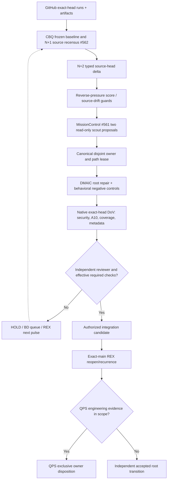

# CODE PURPLE — CBQ/CH-BD N+2 reverse-pressure wave

Status: source-owned, read-only Mission Control extension to [PR #562](https://github.com/GBOGEB/pipeline-automation-hub/pull/562). [PR #561](https://github.com/GBOGEB/pipeline-automation-hub/pull/561) owns subtype scheduling and mutation-path leases. These PRs shall not become competing authority or independent SSOTs.

## Define and measure

The existing five-source CBQ pulse and 15-PR impact census are immutable baselines. This N+2 addition records eight **dated GitHub PR-head metadata** observations; they are neither a full fleet census nor verified artifact contents. All stored workflow statuses are tied to their exact PR source head. Queue and first-red outcomes may change independently after the readback.

The source-controlled graph contains six **canonical owner clusters**, nine CBQ families and owner-to-related-PR links. A link means *declared repair dependency/ownership*, not independently demonstrated causal impact. The reverse pressure count for root family `r` is the number of **distinct referenced open PRs** in the selected metadata snapshot:

```text
reach(r) = |unique open PR references in canonical(r) union related(r)|
score(r) = priority_weight(r) * reach(r)
priority_weight: P0=3, P1=2, P2/P3=1
share(r) = score(r) / sum(score(r_i))  [only when sum > 0]
```

Rank **first by noncompensating policy tier**, then descending score within that tier. The numerical weights are explicit *heuristic policy parameters*, not measured repair returns, probability of closure, Bradley–Terry strengths or PCA eigenvector loadings. Their units are policy-points times referenced PRs; repeated PRs across different root clusters are not unique roots. The COV_MODE P1 classification is a provisional scheduling heuristic because the frozen CBQ families contain no coverage-mode priority. Missing/different SHA or unrefreshed dependency rows remain `PARTIAL_OR_DRIFT`.

### Frozen-owner reverse pressure (before independent follow-up)

| Policy tier | Canonical owner | Direct referenced open PRs | Raw score | Interpretation |
|---|---|---:|---:|---|
| P0 | WORKFLOW_POLICY / ABACUS #1973 | 4 | 12 | Governance owner collision; reconcile #1995/#2037/#2038 rather than duplicate mutations |
| P0 | SECURITY / ABACUS #2027 | 3 | 9 | Independently evaluate Safety/Bandit; no baseline hiding or waiver |
| P0 | REPLAY / ABACUS #1993 | 1 | 3 | Federated proof consumer; other two referenced PRs were merged, QPS owner still DEFER |
| P1 | PY_COMPAT / ABACUS #2026 | 4 | 8 | Canonicalize #2029/#2038/#2045; keep native Python matrix exact head |
| P1 | COVERAGE_MODE / ABACUS #2040 | 2 | 4 | Join branch/statement measurement without excluding difficult lines |
| P1 | FORMAT / ABACUS #2004 | 2 | 4 | Root-owned formatter baseline/ratchet, tracked separately from Census |

These scores use the existing bounded dependency graph, not all 65 open ABACUS PRs. They may be stale until independently refreshed. A high-scoring blocked owner is an escalation target, not an automatically dispatchable repair.

## Operational reality and queue pressure

The source-bound eight-PR P2 readback contains 193 workflow observations: 39 success, nine failure, two cancelled and 143 nonterminal. Terminal = 50/193 (25.91%); nonterminal = 143/193 (74.09%). These are a **bounded mixed-PR status snapshot**, not comparable Bernoulli trials, worker-hours, a CI stability time series, unique defects or global CI performance. The first-page-only query does not prove completeness beyond these retrieved workflow records.

Near-term pressure is proof-drain and reuse of existing native receipts, not launching four mutating workers. Keep the #561 concurrency ceiling at two **proposed read-only scouts** until same-source checks and artifact members are qualified. C2/C3/C4/C5 source behavioral tests are already expanding in ABACUS #2046/#2051/#2054/#2055/#2057, and must use their canonical owners rather than duplicate source changes here.

## MIP / DMAIC / 3P* and REX

- **Define:** Root owner, typed downstream PR links and source identity; keep A10, Safety, and QPS owner noncompensating.
- **Measure:** PR-head SHA, exact run/attempt/job, terminal/pass/fail/queued, artifact byte hashes, matched source statement/branch denominators, factual close/reopen receipts. UNKNOWN is not zero.
- **Analyze:** Separate failed workflow *manifestations* from independently verified causes. Identify owner collisions and queue wait using actual run/job timestamps from ABACUS #2033; keep p95 null without samples.
- **Improve:** Route repairs by canonical owner and disjoint paths (#1995, #2045, #2040, #1988, #2052). Build tests that exercise difficult branches rather than reducing eligible denominators.
- **Prove:** Native exact-head checks, no-new-debt scanners, source-bound JUnit/coverage, original ZIP/member checks and independent reviewer.
- **Propagate:** #561 read-only candidate packets; CODEX/QPS independently verify contracts and preserve child decision.
- **Control / REX:** Compare exact integrated-main behavior with accepted root IDs, reopening on matched future observations. A passing PR head without integrated-main REX is not formal closure.

### Statistical maturity and identifiability

**PCA (ADVANCED):** An exploratory loading matrix requires multiple **independent, aligned samples** across measured families (at least the seven defined MIP families), consistent measurement units, a justified scaling/covariance model, missing-data strategy, eigengap and sensitivity checks. Historical #1989 contains 13 CI-only observations across three SHAs, and no complete seven-family rows. Consequently PCA ranks and reverse-pressure *PCA* loadings are **not identifiable**. The pressure shares above are deterministic graph scores, not PCA.

**Bradley–Terry (ADVANCED):** For candidate methods A and B, a comparable paired trial yields `logit(P(A beats B)) = theta_A - theta_B` under a defined metric and equal source/task conditions. Fitting needs a connected comparison graph with real independent wins and losses (and remedies against complete separation). Current telemetry contains **no authenticated paired method-worker trial population**. Thus BT strengths, confidence intervals and worker allocation odds are withheld. Do not turn cross-PR run ratios or synthetic fixtures into wins.

**Next valid experiment:** pre-register two source-identical methods on a labeled diagnostic corpus with a time/quality/coverage decision rule; collect independent paired trials with run/job, tool/config versions and artifact bytes. Only then evaluate a BT fit and a holdout.

### N+2 predictions, recorded before actuals

| Horizon | Bounded categorical forecast | Later scoring |
|---|---|---|
| N+1 | Method qualification stays HOLD until terminal exact-head coverage and original artifact evidence | Compare actual terminal run/job state; do not rewrite prediction |
| N+2 | Four-hop engineering acceptance remains DEFER unless authenticated provider, KEB, DOW and child-owner receipts exist | Evaluate owner-accepted transition separately |

No probability or CI is attached to those policy-conditional forecasts.

## Existing Mission Control DAG



The feedback arrow belongs to the **next** logical pulse, not the same-pulse execution DAG.

## SIPOC

| Supplier | Inputs | Process | Outputs | Customer |
|---|---|---|---|---|
| ABACUS #1929, #2033, #1998 | Exact SHA, run/job/attempt, BD and LDAB lineage | Native source-bound joined CENSUS | Root and queue observations | Mission Control #562 |
| MissionControl #562 | Frozen CBQ/N+1, dated N+2 readback | Validate → rank → measure drift | Read-only pressure and branch coverage receipts | MissionControl #561 |
| MissionControl #561 | Typed packets, priority, locks, owner refs | Allocate ≤2 disjoint read-only scouts | Proposed waves, no dispatch authority | Canonical repository owners |
| ABACUS/CODEX/QPS | Verified repair source and artifacts | Native proof → independent review → REX | Reproducible DoV and explicit disposition | Protected release / QPS owner |

## Admission and DoV

1. Native #562 reverse-pressure tests pass on the actual PR head, with covered/eligible branch numerators and denominators from real coverage JSON.
2. Validate input hashes, current SHA compare, no duplicate PR, missing nonterminal metrics, no invented root or QPS closure, and two-worker ceiling.
3. Preserve #561 separate scheduling contract and first-party GitHub required checks; no actor may infer an executed worker from a proposed packet.
4. Re-census changed PR heads after this wave. Promotion from method availability to method effectiveness is strictly source- and corpus-matched, and requires eligible independent review.

**Authority:** `authority_transfer=false` · `security_waiver=false` · `merge_authorized=false` · `QPS=DEFER`.
