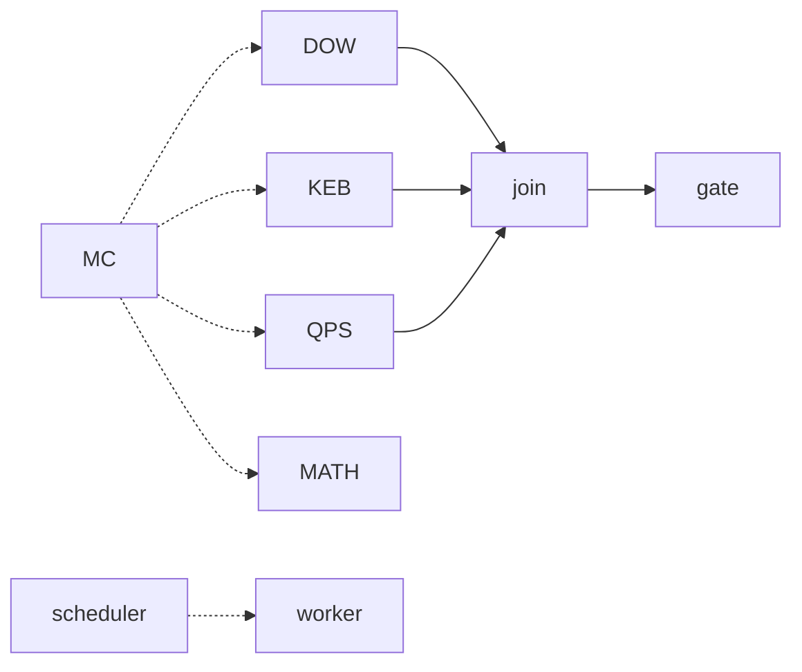

# Mission Control federated N10 projection

This is an **additive read-only launch** tied to the existing Mission Control v2 pointer, federation atlas, N9 pulse ledger and telemetry contract. Do not install as a scheduler or use as an admission decision.

* View `MISSION_CONTROL_FEDERATED_LAUNCH_N10.html` locally or via the GitHub blob raw/download path.
* Model in `MISSION_CONTROL_FEDERATED_LAUNCH_N10.json` is intentionally a **projection**. No overwrite of existing canonical source or automation.
* DAG nodes: 9 type entities (9 visual nodes), 9 display edges, with DECLARED vs historical receipts. No native worker dispatch attempted.
* The N9 ledger remains unchanged; no PR admission, Crew validation, proof of QPS acceptance or new source metrics asserted.
* Next disjoint pulse: integrate source-freshness adapter with GitHub exact-head runs, then improve responsive browser tests; schedule/dispatch changes must be separately reviewed and authorized.

## SIPOC

Repo owners -> Head SHA + CI receipts -> Read-only intake and validation -> Source-bound atoms -> Evidence join
Mission Control -> Mission, wave, pulse -> Scheduler and capacity classification -> Proposed disjoint jobs -> Owner workers
ABACUS / CODEX / QPS -> Typed source evidence -> Join and lineage validation -> DAG and KPI projections -> Golden Thread
Golden Thread -> Exact SHA and risk gates -> Noncompensating review -> HOLD or evidenced candidate -> Human controller

## Graph

All edges are projection relationships, not new runtime bridges.
