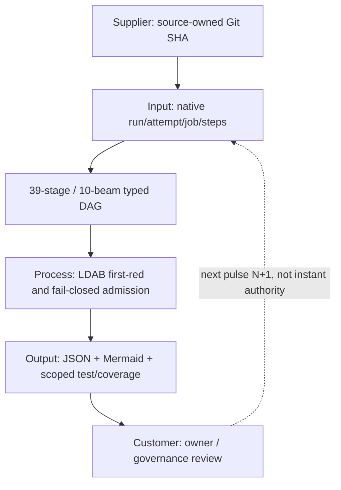

# CODE PURPLE N2 — LDAB false-green and typed-DAG proof qualification

**Scope:** bounded follow-up to merged PR #691 on the existing Mission Control publisher and GG_MATH method infrastructure; no second dispatcher, scheduler, SSOT or merge authority.

## Reproduced three negative findings (before source edits)

With the source that entered main through PR #691, 25 existing tests passed, while three independently added adversarial tests failed as expected:

1. **LDAB-STEP-01:** a job with a success conclusion but a failed inner step still satisfied the clean native job proof predicate. This can occur with continue-on-error. The new guard requires a completed positive step **and no failed step**. An observed failed step is a manifestation, not an accepted causal root or a native debugging session.
2. **DAG-EDGE-01:** a fake REPOSITORY -> STAGE process edge passed the old validator.
3. **DAG-EDGE-02:** a fake BEAM -> STAGE beam dependency passed the old validator.

The two graph manifestations share the same **missing typed-endpoint invariant root family**. The LDAB false-green has an independent predicate root family. **2 diagnostic root families / 3 reproduced manifestations**; accepted engineering root closures remain **zero** pending governance and exact-head native proof.

## Three implementation pulses

- **P1, LDAB:** reject masked failed steps while preserving run ID, job ID, step ordinal, fingerprint and causal-root separation; native LLDB debugger not invoked.
- **P2, DAG/SIPOC:** require 38 PROCESS STAGE -> STAGE edges, 10 BEAM -> BEAM FEEDFORWARD edges, 3 N+1 BEAM -> BEAM FEEDBACK edges, no duplicate typed edges, no same-pulse cycle and a connected 39-stage directed path. Repository locators have no invented dependency edges.
- **P3, QA:** correct the synthetic test fixture to the existing canonical 10/3 beam split; add six adversarial negatives for masked failures, mis-typed edges, duplicates, altered beam split and fractured stage path. Keep original 25 tests.

## Cold reproducibility evidence (not native)

- Source-matched baseline: **25/25 existing tests passed**; 3 proposed negative tests failed as predicted.
- After source repair: **31/31 cold tests PASS** (25 historical + 6 new), 0 fails or skips; compileall, tabnanny, warnings-as-errors PASS.
- Focused two-module coverage: **144/160 statements = 90.0%**, **28/30 branches = 93.33%**. LDAB module alone: 50/50 statements and 10/10 branches = 100% each.
- Historical two-module cohort was 115/131 statements and 22/24 branches. Its denominator differs, therefore 144/160 is a **new denominator and NOT a matched-scope coverage uplift**.
- Ruff / Black / Flake8 not installed in local cold environment, so NOT RUN. Full native security/lint remains independent.
- Source identity can be checked with `git hash-object`; generator emits SHA-bound JSON/Mermaid to existing Atlas ZIP after native execution.

## DAG -> SIPOC -> LDAB debug feedback

## DMAIC, MIP, statistics and stopping rule

**Define:** no masked failure or untyped DAG edge may become valid first-red proof.
**Measure:** exact-head SHA/run/attempt/job, 54 nodes / 51 edges, 31 selected contract tests, scoped branch/statement denominators.
**Analyze:** distinguish 2 diagnostic root families from 3 manifested failing adversarial controls. A missing runner assignment does not establish runner capacity zero.
**Improve:** source-owner code changes above.
**Control:** enforce the same negative fixtures in the existing Method Atlas job and independently inspect ZIP member bytes when native CI executes.

**MIP:** Modernize evidence trust; Innovate typed edge+step checks; Perpetuate awaits native exact-head proof and eligible review.

A rise in queued runs with 0 running is a **blocked execution population**, not proof of asymptotic equilibrium or Six Sigma capability. No matched independent observations means **PCA/Bradley-Terry NOT QUALIFIED**, M1 source-model only, M2/M3 HOLD, 3.4-DPMO Six Sigma NOT ATTESTED.

**W2_CODE_DOV = COLD_31_TESTS_PASS AND TYPED_54_51_GRAPH AND ZERO_MASKED_GREEN** (local only).

**MERGE_ADMISSION = HOLD** until independent review, effective master required-status protection and exact-head terminal native unit/coverage/artifact receipts. Historic PR #691 merge without terminal execution must not be rehabilitated retroactively.

### Ranked BD / owner queue

- **P0 EXTERNAL_RETURN:** Mission Control issue #336 owner/admin required FPC status on master; master observed `protected=false` despite later merges. Blocking, no normal coding slot.
- **P0 RUNNER/PROOF:** original PR #691 Method Atlas run 39065665390 attempt 1 remained queued; next candidate must obtain native running/terminal >0-step receipts and artifacts.
- **P1 LDAB-N2:** first-red and typed edge repair proposed here; eligible head SHA + independent review + green source coverage and artifact-member verification.
- **P1 METRICS:** issue #520 six native KPIs; queue length alone is not job queue p95 or actual worker-hours.
- **P2 CONTROL:** issue #372 and #85 REX/control recurrence; do not claim systemic root closure from passing selected tests.
- **P2 PRESENTATION:** issue #638 HTML/browser screenshot provenance; no source-model readback replaces browser QA.

No merge, security waiver, QPS owner acceptance, remote fan-out, worker dispatch, llDB breakpoint or global issue closure is admitted by this increment.
