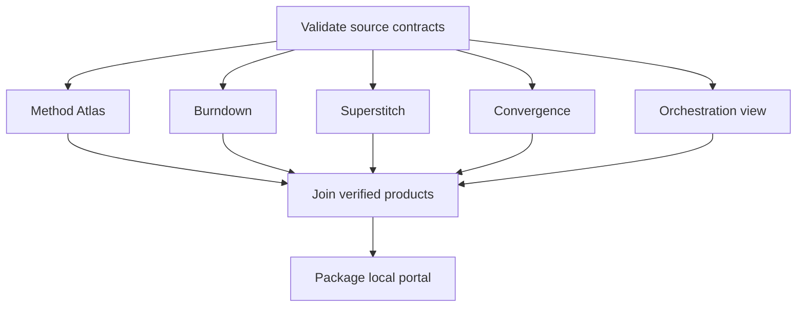

# Runtime coverage and outcome evidence

This is an additive continuation of the existing Method Atlas, local broker and
coverage-observation owners. It supplies a finite real execution and inspectable
output evidence. It creates no additional scheduler, remote worker pool, global
executable registry or notification channel.

## 1. Execute and experience a real path

From a clean checkout, place output outside the repository:

```powershell
$atlasRoot = (Get-Location).Path
$atlasSha = (git rev-parse HEAD).Trim()
$atlasCli = 'mission-control/federation-atlas/orchestration'
$atlasTag = [DateTime]::UtcNow.ToString('yyyyMMdd-HHmmss-fff')
$atlasRun = Join-Path $env:TEMP "atlas-run-$atlasTag"
$atlasReview = Join-Path $env:TEMP "atlas-review-$atlasTag"
python "$atlasCli/main.py" run-local --root $atlasRoot --out $atlasRun --head $atlasSha --workers 2
if ($LASTEXITCODE -ne 0) { throw 'Execution failed; inspect the local receipt.' }
python "$atlasCli/runtime_evidence.py" --root $atlasRoot --run-dir $atlasRun --out $atlasReview
if ($LASTEXITCODE -ne 0) { throw 'Outcome evidence was rejected.' }
Start-Process (Join-Path $atlasReview 'runtime-evidence.html')
```

The same CLI arguments work in a POSIX shell with literal absolute paths. The
HTML replay displays recorded task events. Moving its time slider or clicking
Replay does not execute any task. JSON inspection exposes source identity,
dependency evidence, output hashes, bounds and qualifications. Arbitrary handler
payloads and raw exception messages remain outside this shareable projection.

A tree that is dirty at execution or at inspection qualifies only as
`LOCAL_DIRTY_SOURCE_NOT_COMMIT_BOUND`: the verified bytes are not the bytes of
`source_sha`. Ignored files stay outside the source fingerprint. The Method
Atlas CI job asserts a clean, commit-bound
`LOCAL_EXECUTION_AND_CURRENT_BYTES_VERIFIED` result on the exact checkout.

The existing Method Atlas CI job also runs `runtime_evidence_browser_qa.py`
against that generated HTML. It checks source identity, desktop/mobile layout,
Replay, Reset and the exact terminal slider position with its existing pinned
browser installation. A local browser launch restriction is a blocked check;
it cannot be recorded as a visual pass.

The actual local graph contains eight tasks and eleven dependency edges:



The local broker policy remains default **2**, maximum **4** workers. Its 16/32
experiments require a separately qualified workload and capacity authority;
they cannot be enabled by editing the report.

## 2. Evidence that this extension adds

`main.py` remains the canonical local inventory/execution owner:

- Inventory Python; JS/JSX/MJS/CJS; TS/TSX; SH/BASH; PS1/PSM1; JSON; TOML;
  YAML/YML and workflow/action/package descriptors.
- Hash all inspected source/configuration bytes under snapshot policy V2.
- Preserve typed process registration and bounded literal-reference candidates.
  An unreferenced file remains unclassified; this is not proof it is dead.
- Validate temporal ordering, event transitions, duration arithmetic,
  predecessor completion, failure propagation and concurrency lower bounds.
- Seal every generated regular file at each successful product task's completion,
  including supporting assets and manifest bytes. Reject symlinks.

`runtime_evidence.py` consumes those owners and verifies:

1. The same Git head and current source-byte fingerprint.
2. A complete terminal receipt over the source-owned task population.
3. Successful producers' declared output ports.
4. Exact output-file membership and hashes against completion-time seals.
5. The assembly's exact bytes against the producer combination.
6. Package source identity and honest complete public-member membership.

This establishes an **exact producer-to-assembly join and sealed package
integrity**. It does not establish every packaging source-copy mapping,
application-domain invariant, served-site result or independent acceptance.
Legacy receipts without full product seals can still be read by the existing
Atlas validator; they do not qualify for this stronger product-evidence report.

Self-authored local receipts are not signed independent attestations. The report
keeps native execution, authenticated federation, causal intervention, served
readback, merge authority and whole-repository coverage separate. Ready/deferred
counts are bounded receipt-reported telemetry; task durations and predecessor
ordering are independently reconciled from the stored timeline.

## 3. Coverage is a vector with an explicit denominator

| Dimension | Numerator / denominator | Evidence owner or next extension |
|---|---|---|
| Line/statement | Executed eligible statements / eligible statements | Coverage.py; V8/Istanbul for JS/TS; explicit all-file inventory |
| Branch outcome | Executed decision exits / eligible exits | Instrumented code; zero exits means N/A, not 100% |
| Configuration | Exercised effective variants / declared eligible variants | Parsed YAML/JSON/TOML + actual consumer behavior |
| Workflow | Executed eligible job/step/event/matrix combinations / eligible combinations | Native attempt/job/step receipts; skipped is not executed |
| DAG node/edge | Observed tasks/handoffs / registered eligible tasks/handoffs | Existing broker trace; this observer's bounded graph |
| Outcome | Verified expected outcomes / eligible outcome contracts | Artifact/content/consumer oracles |
| Consumer | Verified reads/acknowledgments / required consumer handoffs | Same content identity at each hop |
| Adversarial | Detected injected failures / applicable injected failure cases | Fault injection; never substitute it for ordinary runtime coverage |
| Metamorphic | Satisfied declared invariants / applicable transformations | Replay, permutation, partition and equivalence relations |
| Scope penetration | Qualified units / eligible units at each scope | File, path, workflow, branch, repo, federation; do not pool differing cohorts |
| Control persistence | Comparable accepted observations / planned observation window | Existing owner monitor and pulse ledger |

Keep a separate state for unknown denominator, unmeasured source, measured zero,
test-not-collected, workflow-not-started, skipped, observed failure and an
intentional library/reference asset. The canonical EVERRED/root census remains
owned by `p-process/everred/harvest.py`; this observer does not create a competing
root count.

The CODEX integration/value contract already owns TESTED_ORPHAN and V0–V5:
`GBOGEB/CODEX/mission_control/mycelium/executable_integration_value_contract.yaml`.
Hub's source inventory is a producer of candidate references. It does not
redefine global registration, deletion policy or value-scope promotion.

## 4. Causality and watcher confidence

A positive trace establishes recorded order and observed outputs. To establish
mechanism sensitivity, execute a bounded intervention: fail a prerequisite,
remove a required artifact, supply stale source identity, alter an output, replay
a duplicate event, or reorder dependent events. The downstream outcome must
change exactly as the contract says. Restore the original and observe recovery.

For a genuine federation hop, retain producer and consumer source SHAs, input
and output digests, schema and policy versions, correlation/causation IDs,
principal/capability identifiers, expiry and verified acknowledgment. An echoed
event type or two locally named callbacks do not prove authenticated delivery.
Never retain bearer tokens or model secrets in the receipt.

A watcher-of-watchers should check observer freshness, source identity, last
successful acquisition, last decision, last accepted delivery, backlog and
negative-canary sensitivity through the existing monitor owners. An absent or
stale observer is UNKNOWN/STALE, not healthy. N6 notifications retain their
exclusive existing owner; this slice registers no watch.

## 5. Scaling experiment and rollout

First measure the existing eight-task production graph with workers 1 and 2 on
the same source and input population. Alternate execution order; retain every
run, including failures. Report whole-run elapsed time, per-task service and
ready-wait durations, output identity/semantic equivalence, errors and resource
limits. Instrumentation-on and instrumentation-off runs are separate cohorts.
Startup/cache effects and repeated same-machine observations limit inference.

Reuse ABACUS `tools/recovery/w38_local_pool_benchmark.py` for synthetic 1/2/4
experiments; it already owns the matched-workload study. Add a representative
production family there before proposing 16/32 hosted workers. Reuse the
existing CODEX/Hub capacity decision owners. Distinguish ready task width,
per-worker throughput, critical path, external quotas, setup time, cache hit
rate, retries, peak memory, queue p95 and useful accepted outcomes per cost.

### RC06 serial-phase profile (2026-11-11, Windows, Python 3.12.7, full checkout)

Useful throughput comes from shrinking the serial phases before adding workers.
On this machine and full (non-sparse) checkout, `run-local` took 57–75 s, not
the ~10.6 s seen earlier; that earlier figure was not reproduced here and its
population (sparse vs full census) is unconfirmed. cProfile of the in-process
orchestration build (73 s under the profiler) split it as follows:

| Phase | Before | Note |
|---|---|---|
| `Path.resolve()` round trips (all callers) | 37 s | 46k calls; `_getfinalpathname` ~0.14 ms each |
| `verify_bundle` (source-name and source-byte rechecks) | 17.6 s | ~2.6k names resolved under the bundle where they do not exist (2.7 ms each) |
| Reference matching (`source_assets`) | 31 s | 20.8k literal resolves |
| Source scanning: Python AST / workflow YAML | 8.1 s / 5.0 s | CPU, needed for model content |
| Model serialization (`canonical`) | 3.1 s | |
| Reading + SHA-256 of census members | ~1 s per pass | hashing is not the cost |

Pages packaging (14.4 s standalone) spends 12.2 s in two more `verify_bundle`
passes; copying is 0.8 s. The census is read once by `run_local`, `source_model`,
each `verify_bundle` (×3) and `run_local` again at the end. Every pass is a
deliberate drift guard, so all are kept; each pass is made cheaper instead:
the root resolve is hoisted out of census loops (`safe_path(base=...)`), source
hash names are validated without resolving absent trees (`safe_names`), literal
resolves are memoized within one scan, and `source_census` is the one census
definition (also used by `runtime_evidence.py`).

Matched results (same source; all runs retained):

- In-process build, old vs new code on the identical tree, alternating order:
  35.5/46.3/60.2 s → 24.1/21.8/32.4 s (median 46.3 → 24.1 s); all 789 bundle
  members byte-identical in every round.
- Full `run-local --workers 2`, interleaved base `9c59a523` / new: whole run
  74.5/67.3/56.6 → 61.9/47.1/47.7 s (median −29%); orchestration task median
  45.6 → 34.3 s; portal median 18.1 → 9.0 s. All six runs succeeded with no
  source drift; new orchestration and portal trees are identical across
  repetitions; `runtime_evidence.py` qualifies 8/8 tasks, 11/11 edges and 15/15
  ports for each new run.

Remaining serial cost after the change (profiled build 36 s): literal reference
resolves 6.5 s, Python AST 5.5 s, JSON serialization 2.9 s, reference regex
2.3 s, YAML 2.1 s. A further exact reduction is per-directory realpath plus a
cached directory listing for reference matching (fall back to `resolve()` for
reparse points and short names). Cross-run content-addressed caching of AST and
YAML rows needs an owner decision on cache invalidation. Same-machine variance
is large (old build 35–60 s), so the medians are indicative, not capacity
claims.

Cache dependency downloads or content-addressed wheels by OS, architecture,
runtime/ABI, lock digest and dependency source. Keep clean-install/cold-cache
controls and fresh immutable build environments. Cache availability is not
output correctness or an instruction to reuse mutable worktrees across writers.

## 6. Finite execution ledger

This child ledger is additive to existing portfolio and B### ledgers. Its counts
must not be added to unrelated root-closure totals. Related parent obligations:
Hub #604, #718, #870 and #1063. They remain under their original acceptance
contracts.

| ID | Work | DoV / closure condition |
|---|---|---|
| RC01 | Extend canonical multi-language inventory | Source membership, hashes, bounded ambiguous references and unknown states verified |
| RC02 | Validate causal timing and actual concurrency bounds | Genuine broker success/failure accepted; forged dependency/timing/peak rejected |
| RC03 | Seal complete producer products | Changed, added, missing or symlink members rejected |
| RC04 | Deliver replayable outcome consumer | Real eight-task run, eleven edges, expected outputs and byte joins verified |
| RC05 | Run exact-source runtime instrumentation | Separate non-test execution coverage, declared file population and missing-path report |
| RC06 | Compare bounded production workers 1/2 | Matched source/input; repetitions and timing limits retained |
| RC07 | Existing native owner integration | Coverage Waves and Method Atlas owner paths execute this slice at exact head |
| RC08 | Independent eligible review and owner admission | All required contexts, trusted FPC and owner decision; no red waiver |
| RC09 | Post-integration CONTROL | Accepted merged-source path and retained comparable observations |
| RC10 | CODEX registry proof qualification bridge | Preserve declared vs independently verified execution; typed consumer acknowledgment |
| RC11 | ABACUS runtime/health entrypoint reconciliation | Correct CLI contract, health derives from actual upstream outcomes |
| RC12 | JS/TS effective outcome instrumentation | Trace real worker/consumer behavior, not event echo or queue logging |
| RC13 | Monitor supervision | Inject stale/missing/failed observer cases through existing notification owner |
| RC14 | Representative scaling rollout | Native matched workload, resource/quota bounds, useful-outcome gain and owner decision |

No row grants merge, engineering acceptance, remote dispatch or issue-closure
credit by its presence. Execution receipts and the PR checklist carry the
observed state for a particular source revision.
