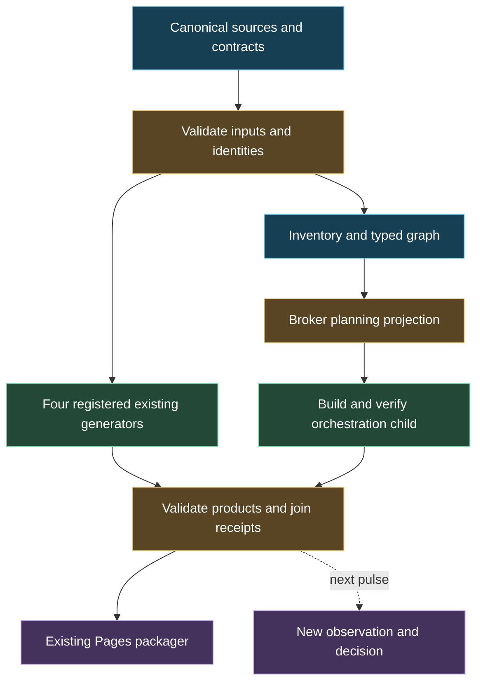

# Method Atlas: process contracts, orchestration and operator guide

The Method Atlas connects each functional process to its source, accepted inputs,
expected outputs, checks, consumers and execution evidence. Its HTML, cards,
styles, graphs and burndown views are generated products of this pipeline.
Their editable sources and rebuild commands are part of the same repository.

This child is served at `orchestration/index.html` through the existing
`mission-control/federation-atlas/pages_portal.py` publisher. The repository
owns the shared implementation; process owners retain their source truth and
acceptance. Repository and user presentation preferences can select or group
views without changing canonical IDs, evidence meaning or required checks.

## Start here: the executable contract

Run commands from the repository root. `build`, `plan` and `run-local` require
this checkout's own `orchestration/main.py`; their `--root` must resolve to the
same checkout. `check` can inspect another repository root. Keep `--out` outside
the source tree. `--head` binds the exact checked-out Git identity, while the
dirty flag and source digest also expose uncommitted source changes.

The source snapshot includes all Mission Control files, repository Python,
workflow YAML and Mermaid files, plus explicitly declared inherited sources and
repository input ports. `source_files_sha256` records their bytes and
`source_digest` fingerprints that map. This is an explicit source snapshot
policy; it does not claim to trace every runtime dependency.

```bash
python mission-control/federation-atlas/orchestration/main.py check --root .
python mission-control/federation-atlas/orchestration/main.py build --root . --out /tmp/method-atlas-build --head "$(git rev-parse HEAD)"
python mission-control/federation-atlas/orchestration/main.py check --root . --out /tmp/method-atlas-build
python mission-control/federation-atlas/orchestration/main.py plan --root . --out /tmp/method-atlas-plan
python mission-control/federation-atlas/orchestration/main.py run-local --root . --out /tmp/method-atlas-run --head "$(git rev-parse HEAD)" --workers 2
```

For a supplied broker observation, add `--snapshot /path/to/snapshot.json` to
`plan`. Without a snapshot, the source-only plan is deterministic and has no
wall-clock observation; remote capacity stays UNKNOWN. A supplied snapshot
provides its own observation time and freshness basis. A plan describes eligible
work and its holds. The
local runner executes the registered local generators with bounded concurrency;
remote dispatch and remote capacity require separately sourced adapters and
receipts. `run-local` requires a new or empty output directory for each run.
It returns a finite receipt; it does not create a recurring monitor or retry
service.

To include a completed local run's measured timings in a review bundle, rebuild
without changing its checkout head or source bytes:

```bash
python mission-control/federation-atlas/orchestration/main.py build --root . --out /tmp/method-atlas-measured --head "$(git rev-parse HEAD)" --local-receipt /tmp/method-atlas-run/local-run.json
```

Receipt attachment requires identical `source_sha` and `source_digest`, a
matching task population, valid bounds and local-only authority. A changed
source snapshot requires a new run. Timings cover the recorded local tasks;
they exclude the later receipt attachment, bundle seal and publication.

### Windows PowerShell

Use the actual local clone. This example selects a common location and stores
reproducible outputs outside the source tree.

```powershell
$repoCandidates = @(
    'C:\DEV\pipeline-automation-hub',
    'C:\repos\pipeline-automation-hub'
)
$atlasRepo = $repoCandidates | Where-Object { Test-Path (Join-Path $_ '.git') } | Select-Object -First 1
if (-not $atlasRepo) { throw 'Set $atlasRepo to the pipeline-automation-hub clone.' }
Set-Location $atlasRepo
$atlasHead = git rev-parse HEAD
if ($LASTEXITCODE -ne 0) { throw 'Cannot resolve the source head.' }
$atlasCli = 'mission-control/federation-atlas/orchestration/main.py'
$atlasBuild = Join-Path $env:TEMP 'method-atlas-build'
$atlasRun = Join-Path $env:TEMP ('method-atlas-run-' + [DateTime]::UtcNow.ToString('yyyyMMdd-HHmmss-fff'))

python $atlasCli check --root .
if ($LASTEXITCODE -ne 0) { throw 'Source-contract check failed.' }
python $atlasCli build --root . --out $atlasBuild --head $atlasHead
if ($LASTEXITCODE -ne 0) { throw 'Atlas build failed.' }
python $atlasCli check --root . --out $atlasBuild
if ($LASTEXITCODE -ne 0) { throw 'Generated-bundle check failed.' }
python $atlasCli plan --root . --out (Join-Path $env:TEMP 'method-atlas-plan')
if ($LASTEXITCODE -ne 0) { throw 'Broker planning failed.' }
python $atlasCli run-local --root . --out $atlasRun --head $atlasHead --workers 2
if ($LASTEXITCODE -ne 0) { throw 'A registered local generator or its output check failed; inspect local-run.json.' }
```

### What each command produces

| Command | Functional need | Inputs | Expected result and boundary |
|---|---|---|---|
| `check --root` | Reject broken source contracts before execution | Repository, profile, contract overlay and canonical source references | Validated registered source contracts or attributable failures; complete source discovery is performed by `build` |
| `build --out --head` | Rebuild the operator's inspectable Atlas | Source registry, taxonomy, process contracts, inventory and source hashes | The generated child bundle below; declared head and actual source hashes stay visible |
| `check --root --out` | Verify the generated product against its manifest | Repository plus generated bundle | Source/contract checks and exact expected member-hash verification |
| `plan --snapshot --out` | Decide what can be admitted under known constraints | Typed dependency graph, task/resource policy and optional observed queue snapshot | Broker plan with eligible work, capacity decisions and explicit holds; no remote launch receipt |
| `run-local --out --head --workers` | Exercise the real registered build sequence | Existing generator commands and declared local worker limit | Existing generator products, the child under `orchestration/`, and `local-run.json` |

The generated child contains `index.html`, `style.css`, `app.js`, `atlas.json`,
`source-check.json`, `inventory.json`, `burndown.json`, `broker-plan.json`,
`metric_observations.json`, `coverage_burndown.jsonl`, and `manifest.json`.
Each normalized graph emits canonical `graphs/*.mmd` plus `graphs/*.light.svg`
and `graphs/*.dark.svg`; existing Mermaid sources retain their source locators.
An attached local receipt adds `local-run.json`. The manifest records source identity and
`files_sha256`. `inventory.json` indexes discovered repository workflows,
Python entries and diagrams; discovery is distinct from registering an
executable process. A discovered script is not automatically safe or scheduled.

Graph files use bounded ASCII stems with a digest of the canonical graph identity;
labels such as `3P*` remain unchanged in the model and diagrams. The bundle gate
rejects nonportable member paths before artifact upload, and the builder rejects
duplicate identities or filename collisions.

Keep generated members together when copying a bundle. Edit the source/template
and rebuild; a manual change to an emitted card, graph or stylesheet invalidates
its member hash. The existing Pages workflow stages and publishes the child.
Local build success, native workflow success, served HTTP identity and an
owner-approved release are separate results.

## Source hierarchy and functional blocks

The additive `PIPELINE_CONTRACTS_v1.json` overlay relates existing sources to
their functional I/O. It does not replace the Method Atlas registry or create
a competing cohort, scheduler, root ledger or publisher. The current profile
declares 15 functional blocks and seven typed joins; discovery also inventories
source outside those registered blocks.

| Source or entrypoint | Role in the pipeline | Consumer/output boundary |
|---|---|---|
| `mission-control/v2/MC_GLOSSARY_TAXONOMY_v2.json` | Canonical vocabulary, identity and collision policy | Every derived label and execution-unit interpretation |
| `mission-control/federation-atlas/PROCESS_LANES_v1.json` | Canonical process/stage templates | Source-owned process instances; a template is not a run |
| `superstitch/SUPERSTITCH_SOURCE_v1.json` and its taxonomy/glossary | Joined typed graph, aliases and presentation semantics | Hierarchical graphs and source drill-down |
| `orchestration/PIPELINE_CONTRACTS_v1.json` | Functional need, input/output bindings and existing generator references | Checked execution projection and operator inspection |
| `orchestration/main.py` | Source check, discovery, build, plan and bounded local run entrypoint | Atlas bundle, plan and local run receipt |
| `orchestration/COVERAGE_OBSERVATIONS_v1.json` and `coverage_contract.py` | Immutable source observations, metric validation, comparison identity and qualification | Coverage model, hierarchy, gates and generated event-ledger projection |
| `gogreen/sipoc_instances.py` | Existing instance-level fan-out, fan-in and feedback model | Source-bound process-planning receipts |
| `qps-triage-ultra/p-process/p_process.yaml` and `p_decide.py` | Existing CODE_PURPLE/EVERRED mode contract and evaluator | Source-owned mode and inherited-root handoff |
| `jade_temple/site/build_*.py` and `jade_temple/portal_bridge.py` | Existing JADE presentation products and staging boundary | Exact child assets under the same Pages publisher |
| `federation-atlas/pages_portal.py` | Existing public-safe portal packaging | Source-bound Pages artifact and subsequent deployment |

Paths without a leading `mission-control/` in this table are relative to that
directory, except `superstitch/` and `orchestration/`, which are children of
`mission-control/federation-atlas/`.

### Main sequence and dependency projection



Blue represents source/inventory, green processing, amber checks/admission and
violet output/observation. Solid arrows are prerequisites in this build view;
the dashed feedback arrow seeds a later pulse. Colours describe diagram roles,
not a measured GREEN or an approved release. The broker controls the local task
set around these branches; the planning projection inside the Atlas is itself
an output. The exact command graph in the
generated bundle is the inspectable execution projection; this diagram explains
the principal process relationships.

The registered existing generators are Method Atlas, CODE PURPLE burndown,
Superstitch and convergence. Their products and the orchestration child join
before existing Pages packaging. JADE and process-lane source blocks are
inspectable functional contracts; they are not additional standalone adapters
in this `run-local` task set. Existing JADE rebuilding and publishing remains
owned by its established producer/workflow. Local packaging does not deploy
the site.

Each executable step needs an entrypoint, declared arguments, working directory,
owner, predecessor set, output scope and success check. It can start only after
its required predecessor receipts validate. A failed producer blocks dependent
consumers while independent ready work may continue within its budget. A return
from a function or process is insufficient when required products are absent or
fail their declared checks.

## Programme taxonomy and tagged combinations

The additive `PROGRAMMES` section in
[`SUPERSTITCH_TAXONOMY_v1.json`](../superstitch/SUPERSTITCH_TAXONOMY_v1.json)
retains source definitions and contextual aliases. It inherits the canonical
[v2 glossary](../../v2/MC_GLOSSARY_TAXONOMY_v2.json); historical artifacts keep
their original meanings and spellings.

| Token | Meaning and authority |
|---|---|
| `GOGREEN` / GoGREEN | Observe successful behavior, verify evidence, widen proof and run bounded resilience/coverage experiments. New failures return to the root owner. |
| `EVERRED` | Recurring health and root-cause repair census. Occurrences, fingerprints, roots and accepted closures are distinct. |
| `CODE_PURPLE` / C-PURPLE | Critical quality/evidence/governance recovery; P-process acute incidents have owner-declared entry, lift criteria and inherited-red handoff. |
| `CODE_MAROON` / Maroon | Source-declared review/security-debt instance: deduplicated manifestations and roots with independent scanner/review provenance. |
| `JADE_TEMPLE` | Continuity, shared instructions, review artifacts and project navigation for release preparation. |
| `JADE_CASTE` | J0–J5 source-bound repository readiness ladder. J4 qualifies a candidate; J5 requires the owner's actual release. |
| `P_PROCESS` | Existing two-mode CODE_PURPLE/EVERRED control loop. Its evaluator remains authoritative. |
| `BREAD_AND_BUTTER` | Retained B&B user label with `UNRESOLVED_USER_LABEL`; no authoritative definition/source binding was recovered in this checkout. |

Bare `JADE` selects the family, not a readiness level or a unique child.
`BREAD_AND_BUTTER` is a provisional discovery token with unknown meaning; it
cannot select a worker until a source-owned definition binds it. No acronym
expansion has been invented.

Use separate fields for programme tags, method profile, execution unit, priority,
health, disposition, evidence class and source identity. For example,
`programmes=[CODE_PURPLE, EVERRED, CODE_MAROON]`, `method_profile=DMAIC`,
`execution_unit=G3P` describes a security-root workstream inside one governed
three-pulse recovery wave. It does not create three root counts or transfer
closure authority. `programmes=[GOGREEN, JADE_CASTE]` can use positive evidence
to assess readiness while retaining the separate GoGREEN and JADE denominators.

The programme sources are the [GoGREEN reader](../../gogreen/README.md),
[P-process contract](../../qps-triage-ultra/p-process/p_process.yaml),
[JADE charter](../../jade_temple/02_CHARTER.md),
[JADE ladder](../../jade_temple/03_JADE_CASTE_METHOD.md), and
[source-declared security packet](../../gogreen/samples/cbd_abacus_20261016.json).

## Mission, sprint, wave, pulse and run

| Unit | Purpose | Accounting boundary |
|---|---|---|
| Mission | Governed objective, owner, scope, acceptance and reentry | One mission identity and authoritative outcome |
| Sprint | Time/capacity planning and review envelope | Contains one or more waves; not itself a proof count |
| Wave | Coordinated work toward a bounded mission outcome | Own scope, dependency barrier and disposition |
| Pulse | One bounded observation, decision or intervention | Before/expected/actual evidence and next legal action |
| Run | Concrete machine or human execution under a pulse | Native run/attempt/job identity or explicitly local execution identity |

Keep a qualified pulse identity such as
`GBOGEB/pipeline-automation-hub::METHOD_ATLAS_IO::W1::PULSE-1`; record `sprint_id`
as planning context. Bare `W1` is not globally unique. Bare `P1` is a priority
when stored in `priority`, and must not be interpreted as pulse identity.

`G3P` is one wave with three ordered pulse slots. `3MP` is three measured pulse
dispositions. `3W` is three delivery waves. `G3A` targets three separately
accepted advances. The canonical cross-repository taxonomy distinguishes
`n_pulse` from `n_accepted`: an evidence-qualified HOLD can complete a pulse
without increasing accepted progress. Zero launched runs can therefore be a
valid blocked pulse; three successful local commands are not three accepted
advances. Retain the exact baseline, source/configuration changes, prediction,
actual result, blockers and next step at every checkpoint.

## Typed SIPOC joins and parallel work

Preserve **S → I → P → O → C** for each process. `C₁` can be the actor that
supplies the next process, but `C₁ = S₂` alone does not prove `O₁` is an
acceptable `I₂`. Record two distinct joins:

1. **Artifact join:** `process_1.output_port → process_2.input_port`, with
   producer/source identity, artifact type/schema, version, cardinality and
   consumer acceptance predicate.
2. **Actor handover:** `process_1.customer → process_2.supplier`, with named
   ownership and receipt/disposition authority.

| Composition | Required relationship | Failure or ambiguity handling |
|---|---|---|
| Sequence | Accepted output matches the next input contract | Block the consumer on missing, stale or incompatible output |
| Fan-out | Several independent consumers read a qualified predecessor | Bound workers and owner quotas; reserve disjoint mutation paths |
| AND fan-in | Every required predecessor is qualified for the join scope | A missing/failed branch holds the successor; optional branches stay explicit |
| OR / alternative | Contract specifies permitted alternatives and selection rule | Do not implement an undeclared first-success-wins policy |
| Quorum | Contract specifies population, threshold and proof identities | Do not infer a quorum from task count or silently reduce its denominator |
| Feedback | Return has `NEXT_PULSE` scope and a new observation identity | Keep it out of the same-pulse DAG; preserve failed predecessor evidence |

AND joins are the default for declared required dependencies. Alternatives or
quorum joins require an explicit supported contract; a diagram cannot enable
them. Completion order may vary among independent tasks. Reorder only where
inputs are immutable/read-only or effects are disjoint, and output reduction
uses stable identities. Shared writes, overlapping paths, release operations
and required predecessor checks retain serialization or an explicit lock.

The existing [SIPOC instance method](../../gogreen/SIPOC_INSTANCE_DAG.md)
separates a `lane:stage` template from an incarnation with source SHA, owner,
dependencies and success predicate. Keep that distinction when stitching graphs:
a duplicate drawing of one `canonical_id` is an alias, not another execution or
another closed root.

## Source and output checks

The contract overlay makes each functional need reviewable as
**input → process → expected output → consumer acceptance**. The following
boundaries also guide extensions; fields unsupported by an adapter remain
unknown or an explicit hold rather than being fabricated.

| Boundary | Check or required evidence |
|---|---|
| Source ingress | Repository and source identity, readable declared paths, content hashes, permitted scope and schema |
| Graph construction | Stable canonical/process-instance IDs; resolvable endpoints; valid selected dependencies; no cycle in the execution projection |
| Process input | Required members and fields, schema/version compatibility, units and cardinality where meaningful; declared optional inputs |
| Dispatch admission | Required predecessors, resource budget, worker/backend capability, owner/path conflict and source freshness |
| Process output | Expected files, parseable type/schema, semantic predicate, nonempty required payload and artifact hashes |
| Consumer join | Correct producer and source; compatible observation/configuration/window; complete required fan-in and consumer disposition |
| Rendering | Same semantic source across HTML/cards/graphs/ledger; safe links; consistent IDs, legends, navigation and viewport behavior |
| Packaging | Exact declared members and `files_sha256`; no silently substituted output from an earlier run |
| Hosted release | Existing publisher artifact plus actual served version/hash evidence; release authority remains independent |

For remote proof, retain repository, head SHA, run ID, attempt, job/step, artifact
ID/member hash and observed time. A source registry edge, local receipt or
planned worker does not supply those missing native identities.

## Broker, queues and intervening load

The implemented broker runs locally/in-process. Its plan is bounded by the
current source and supplied observation. A practical decision loop is:

1. Freeze graph, source identities, task priorities and resource policy.
2. Reject invalid dependencies and classify ready, blocked, running and terminal
   work without mixing their populations.
3. Determine available local slots and known external reservations; retain
   UNKNOWN when remote occupancy/capacity is not supplied.
4. Admit eligible tasks within this invocation's worker and ready-buffer bounds,
   rotate fairly across repository queues, and serialize conflicting paths.
   The adapter has no per-repository hard quota or cross-process lease. Start
   only the registered local backend for a local run.
5. Record task start/end, queue wait, success/failure, output evidence and holds;
   release capacity only when its receipt is dispositioned.
6. Re-evaluate readiness at completion or the next observation, then return the
   actual result and remaining queue. A held plan is not an ongoing daemon.

Queue **depth** means waiting items at a named boundary and timestamp. Queue
**length** is an alias only if a producer includes the same states. Always show
blocked backlog, eligible waiting, running, available slots and completed work
separately. A dashboard count of open PRs is not runner queue depth. Logical
workers, started local processes and authenticated GitHub runner jobs have
different counts.

Time of day, concurrent sessions and intervening work can change service time
and available capacity. Measure UTC observation time with the displayed local
timezone, queue window, arrivals/completions, running occupancy, external
reservations, wait distributions and retry/duplicate demand when available.
Compare like queue boundaries and workload classes. A quiet previous period
does not justify today's concurrency, and an old snapshot cannot establish
free remote slots. If pressure exceeds the declared budget, hold or reduce
admission; never flood a queue merely to collect more timing samples.

Scale beyond the initial two local workers only after observing positive useful
proof yield, no new root recurrence, acceptable queue/service tails, disjoint
scope and authenticated capacity for the intended backend. Separate measured
local timing from simulated stress and native fleet measurements. Three no-gain
comparable pulses can trigger a review/pivot under the existing JADE stop
contract; they do not establish statistical stability.

## SPINE, SPLINE and honest burndown

**SPINE** retains its source definition: the
source/process/identity/node/evidence navigation lens. It lets an operator move
from a functional requirement to its input, Python/workflow source, output,
consumer and evidence. It remains a proposed view label, not a new canonical
method or acronym authority.

**SPLINE** is the descriptive time-aligned trend over comparable observations.
It needs a metric owner, cohort, unit, numerator/denominator, source/configuration
and observation window. Unknown measurements remain gaps. Connecting points
does not establish causality or license extrapolation into future pulses.
SPINE organizes relationships; SPLINE organizes comparable measured history.

Burndown shows both scope and event type: candidate actions, accepted roots,
occurrences, open/closed dispositions and verified output contracts retain their
own denominators. Expose repository/branch, cohort, source age and unknown count
beside each number. New scope is a scope change, not a negative repair result;
reclassification is distinct from accepted closure. Changed coverage requires
matched statement/branch denominators, instrumentation, test selection and
exclusions. Local bundle validation must never appear as fleet coverage gain.

For each pulse, record baseline, intended change, actual changed source, terminal
results, first attributable failing step, newly acquired proof, root recurrence,
queue/service time where observed and the next permissible action. Emit these
records into the source-owned ledger and rebuild the views from them. Preserve
the previous checkpoint so the reader can explain a changed number.

### Coverage populations, qualification and event history

The [coverage source](COVERAGE_OBSERVATIONS_v1.json) records the user-provided
`Pasted text(20261019-145114).txt` attachment by filename and SHA-256. These are
attachment-reported historical observations; the attachment does not supply
independently verified native source, test or coverage receipts. The coverage
cards keep repository, family, cohort and denominator visible.

| Observation | Population | Statements | Branches | Interpretation |
|---|---|---|---|---|
| QPS 2016 | 10 reported modules | 754/852 | 270/304 | Attachment-reported historical baseline |
| QPS 2017 | Same reported 10-module population | 763/852 | 277/304 | Matched-history arithmetic, independently verified = false |
| QPS 2014 N6 | Separate 12-module population | 918/1026 | 341/378 | Separate cohort; do not join to the 10-module line |
| Later QPS main | 15 inventory modules | UNKNOWN | UNKNOWN | Inventory membership does not establish instrumented or covered modules |
| ABACUS broad history | Historical broad main population | 30,603/43,527 | 8,986/13,066 | Separate repository and historical denominator |
| gg_MATH W33 | One focused module | 172/172 | 84/84 | Focused result; broader repository coverage remains UNKNOWN |
| CODEX | Unknown coverage population | UNKNOWN | UNKNOWN | No inferred current pass |

QPS 2016 → 2017 adds nine covered statements: `9 / 852 × 100` is about
**1.06 percentage points**. The note's 1.05 is the difference between rounded
cards (89.55 − 88.50); preserve that distinction. Seven additional covered
branches are about 2.30 percentage points. Historical federation breadth, such
as 6/42 repositories, stays outside code-coverage totals.

A qualified live comparison needs actual source-manifest, coverage-configuration
and denominator identities, bound to a native receipt. Unverified historical
rows do not acquire those identities through rendering. Missing per-module,
function, test, freshness or current-head measurements remain UNKNOWN; true zero
coverage and branchless code have separate classifications. Inventory
completeness, zero-coverage elimination, behavioral evidence and aggregate
targets are noncompensating gates in that order. Portfolio qualification stays
`NOT_QUALIFIED`; a high focused percentage cannot satisfy a missing broader gate.

Source events have immutable IDs and hashes. When a prior registry is available
in local Git `HEAD` or `HEAD^`, the build requires its events to be an identical
ordered prefix of the current registry. Removing, modifying or reordering old
events fails validation. Corrections append a new logical ID that supersedes the
old event. Missing prior Git history is reported explicitly. The emitted
`coverage_burndown.jsonl` is a regenerated read projection of those events; it is
not a separately maintained append-only database.

## Extending and reviewing the pipeline

Add a process to the source-owned contract overlay only after locating its real
entrypoint and consumer. Declare its functional requirement, precise I/O,
dependencies, resource/conflict scope and success check. Reuse an existing
producer where it already owns the result. Add the new process to the relevant
SIPOC and graph lens, regenerate outputs, run the source/bundle checks, and
inspect the actual changed view. A negative input, broken join or missing
required product should produce an attributable failure before its consumer
runs.

The new orchestrator is an additive local execution and inspection surface.
Existing canonical vocabulary, GoGREEN, P-process, JADE, owner root ledgers and
Pages publishing remain the reference contracts. Any new backend needs explicit
capability, source, capacity and native receipt evidence before its planned
tasks can be reported as running or accepted.
