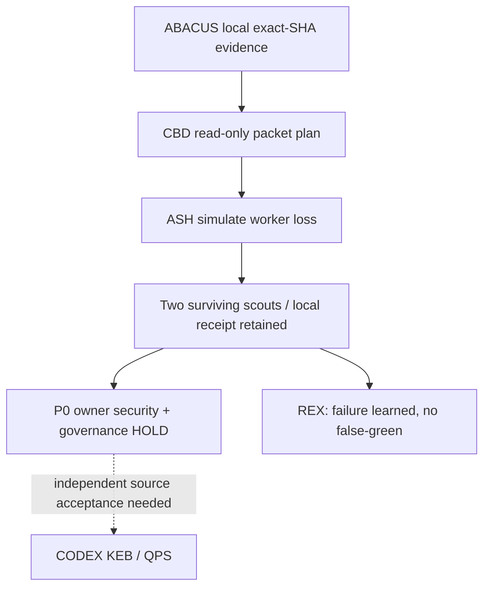

# CBD → ASH — Ariana governed disjoint worker recovery (17 October 2026)

**Source authority:** [ABACUS Ariana #2138](https://github.com/GBOGEB/ABACUS/pull/2138), [REX #2148](https://github.com/GBOGEB/ABACUS/pull/2148), new [security child #2152](https://github.com/GBOGEB/ABACUS/pull/2152), [BD–LDAB #1929](https://github.com/GBOGEB/ABACUS/issues/1929#issuecomment-6236743176). Mission Control is a **read-only consumer and planner**, not a replacement SSOT.

**ASH = after-burn survival test** as defined by ABACUS-UNIFIED's maturity assessment: controlled graceful degradation and partial result usability after failure. A historical row labelled '0%' is not today's measured Ariana baseline. Current proof: Ariana #2138 local native tests passed 29/29 in Python 3.11 and 3.12 on exact head `ba3423f3e5141bb5a85ecf3d5f042ee818ec932c`, statements 208/209 and branches 39/42, local evidence join run `39046986905` passed. Security/governance/compatibility/review and CODEX/QPS external acceptance still HOLD.

## Executed vs planned — do not confuse

| Lane / area | Source, lease and packet status | Executed or currently proven | Next governed admission |
|---|---|---|---|
| ABACUS security source | Child PR #2152, branch source changed at exact `da0c6120407bd9c3a080e703656f9cb19a7806e5`, 4 paths: parser, workflow, tests, root bounded dependency | Commits pushed; independent exact-head CI/scanner needed | Native negative and functional tests, immutable action hash verification, source-owner security review |
| Mission Control ASH control | This PR, `mission-control/gogreen/` only | Registered 10 work packets and 12 negative/positive ASH tests | Exact-head native ASH tests and derived packet receipt |
| CBD scouts | 3 **READY** read-only packets; configured max_parallel=2, planned in two waves | **No Crew dispatch or external worker session** is inferred from this plan | Two bounded read-only scouts can be assigned by an authorized executor; proof required to mark active/completed |
| Governance owner | ABACUS #1566, BLOCKED | Workflow classification + inherited inventory red | Authorized canonical policy disposition and checked inventory; no bypass |
| Security owner | ABACUS #1929, BLOCKED | Semgrep parser and mutable actions previously red; child repair committed | Current-head SARIF, CodeQL, independent review and resolved threads |
| Compatibility owner | ABACUS #1874, BLOCKED | Python 3.10 matplotlib resolver inherited; separate root | Canonical dependency owner fixes and proves matrix |
| REX/statistics | ABACUS #2148, PROOF_PENDING | Three retrospective pre-run directional matches with no calibrated probability | Current exact-head native tests; future independent N+2 |
| CODEX/KEB/QPS | BLOCKED external acceptances | Local Ariana evidence join **only** | Independently reviewed, exact-source KEB and QPS child receipts |

## Implementation, source and tests

The existing CBD planner at [`mission-control/gogreen/subtype_orchestrator.py`](subtype_orchestrator.py) remains canonical and retains disjoint leases, max-parallel guard and lack of dispatch authority. This wave adds:

- [Ariana current-head packets](samples/ariana_ash_disjoint_20261017.json) using existing `missioncontrol.cbd-subtype-plan.v1`, scoped to 10 packets.
- [ASH survival adapter](ash_survival.py), which **calls the existing planner** and derives partial survivability, unknown denominators, P0 blockers and proof preservation. It never sends GitHub API requests or runs workers.
- [12 targeted ASH regression cases](tests/test_ariana_ash_disjoint.py): simulated loss of one/all scouts, nonzero/unknown separation, source-spoof rejection, ancestor/descendant lease exclusion, QPS nonpromotion, no unapproved root closure, no Crew competence inferred from activity count.

From the Mission Control repository root:

```bash
python -m unittest discover -s mission-control/gogreen/tests \
  -p test_ariana_ash_disjoint.py -v
python mission-control/gogreen/ash_survival.py \
  --input mission-control/gogreen/samples/ariana_ash_disjoint_20261017.json
python mission-control/gogreen/ash_survival.py \
  --input mission-control/gogreen/samples/ariana_ash_disjoint_20261017.json \
  --simulate-loss ASH-SEC-SCOUT
```

The first invocation has no network or side effects. `--simulate-loss` is **synthetic failure injection on the packet plan**, not cancellation of a real GitHub runner. Optional `--out` explicitly writes one derived JSON report. Source data and owner issues remain elsewhere; no second ledger.

## ASH survival / DAG / SIPOC



Supplier = ABACUS GitHub job/artifact and authorized owner; input = exact SHA, active owner issue and stage eligibility; process = CBD `validate → plan` followed by ASH survival analysis/fault injection; output = read-only control receipt and remaining scout plan; customers = security/governance reviewers, BD owner, CODEX semantic owner and QPS engineering owner. Each edge to remote consumer is **DECLARED_NON_EXECUTED** until native evidence proves otherwise.

**Prediction vs actual:** Forecast local ASH survival is `PARTIAL_READ_ONLY_WITH_OWNER_HOLDS`, with no accepted causal root closures. Planned scouts 3; executed Crew count **UNKNOWN**, not 3 or 0. Under simulated single-scout failure, expected surviving scouts 2, one planned wave, historical local native receipt still source-bound, merge HOLD. No queue p95, worker-minute cost, PCA, BT or Six Sigma claim from this test model.

**ASH continuation gates:**

1. Examine current #2152 exact-head security scan and negative tests; correct source-owned first-red only.
2. Reconcile required policy path classification and independent reviewer gate separately.
3. Obtain terminal native exact-head receipts for both source PR and MC ASH adapter; publish run/job/attempt, denominators and artifact digests.
4. Only after independent security/governance review can owners integrate serially; re-run against integrated head. No merged QPS acceptance is inferred.

**Hard control:** `MERGE_ADMISSION=HOLD`; `authority_transfer=false`; `dispatch_authorized=false`; `security_waiver=false`; `qps_disposition=DEFER`. No user-unrequested Crew dispatch, source-owner override or protected main merge.
