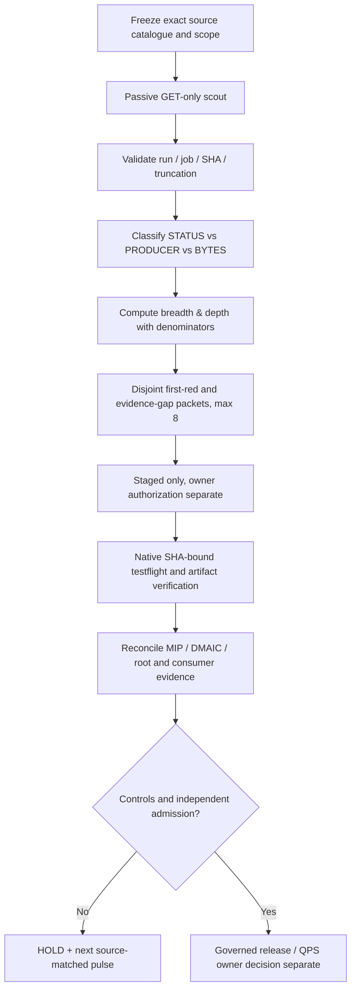

# GOGREEN G4 — MissionControl-Wide Pulse Contract

**Admission:** DRAFT / HOLD. Owner QPS TRIAGE = DEFER. No remote dispatch,
unbounded fan-out, reviewer proxy, security waiver or implicit source acceptance.

## Breadth, depth, fan-out and scaling

- **Breadth denominator:** fixed 6 catalog repositories, 42 declared
  repository-family cells. The observed numerator requires exact source-SHA
  workflow/job metadata, not a guessed workflow count or mere repo presence.
- **Depth ladder:** CATALOG → STATUS_ONLY → PRODUCER_METADATA → ARTIFACT_BYTES
  → ACCEPTED. A workflow-name hint cannot advance past STATUS_ONLY.
- **Observed fan-out:** 2 runs x 3 jobs max per repository, read-only GET,
  six repos, maximum 36 sampled jobs (not proof of 36 jobs executed).
- **Dispatch fan-out:** 0. At most 8 candidate disjoint **staged** packets per
  pulse, each pinned to owner, repository, source SHA and a family; ownership
  and accepted worker return remain UNKNOWN.
- **Temporal depth:** independent native trials remain UNKNOWN even when one
  run has multiple jobs and attempts. RHEL, Docker, port, debugger/LLDB and
  REX return receipts have separate acceptance contracts.

## Control-plane dimensions

| Dimension | Minimum qualifying evidence | Default |
| --- | --- | --- |
| MIP | Native exact-head run + validated producer and negative controls | UNKNOWN |
| DMAIC | Root-owned baseline, matched after, causal and recurrence evidence | UNKNOWN |
| PCA/BT | Eligible multivariate cohort, versioned inputs and independent trials | UNKNOWN |
| REX | Authenticated worker dispatch + signed/hashed return + independent acceptance | UNKNOWN |
| LDAB/LLDB | Real job/runtime identity, debugger session and source-bound logs | UNKNOWN |
| CENSUS | Repo, SHA, run, attempt, job, root/fingerprint, completeness/truncation | PARTIAL |
| 3P* | Distinct M1 validity, M2 stability and M3 capability qualification | UNKNOWN |
| QPS TRIAGE | Provider→KEB→DOW authenticated chain + controlled owner decision | DEFER |

## Measurement pulse (MIP / DMAIC)

**Important:** G4 source snapshot `fleet_g4_20261015.json` is a dated
GitHub connector readback, not an evergreen floating pointer to current main.
The offline PR testflight explicitly performs **zero live GETs** and records
zero current observed cells unless supplied with grounded observations.
Manual read-only scanning is only allowed on the default branch and retains
access failures, incomplete sampling and unknown acceptance. Its bounded
results do not demonstrate all repo checks passing.

## Initial connector replay (15 October 2026)

Six repos reachable, 11 sampled workflows, 12 success jobs, 7 of 42 cells
classified by name only, 35 unobserved, three non-green workflow observations
(2 queued, 1 cancelled), five truncated repo samples. No native status-to-family
or ZIP-byte credit is claimed by this replay. Separate G1 PR #530 native
evidence has 64/64 tests and 652/828 combined eligible coverage outcomes
(78.744%); that is a different exact PR head and not current-main fleet proof.

All future waves shall present denominator identity, comparative
eligibility, first-red classification, queue latency where measured,
distinct root closure, consumer replay, and unchanged admission HOLD.
