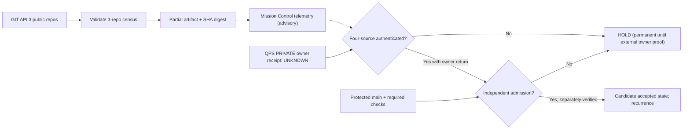

# QBD! W50 — public census source-bound root containment

**Owner:** Mission Control / CODE PURPLE BD. **Datum:** 2026-10-19.  
**Status:** read-only structural/telemetry implementation, not a new source of BD
authority. Actual cross-repository native 4-repo admission remains **HOLD**.

## 1. What is actually broken

The canonical `mission-control/gogreen/bd_queue_wave.py` producer queried four
repositories from a public Hub GitHub Actions `GITHUB_TOKEN`. On [native
run 39234135620](https://github.com/GBOGEB/pipeline-automation-hub/actions/runs/39234135620),
job `117998999337`, structural tests were **16/16 QBD and 50/50 BD PASS**,
but the subsequent full census failed `urllib.error.HTTPError: 404` at
`scan → paginate(/repos/{repo}/pulls?state=open)`. The log does **not**
print the exact denied repository, but QPS is a private member of the query
tuple and read access is not authenticated by the public Hub token.

Do not assert token provenance or change secrets without administrator evidence.
PR [#748](https://github.com/GBOGEB/pipeline-automation-hub/pull/748) was
merged despite this RED; merge occurrence is NOT governed admission.

## 2. Remediation: split evidence collection, preserve red

- The original full-four scanner and existing full-four CI required/failed
  path are **unchanged**; it can still fail closed on missing access.
- New `--public-only` collects exactly ABACUS, CODEX and Mission Control.
  It does **not** attempt the private QPS repository. JSON/CSV/Markdown
  are marked `LIVE_PUBLIC_THREE_REPO_PARTIAL_QPS_UNKNOWN`.
- `private_qps_open_issues`, `private_qps_open_prs`,
  `private_qps_root_closures` are JSON null, never guessed zero.
- A separate `qbd-public-three-observer.yml` is an **observer**, not
  dispatcher, alternate release workflow or replacement canonical SSOT.
  On native pull-request SHA it executes the existing 50+6 source tests,
  three public API source readbacks and records a SHA-bound public artifact.
- No cross-repository writer access, private source SHA, original QPS
  binary, confidential commercial data or private owner issue IDs are
  propagated to Hub or CODEX.

## 3. SIPOC per lane

| Lane | Supplier | Inputs | Process | Output | Customer / no-credit gate |
| --- | --- | --- | --- | --- | --- |
| GT01 Public API | GitHub, 3 public repos | Open PR/issue pages, current PR head | Validate IDs and dedup workflow attempts | Partial public BD census | Mission Control readers; NOT four-repo proof |
| GT02 Historical ABACUS | EVERRED V3 | 75 PR / 260 failed associations | Dedup 253 run IDs; gather native job first-reds | Root *candidates* | ABACUS source owner; causal confirmation required |
| GT03 Private QPS | SCK CEN owner machine | Physical hashed ALAT / OD15 / LKT + register | Original row locate, witness disposition, return receipt | Private owner acceptance candidate | QPS owner alone, no public disclosure |
| GT04 CODEX REX | CODEX producer | Signed/attributed producer receipt | Independent consumer trust evaluation | Candidate federation handoff | Separate QPS and MC consumer acceptance |
| GT05 Admission | Repo admin + independent reviewer | Real required checks, rule target, RED canary | Noncompensating final-head check | Eligible review, not auto-merge | Security, governance and current-main verify |

## 4. Typed golden-thread DAG / blocking edges

Solid arrows are exact producer or blocking prerequisites; dotted arrows are
**DECLARED advisory handoffs**, not authenticated cross-repo receipt edges.
There are no QPS physical-source pages or private identifiers in this public
diagram.

## 5. Capacity and DMAIC control

**Proposed**: four read-only worker scouts and up to two source-writer
workers under separate CAS leases. **Actual dispatch in this PR: zero**.

- **D**: distinguish 201 pending/mixed-status QPS NEG/MoM records from
  GitHub issue objects and historical ABACUS manifestations.
- **M**: count public issue/PR population and failed-workflow names only
  within its source scope; preserve source SHA, run, attempt, artifact digest.
- **A**: infer *symptom family candidates*, not root closure. Independent
  root count, matched branch coverage and retry economics remain UNKNOWN
  without joined native cohorts.
- **I**: repair exact shared root in disjoint source-owned PRs, then rerun
  negative controls on terminal immutable head.
- **C**: retain required RED canary and repeat at next main SHA. Allow
  recurrence-rate/LDAB improvement only against matched scope/config.

**Hard stop:** no insecure token fallback; do not downgrade a mandatory
four-source gate because the three-public observer succeeds. Do not reuse
the observer's partial green as `MERGE_ADMISSION`, `ENGINEERING_ACCEPTANCE`,
or `FORMAL_ROOT_CLOSURE` credit.

## 6. Exact actions remaining

1. Hub admin / #336: require actual FPC issuer, 1 eligible independent
   reviewer, blocked RED canary, current effective ruleset.
2. Hub / #636: define authorized private-owner return contract
   without public private-target queries; verify provenance and redaction.
3. ABACUS / #2077: integrate newer policy/requirements from current main,
   then separately treat formatter and security first-reds.
4. QPS / #1745, #1186 and #1959: retain physical ALAT 50 receipt,
   retrieve exact OD15 original, execute the full N400 `Master_Input`
   owner return, and perform owner acceptance/release gates.
5. Re-scan current main after each authorized merge; compare
   exact-head proofs before any root closure claim.

`MERGE_ADMISSION=HOLD` · `ENGINEERING_ACCEPTANCE=WITHHELD` ·
`FORMAL_CREDIT_DELTA=0` · `AUTHORITY_TRANSFER=false`.
