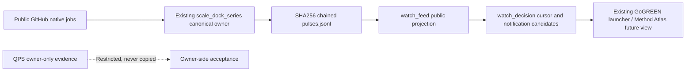

# CODE PURPLE vNext — source-owned watch feed (stacked continuation)

This is the **next** bounded PR after the transition consumer (#881) and after the N0 preservation draft (#876). This layer solves the missing bridge to an **existing** canonical source: the hashed `mission-control/gogreen/scale-dock/real/pulses.jsonl` ledger. It does not create another event journal, run GitHub API requests or publish a dashboard.

## Data movement



- `scale_dock_series.py` now retains **native job `completed_at`** when supplied by GitHub. Old pulses remain byte-for-byte untouched. A poll time must never be backfilled as a fake native completion time.
- `watch_feed.py` reads through `scale_dock_series.read_ledger()`, verifying canonical JSONL, ordinals, the SHA256 chain and chronological pulse order before projection. It exports only public `pulse.findings`; the source record's `issue_bd` (which can contain restricted aggregate metadata) is never exported.
- A public finding must be on the source `source_heads` SHA, have complete native run/attempt/job and event-clock identities, and explicitly say `owner_accepted=false`. Missing old fields are counted as **gaps**, never converted to zero or successful evidence.
- The exported `MERGED_MAIN` source identity is distinct from `PR_HEAD` and `SYNTHETIC_MERGE`. Diagnostic workflow identities are hashed to safe opaque labels, so arbitrary log strings are not copied into the public feed.
- The feed does not carry required-status receipts, matched coverage, QPS evidence, root acceptance, six-repo breadth or worker telemetry. Those remain UNKNOWN or withheld for a separate source-authenticated join. Notification candidates are not delivered.

## Offline proof and dry-run

```bash
python -m unittest discover -s mission-control/gogreen/tests -p 'test_watch_feed.py' -v

# Only the existing owner ledger is read. Default is dry-run and prints aggregate gaps.
python mission-control/gogreen/watch_feed.py

# Opt in to a public-only transient events snapshot; no new event journal.
python mission-control/gogreen/watch_feed.py --output /path/to/public-terminal-events.jsonl
python mission-control/gogreen/watch_decision.py \
  --events /path/to/public-terminal-events.jsonl --cursor /path/to/watch_cursor.json
```

**Important:** The committed legacy ledger may yield zero eligible exported events because it did not retain the job completion clock. Such a result is a **lineage gap**, not proof that no native events occurred, and not evidence of a stable fleet. A later approved native source pulse will be needed for an end-to-end qualifying readback.

## Governing boundary

One canonical source journal; one last-qualified consumer cursor; no redundant producer. No automatic merge, no ChatGPT watch activation, no private QPS identifiers, no independent owner attestation, and no release claim. Pending gates: source-native readback of new completion clocks, exact-head G4 tests, First-Pass and review, owner check receipts, and a separate launcher/dashboard consumer PR.
