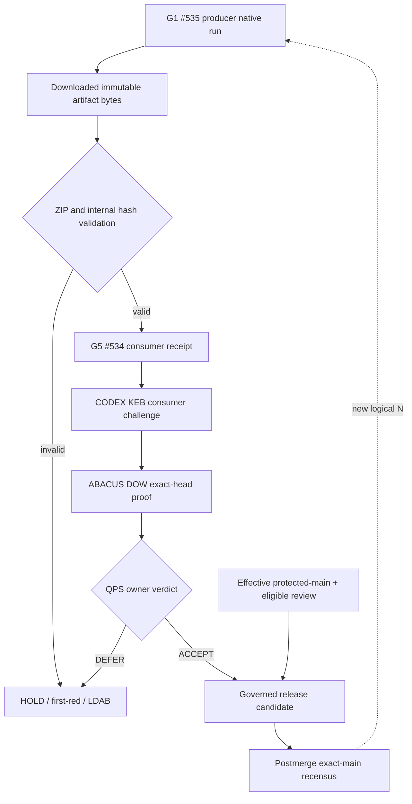

# CODE PURPLE — N+2 nine-track WBS and consumer replay

**Mission owner:** MissionControl, existing G5 [PR #534](https://github.com/GBOGEB/pipeline-automation-hub/pull/534).
**Evidence clock:** logical N+2 is a user/engineering improvement cycle, not a Git revision; each git commit and GH Action run keeps its independent SHA, UTC, attempt and job identity.
**Authority:** source and producer tests do not grant a merge, policy waiver or QPS engineering ACCEPT.

## Nine non-compensating tracks

| # | Group / cohort | Existing baseline | N+2 action | Acceptance / residual |
|---:|---|---|---|---|
| 1 | Measurement / evolution | G0→G3 immutable 42-cell ledger, tests 39→55→75 | Preserve per-wave numerator, denominator, tool, source SHA and UTC | Append G4 **only** after new comparable observation |
| 2 | QPS evidence | Cryoplant #1926 SSOT tree integrated; physical input objects still governed separately | Import pointers only, not delegated authority | QPS engineering and publication decisions DEFER until true recipient evidence |
| 3 | GOGREEN scaling | G5 fixed 42-cell snapshot 1→6→8, 13 declared typed links, read-only planner | Add one genuine producer→consumer archive replay | Require native consumer-run receipt; keep six packets staged/0 dispatched |
| 4 | Breadth vs depth | G1 separate 13/66 source paths, 0 native/0 recipient bytes | Keep 42 family cells and 66 surface cells distinct; receive actual G1 rollup archive | Same-repo verified replay ≠ new native G1 66-cell census |
| 5 | Runtime economics | Queue snapshots not simultaneous, no authenticated worker launches/hours | Capture native run wall time / worker-hour where possible | Fan-out savings, p50/p95, BT and causal queue reduction UNKNOWN until comparable receipts |
| 6 | First-red / EVERRED | Zero-Test first-red repaired in main via #536; ABACUS #1993 separately has formatting, Bandit, Safety and governance red roots | Isolate root fingerprints across branches and owner PRs | No independent BD global root closures inferred |
| 7 | Control & stability | G5 producer checks passed on exact head; required checks on MissionControl main not enforced | Fail closed on artifact drift/ZIP injection; require independent review | M2/M3 stability and governed merge HOLD |
| 8 | MIP, DMAIC, PCA, BT, 3P* | Descriptive measurements available, insufficient IID aligned trials | Measure changes, isolate comparable scopes and refusal controls | Inference and control limits DEFER; 3PR Refresh→Probe→Rank remains active |
| 9 | Telemetry / HTML handover | G1 rollup JSON, manifest and monochrome HTML native; #537 W1/W2 flightdeck on main | Attach G1→G5 consumer JSON/MD/HTML receipt, avoid competing SSOT | Git/Actions immutable lineage; no default binary committed |

### N+2 forecasts fixed before terminal consumer flight

- **N2-F01:** ten negative/unit tests for the G1 consumer ZIP should PASS; native G5 original 44-test suite should remain 44/44 and coverage instrumentation comparability unaffected.
- **N2-F02:** G5 consumer should retrieve pinned G1 producer archive ID `11968217957`, verify actual downloaded archive SHA-256 `f926b86d377f989cfb380c587ce5cbf2843a3e7e152d0df3c4d8a3a914ba2117`, verify five bounded members, manifests, producer exact head `63d1ac9618b2612d0ec3ceb32faad3841413b79d`, producer run `38726158685`, job `116392416193`, and report **1 same-repository producer→consumer replay**, NOT a cross-repo accepted edge.
- **N2-F03:** No QPS engineering decision in this MissionControl producer: cross-repo links 0, QPS ACCEPT 0, governed merge HOLD.
- **N2-F04:** Existing G5 and G1 PRs may still require revalidation after the newer #537 main commit. An earlier 10/10 or 9/9 valid native result is historical head evidence, not automatic current-main admission.

Forecasts are falsifiable and must not be rewritten after CI outputs. A download/network failure scores F02 FAIL/DEFER, not a synthetic successful receipt.

### SIPOC

| Supplier | Input | Process | Output | Consumer / authority |
|---|---|---|---|---|
| G1 #535 source owner | Exact-run artifact ZIP, source SHA and digests | Fetch immutable archive and validate byte hashes, limits, internal manifests and data counts | Consumer replay JSON/HTML + SHA-256 | G5 #534 producer owner, not QPS |
| CODEX KEB | Provenance challenge / semantics | Origin-independent validation on real run/job/bytes | KEB challenge receipt | ABACUS/DOW native execution |
| ABACUS DOW | Validated source and root lineage | Native consumer/authenticated debugger/LDAB execution | Signed evidence / REX | Cryoplant/QPS engineering authority |
| QPS child owner | Valid complete four-hop chain and safety context | Evaluate engineering acceptance | ACCEPT, REJECT or DEFER | Corporate publication gate |

### Execution DAG

The dashed global-feedback loop is not part of the execution DAG's per-wave acyclicity check.

## Glossary / controlled taxonomy

- **Cohort:** frozen, scope-matched observation population; a 42-cell family cohort is not the 66-cell surface cohort.
- **Breadth:** eligible cells with source/status observations, explicitly typed by evidence level.
- **Depth:** escalating proof level (discovered → producer native → consumer replay → QPS accepted), with distinct counted denominators.
- **Consumer replay:** separate native process downloads immutable producer bytes and validates them; does not grant owner authority.
- **SSOT:** governed semantic source-of-truth; HTML/PDF/Office are derived views, not competing SSOTs.
- **First-red:** earliest attributable failed gate with source/run/job fingerprint, not every downstream failing workflow.
- **DoV:** definition of verification (exact SHA, native tool, digest, denominator, negative control).
- **DoD:** definition of done, separately including governed acceptance.
- **BT:** Bradley–Terry comparison; withheld absent comparable independent outcomes.
- **3P*:** relevant configured phase method; a name or workflow does not prove model maturity.

**Stop condition:** no merge, waiver, invented worker hours, fabricated reviewer, changed QPS disposition or false cross-repo evidence.
