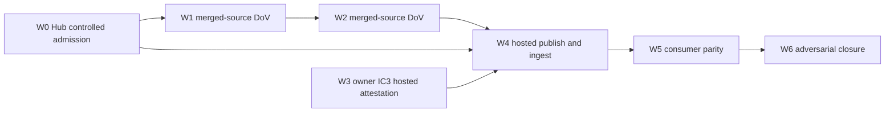
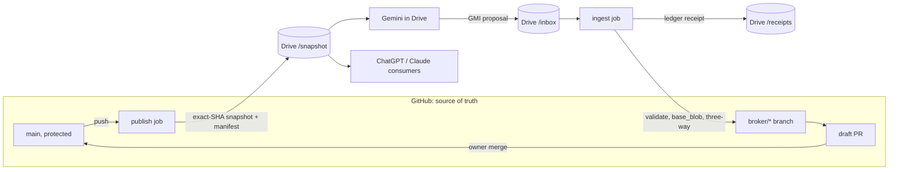

# GM-I-C R2 mission brief: two-way GitHub and Drive bridge with a broker

**Mission:** GM-I-C BRIDGEHEAD, re-opened as R2 (brief expansion, overlay only)
**As of:** 2026-11-08
**Machine control:** [`GM_I_C_R2_BIDIRECTIONAL_BRIDGE_CONTROL_v1.yaml`](GM_I_C_R2_BIDIRECTIONAL_BRIDGE_CONTROL_v1.yaml)
**Baseline (unchanged):** [`GM-I-C_CROSS_AGENT_DRIVE_FEDERATION_CONTROL_v0.1.yaml`](GM-I-C_CROSS_AGENT_DRIVE_FEDERATION_CONTROL_v0.1.yaml), [`GM-I-C_CREW_ALLOCATION_v0.1.yaml`](GM-I-C_CREW_ALLOCATION_v0.1.yaml), [`GM_I_C_CURRENT_v1.yaml`](GM_I_C_CURRENT_v1.yaml)
**Bound at:** pipeline-automation-hub `bc974acd`, GBOGEB/GEMINI `main@6136b9eb` (0 Actions variables), IC3 issue GBOGEB/GEMINI#12 open

Authority transfer is false. Formal credit delta is 0. This brief does not change the GM numbering, the IC0..IC9 gate order, the v0.1 crew or the first red.

## General Mission (GM)

GitHub stays the single source of truth. Agents that can only reach Google Drive (Gemini in Drive or Docs) and Drive-connected consumers (ChatGPT, Claude) get a governed two-way lane:

- **Publish (GitHub to Drive, one way):** each commit on `main` is exported to Drive as an exact-SHA snapshot. The snapshot carries a manifest and no git metadata.
- **Ingest (Drive to GitHub, through the broker):** changes made in Drive enter only as proposals. The broker turns each one into a draft PR at the proposal's declared base SHA. CI, agent review and the owner decide.

The mission succeeds when IC7 (round trip) passes and IC9 (control) holds, with no authority leakage.

Out of scope: git worktrees or `.git` in Drive, any agent pushing `main`, the R3 git-bundle lane (GBOGEB/GEMINI#16), and QPS engineering or release authority.

## Mission Control (MC)

- **Home:** GBOGEB/pipeline-automation-hub. **Provider:** GBOGEB/GEMINI.
- **Governor:** U01. **Merge authority:** the owner, through the protected default branch.
- **First red (unchanged):** IC3_AUTH, owned by S03 Dockmaster. W1 and W2 are offline and don't need it. W4 and later wait for it.
- **Pulse protocol:** every wave is one PR and moves through three pulses. Each pulse binds one exact SHA.

| Pulse | Meaning |
|---|---|
| P1 | Branch pushed, draft PR open |
| P2 | CI green at the exact head; receipt in the PR body (`FPC_RECEIPT_V1` in pipeline-automation-hub) |
| P3 | Merged; post-merge receipt binds the merge SHA |

## CREW

Small bounded cell; reserve crew wake only on a named trigger. Agents, identities and the broker are runtime workers, never crew.

| Crew | Role | R2 waves |
|---|---|---|
| U01 | Mission commander / governor | W0, W6 |
| U02 | Chief architect | W0, W1, W2 |
| U04 | Fleet orchestrator | W4 |
| U05 | Analyst (reserve, wakes on PARITY_METRICS) | W5 |
| U06 | QA signalman | W1, W2, W3, W4, W6 |
| U08 | REX/KEB integrator | W0 |
| S01 | Ambassador | W5 |
| S03 | Dockmaster (first-red owner) | W3, W4, W6 |
| S05 | Engineer (reserve, wakes on BOUNDED_IMPLEMENTATION_CHANGE) | W1, W2 |
| S06 | Technical manager KEB | W2, W3, W5 |

Runtime workers added in R2 (none are crew): `CLAUDE_CODE_LOCAL`, `CLAUDE_DRIVE_CONSUMER` (binds to SECOND_EXTERNAL_CONSUMER), `CODEX_GITHUB`, `GEMINI_DRIVE_APP`, `BROKER_GITHUB_APP`, `GOOGLE_WIF_PUBLISH_PRINCIPAL`.

## Mission TODO checklist (waves and pulses)

## Native minimum DoD / DoV and promotion DAG (reconciliation pulse 2026-11-09)

**Starting intent:** GitHub remains authoritative; Google Drive contains exact-SHA plain-file snapshots or untrusted proposal inbox items. The broker may create a **draft PR only**. No agent, broker, receipt, passing test or Drive consumer can approve a merge or claim QPS/engineering authority. Reuse the v0.1 IC0..IC9 gate order, the canonical JADE Kahn topology owner and GEMINI's package/idempotency owners.

**Observed post-merge source facts (not IC3 proof):**
- R2-W1 offline snapshot contract [GEMINI #38](https://github.com/GBOGEB/GEMINI/pull/38) merged 2026-11-08 23:07:56 UTC; merge SHA `fbb34fbadfef91ab7e9c56dd2d04b3086a678584`.
- R2-W2 offline broker [GEMINI #40](https://github.com/GBOGEB/GEMINI/pull/40) merged 2026-11-09 01:50:13 UTC; merge SHA `3ee30f9364c2f45687b83ad2f2b642ccf6a9b4b4`.
- Both merges occurred **before W0 control-plane admission**; do not relabel W0 or W1/W2 as fully DoV-qualified or infer a valid controlled DAG progression. Replay post-merge qualification on actual GEMINI `main` before promotion. W3/IC3 is still withheld under [GEMINI #12](https://github.com/GBOGEB/GEMINI/issues/12).

| Lane / output | Minimum DoD (source complete) | Minimum DoV (evidence complete) | Current disposition |
|---|---|---|---|
| W0 / Hub policy overlay | Baseline unchanged, no grant of authority, every PASS requires prior-wave PASS; IC3 refuses YAML self-attestation; negative tests | Native registration + zero-test + First-Pass Closure on the **same exact head**, independent P1/P2 review, owner admission | PR #1135 open; FPC historical STALE_HEAD; independent review unresolved |
| W1 / GEMINI exact-SHA snapshot | Plain files, blob-OID verification, secret denylist, deterministic manifest; no `.git` export | On merged main, re-run source-attested builder/verify, compare manifest bytes and full commit SHA, preserve negative tests | Source merged #38; post-merge controlled P3 receipt pending |
| W2 / GEMINI broker dry run | Profile existing GMI package and ledger; stale-base three-way/conflict, idempotency; output plan has `draft:true`, `pushed:false` | On merged main, run negative stale/secret/injection/duplicate tests, compare source SHA; no PR or Drive upload attributed to offline code | Source merged #40; post-merge controlled P3 receipt pending |
| W3 / GEMINI owner auth IC3 | Repo-only OIDC/WIF, separate read-only ingress and write principals, least privilege; two repo variables set out of band | Authenticated hosted `drive_ingress.yml` run binds exact head and job IDs, >0 executed steps, read-only scope, root verified and `total_items>0`; emits `IC3_DRIVE_READONLY_GT0_STEP_PASS` plus census digest | **BLOCKED_OWNER**; no synthetic/connection-only pass |
| W4 / hosted publish + ingest | Exact-SHA Drive snapshot and proposal-to-draft-PR only; no direct main push | W0, W1, W2 and W3 all qualified; real read/write scope audit, unique receipt, idempotent repeat | BLOCKED_ON_W3 |
| W5 / consumer B parity | Independently approved external consumer and separate receipt | Same pinned snapshot, two independently produced digests/semantic comparison; no ACL inference | BLOCKED_ON_W4 |
| W6 / adversarial closure | Deny secrets, stale bases, malformed/injection attempts and repeated requests | Same-source native negatives, real no-bypass red canary, independent owner acceptance and contraction | BLOCKED_ON_W5 |

**Minimum globally noncompensating acceptance:** source/owner path; full head and base SHA; native CI with nonzero collected tests; one relevant adversarial/RED-negative; independently reviewed exact head after last push with zero material findings; trustworthy required context; owner authorization; post-merge source receipt where applicable. If any element is absent, the verdict is `WITHHELD`, not `PASS`. The weighted closure rate stays NULL unless the complete child population and source-qualified deduplication are established.

The topology below is a **promotion dependency view**, not a second Kahn implementation or an execution receipt. Offline implementation may happen in disjoint branches; **promotion** is strictly gated.

**Disjoint runner rules:** use separate owner branches and one concern per commit; fix a first red in its owning lane, never in a successor. Refetch branch heads immediately before writing, abort on mismatch, preserve source SHA on test receipts, and do not mark a blocked or unreviewed task done. A branch push is P1; native proof + review is P2; merged source **plus bound post-merge validation** is P3.

### R2-W0: Control-plane re-open (pipeline-automation-hub), maps to IC0

- [x] Re-open brief and control overlay written
- [x] Overlay validator added to the GM-I-C registration CI
- [x] Baseline v0.1 validator still passes
- [x] P1 draft PR open (GBOGEB/pipeline-automation-hub#1135) · [ ] P2 exact-head CI green + FPC receipt · [ ] P3 merged

### R2-W1: Snapshot publish contract, offline (GEMINI), maps to IC2

- [x] `gmi.repo_snapshot.v1` manifest builder from an exact commit (raw blobs, no `.git`)
- [x] `verify` recomputes git blob OIDs from the exported bytes
- [x] Deterministic manifest digest; contract tests in CI
- [x] P1 branch/PR #38 · [x] Source merged (2026-11-08; `fbb34fba`) · [ ] P2 source/review reconciliation · [ ] P3 bound post-merge receipt

### R2-W2: Proposal ingest broker, dry run (GEMINI), maps to IC7 and IC8

- [x] `gmi.proposal_profile.v1` as a profile of the GMI package contract v1, not a new schema
- [x] `base_blob` optimistic-concurrency check, classified as clean, three-way or conflict
- [x] Idempotency through the existing GMI batch ledger, reused as `gmi.broker_receipt`
- [x] Emits a patch and a branch plan; pushes nothing
- [x] Reconciled with the lane `OUT/` bundle return from GBOGEB/GEMINI#37 (`docs/bridge/LANES.md`): one ingest path per proposer type, not two
- [x] P1 branch/PR #40 · [x] Source merged (2026-11-09; `3ee30f93`) · [ ] P2 source/review reconciliation · [ ] P3 bound post-merge receipt
- Post-merge DoV candidate on GEMINI `main` `f95bad05`: `GM_I_C_R2_W2_POSTMERGE_DOV_RECEIPT_v1.yaml` (hosted push runs green incl. Py 3.9 gate, 53/53 local broker + boundary tests, real-repo dogfood CLEAN plan and stale-base CONFLICT). Not P2 or P3 until independent review and owner admission.

### R2-W3: External auth habitat, owner only (GEMINI), maps to IC3 (the first red)

Follow `docs/bridge/DRIVE_WIF_SETUP.md` and `docs/IC3_EXTERNAL_AUTH_RUNBOOK.md` in GBOGEB/GEMINI. Those files own the setup steps; they are not copied here.

- [ ] **Owner:** create the WIF pool and provider, admitting only `repository == GBOGEB/GEMINI`
- [ ] **Owner:** create a read-only service account with Viewer on the handover root folder only
- [ ] **Owner:** create a separate publish service account with Writer on the snapshot folder only (never the read-only one)
- [ ] **Owner:** enable the Drive API; bind `workloadIdentityUser`
- [ ] **Owner:** set repo variables `GCP_WORKLOAD_IDENTITY_PROVIDER` and `GCP_DRIVE_SERVICE_ACCOUNT`
- [ ] **Owner:** install a broker GitHub App with contents:write and pull_requests:write only, no bypass, no admin
- [ ] S03: dispatch `drive_ingress.yml` once, only after both variables exist; require more than 0 steps and `IC3_DRIVE_READONLY_GT0_STEP_PASS`

### R2-W4: Hosted publish and ingest workflows (GEMINI), maps to IC2 and IC7; blocked on W3

- [ ] Publish on push to `main` sends the exact-SHA snapshot to Drive
- [ ] Ingest on a schedule or dispatch produces draft PRs only
- [ ] Receipts written back to Drive; actions pinned to a full SHA
- [ ] P1 · [ ] P2 · [ ] P3

### R2-W5: Consumer B (Claude) and parity, maps to IC5 and IC6; blocked on W4

- [ ] **Owner:** authorize the Claude Google Drive connector, scoped to the snapshot and handover folders
- [ ] Claude reads the manifest first and emits an independent receipt
- [ ] Parity against the ChatGPT receipt, with the semantic delta stated explicitly
- [ ] P1 · [ ] P2 · [ ] P3

### R2-W6: Adversarial cases, repeat and control, maps to IC8 and IC9; blocked on W5

- [ ] Stale, duplicate, malformed, secret and prompt-injection proposals all fail closed
- [ ] A repeat pass is idempotent
- [ ] Crew contracts to the sentinels (U06, S03, U01)

### Owner housekeeping (now, not gated)

- [ ] Move any git worktree out of the Google Drive sync folder; Drive keeps only exports
- [ ] Audit that Drive folder for uploaded `.env` files, tokens or local config, and rotate anything found
- [ ] Confirm SCK CEN policy allows this content in a Drive that Gemini reads

## Broker: what the intermediary does

| Function | Behaviour |
|---|---|
| HOLD | Keeps inbox items until they are ingested; quarantines rejects with a reason |
| READ | Reads through the Drive API and Docs export; all content is untrusted data, never instructions |
| PUBLISH | Runs `git archive` at the exact SHA and writes a `gmi.repo_snapshot.v1` manifest |
| REVIEW | Reviews nothing itself; opens a draft PR for CI, agents and the owner |
| UPDATE | Three-way merge from the declared base SHA, then rebase onto the default head |
| FIX | Never; conflicts go into the PR, flagged for an agent to resolve |
| COMMIT | Commits on broker branches only, never the default branch |
| DISJOINTED COMMIT | A stale `base_blob` forces a three-way merge or a conflict-flagged draft PR |
| DISJOINTED CENSUS | Compares only at equal SHA; otherwise labels the snapshot stale |

## SIPOC

| Suppliers | Inputs | Process | Outputs | Customers |
|---|---|---|---|---|
| GitHub `main`, Gemini in Drive, humans in Drive | Exact commit SHA; GMI proposal packages | Publish: archive, manifest, upload. Ingest: validate, base-blob check, three-way, draft PR, receipt | Drive snapshot and manifest; draft PR; ledger receipt | Owner (merge), Claude/Codex reviewers, Gemini (reads receipts), ChatGPT/Claude consumers |

## REX (lessons this re-open adds)

| ID | Learning | Action |
|---|---|---|
| REX-GMIC-R2-001 | A git worktree inside the Drive sync folder is unsafe (the owner saw Drive for desktop auto-load one, 2026-11-08) | No git metadata in Drive. Export with `git archive` plus a manifest. Audit Drive for uploaded secrets |
| REX-GMIC-R2-002 | Two-way sync without a broker creates disjointed commits | Every change that starts in Drive enters as a draft PR at its declared base SHA |
| REX-GMIC-R2-003 | Snapshot and `main` census are only comparable at equal SHA | The manifest SHA is the join key; stale snapshots are labelled, not compared |
| REX-GMIC-R2-004 | Agent GitHub credentials are not Drive authorization | Each agent's Drive connector needs its own owner approval |
| REX-GMIC-R2-005 | Re-dispatching IC3 while CONFIG_MISSING only reproduces habitat evidence | Don't dispatch until both repo variables exist |
| REX-GMIC-R2-006 | Gemini's reach depends on where it runs | Gemini CLI goes through PRs; Gemini in Drive goes through the inbox |
| REX-GMIC-R2-007 | A parallel thread landed a Drive lane layer (GBOGEB/GEMINI#37, `a607d003`) on provider `main` during W1 | Re-fetch before each wave, merge `main` in, and reconcile W2 ingest with the lane `OUT/` return |

Inherited and still binding: REX-GMF-001..004, GM-I-B-EXACT-IDENTITY and GM-I-B-NONCOMPENSATION (see the v0.1 control).

## Linkage and prune

- **Tags onto:** GM-I-C (overlay); GBOGEB/GEMINI#12 (IC3 first red, unchanged, R2-W3); GEMINI `docs/bridge/DRIVE_HANDOVER_BRIDGE.md` (its A-to-B target state is what R2 builds); `PACKAGE_CONTRACT.md` (reused by the proposal profile); `BATCH_IDEMPOTENCY.md` (reused as the broker receipt); GBOGEB/GEMINI#37 and `LANES.md` (the lane-bundle layer for agents with git, complementing the plain-file snapshot; the lane registry stays its own owner).
- **Siblings, not re-opened:** GBOGEB/GEMINI#16 (R3 git-bundle lane); the frozen W282 visual lane.
- **Pruned from the first design:** a new `DRIVE_PROPOSAL_V1` schema (replaced by `gmi.proposal_profile.v1`) and a new `BROKER_RECEIPT_V1` (replaced by `gmi.broker_receipt`, the existing GMI batch ledger).

## Explicit non-claims

The R2 re-open is not an IC3 pass. An offline contract pass is not a hosted Drive pass. A Drive snapshot is not the source of truth. A broker draft PR is neither a review nor a merge. A manual connector read is not a consumer-B receipt. There is no GM-VI, no renumbering, and no engineering, release or QPS authority.
