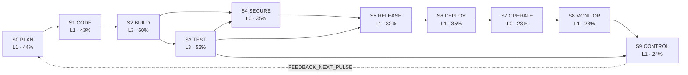

# JADE N+9: DevOps lifecycle and deploy/production reference architecture

**Status:** PROPOSED, not enacted. `merge_admission=HOLD`, no release or deploy authority. Measured on
2026-10-23T09:55:39Z over all 21 TOP21 repositories (21/21 reachable). Census digest `1b3a1c52…`
([DEVOPS_CENSUS_N9.json](../data/DEVOPS_CENSUS_N9.json)). Every number below comes from that file. The complete
tables are in the generated [DEVOPS_CENSUS_N9_READING.md](DEVOPS_CENSUS_N9_READING.md).

## 1. Why: the fleet builds and tests, but does not deploy or operate

The JADE fleet has 883 workflows and 1,241 jobs. Most of that effort sits in build, test and control:
446 CI test jobs and 21,700 declared test cases. The right-hand side of the lifecycle is thin:

| Signal | Fleet value |
|---|---|
| Deploy jobs (any workflow) | 34, in 11 of 21 repositories (16 of them in ABACUS) |
| Deploy jobs passing the core contract (DP1–DP6, DP9, DP10) | **0** |
| Deploy jobs that read back the served result and leave a receipt (DP7 + DP8) | 8 |
| Repositories with a rollback path (dispatch deploy of a prior ref) | 1 |
| Live sites whose served SHA equals HEAD | 0 proven. The hub serves `010ac255`, not HEAD `24c7dd93`. 7 other live sites publish no manifest |
| Production environments with protection rules | UNKNOWN for 21/21 (public API quota refused, HTTP 403) |
| Third-party actions pinned to a commit SHA | 594 / 3,078 (19%) |

Median stage levels are L3 for BUILD and TEST but L0 to L1 for SECURE, RELEASE, DEPLOY, OPERATE, MONITOR and CONTROL.
Scaling 21 repositories one workflow at a time does not converge. The fleet needs one standard path, one evidence
schema and one maturity ladder, all measured by the same census.

## 2. The total process: one DAG per pulse

Node labels show the fleet median level and mean completion. Feedforward edges form a DAG inside one pulse. The single
feedback edge S9 → S0 carries a result into the next pulse, so the graph unrolled over pulses stays acyclic. This
is the same rule as `CODE_PURPLE_BEAMS_DAG_v1` (FEEDBACK edges) and the JADE P-loop `recurse` edge. Layering is
computed and checked by `lifecycle.topo_layers()`. Because S4 needs both S2 and S3, and S9 needs both S3 and S8,
the ten stages land on ten successive layers, S0 through S9. That gives a strict critical path, and every
stage gates the next.

## 3. SIPOC per stage

| Stage | Suppliers | Inputs | Process | Outputs | Customers |
|---|---|---|---|---|---|
| S0 PLAN | owners, BD queue, Mission Control roster | issues, BD items, first-red roots, ADR | triage, route by CODEOWNERS, protect default branch | owned work item, protected branch | S1, reviewers |
| S1 CODE | authors, agents | work item, lint/format/type config | edit, pre-commit, lint + type check in CI | reviewed commit (40-hex SHA), lint receipt | S2 |
| S2 BUILD | S1 commit, registries | manifest, lockfile, pinned actions | resolve pinned deps, build once, hash | artefact + sha256 manifest | S3, S4, S5 |
| S3 TEST | S2 artefact, test authors | suites, coverage floor, min test count | tests on PR/push, zero-test guard, coverage gate | test receipt (ran N, coverage %), first red | S5, S9 |
| S4 SECURE | advisory DBs, scanners | dependency graph, permissions, pins | update bot, SAST/audit, least privilege, attest | scan receipt, provenance | S5, auditors |
| S5 RELEASE | S3 + S4 receipts | version, changelog, artefact digest | tag semver, cut release gated on tests, attach digest | immutable release (tag SHA + digest) | S6, consumers |
| S6 DEPLOY | S5 artefact | digest, environment, DP1–DP10 | admit, verify digest, serialized deploy, readback | deployment receipt (env, SHA, digest, URL, parity) | S7, users |
| S7 OPERATE | S6 receipt, platform | runtime descriptor, runbook, health check | run, health-check, protect production, roll back by prior digest | service at a known SHA | users, S8 |
| S8 MONITOR | S7 service, scheduler | served URL, expected SHA/digests, SLO | scheduled readback, observability, alert → issue | parity/SLO receipts, incident issue | S9, owners |
| S9 CONTROL | S3 first red, S8 alerts, red-trace | EVERRED/GREEN→RED/RED→GREEN classes, BD/REX lifecycle | classify, root (root_red), repair lane, verify, control + recurse | BD item in DONE/CONTROL, prevention gate | S0 of the next pulse |

The machine-readable SIPOC is in `lifecycle.SIPOC` and in `lifecycle.stages[].sipoc` of the census.

## 4. Are the stages formalized? Maturity and completion

**Ladder (all stages):**
- **L0 ABSENT**: no evidence.
- **L1 AD_HOC**: assets exist.
- **L2 DEFINED**: declared configuration.
- **L3 AUTOMATED**: runs in CI.
- **L4 GATED**: fail-closed gate.
- **L5 CONTROLLED**: measured feedback.

Each stage has one probe per level (50 probes). A stage is at level L only when **every** probe of tiers 1..L is
PASS, and UNKNOWN is never PASS. Completion = PASS probes / 5.

**Formalization:**
- **FORMALIZED**: a written hub contract exists *and* at least one repository is GATED on it.
- **PARTIAL**: one of those two holds.
- **INFORMAL**: evidence exists but there is no contract and no automation.

| Stage | Question it answers | Gate crosswalk | Hub contract (blob OID) | Repos at ≥L3 / ≥L4 | Formalization | Most common blocker |
|---|---|---|---|---|---|---|
| S0 PLAN | Is work routed, owned, protected? | H03 | `04_REPO_ROOT_SPINE_CONTRACT.md` `2e866cdb`, `05_MACH_TIERS.md` `d1a31eea` | 6 / 0 | PARTIAL | `plan.templates` FAIL (12) |
| S1 CODE | Same lint/type rules locally and in CI? | H01, H02 | none | 6 / 2 | PARTIAL | `code.lint_config` FAIL (11) |
| S2 BUILD | Declared, pinned, one digest? | H04 | none | 11 / 1 | PARTIAL | `build.pinned_actions` FAIL (10) |
| S3 TEST | Fail-closed on zero tests, floor held? | H05, H06, H10 | `CODE_PURPLE_BEAMS_DAG_v1.json` (B1) `e591765b`, `zero_test_gate_audit.py` `feb45267` | 15 / 5 | **FORMALIZED** | `test.fail_closed` FAIL (10) |
| S4 SECURE | Scanned, least privilege, attested? | H07 | none | 6 / 4 | PARTIAL | `secure.policy` FAIL (11) |
| S5 RELEASE | Versioned, test-gated, provenance? | H11, H12 | `02_CHARTER.md` `218361e5` | 3 / 2 | **FORMALIZED** | `release.notes` FAIL (9) |
| S6 DEPLOY | Same artefact promoted by digest, verified? | H11, DP1–DP10 | this note (on merge), `NAVIGATION_PAGES_STYLE_CONTRACT.md` `bcf2a153` | 8 / 0 | PARTIAL | `deploy.descriptor` FAIL (10), `deploy.contract` FAIL (8) |
| S7 OPERATE | Described, health-checked, rollback-able? | DP-OPS (proposed) | `hosted_parity.py` `33a70507` | 4 / 0 | PARTIAL | `operate.runtime` FAIL (13), `operate.rollback` FAIL (4) |
| S8 MONITOR | Re-verified on a clock, alerts → issues? | DP-MON (proposed) | none | 5 / 0 | PARTIAL | `monitor.schedule` FAIL (10), `monitor.live_parity` (5 core) |
| S9 CONTROL | Red → ledgered, rooted, prevented? | H08, H09, P-loop | `CODE_PURPLE_BD_QUEUE_v1.json` `426a8b6e`, `JADE_STOP_RULES_CONTRACT.md` `68fda49d`, red-trace README `d213e1ca` | 4 / 0 | PARTIAL | `control.ledger` FAIL (10) |

Only TEST and RELEASE are formalized. No repository reaches L4 in DEPLOY, OPERATE, MONITOR or CONTROL. For the five
CORE repositories the S6, S7 and S8 levels all stop at L3, and the next blocker is the same everywhere:
`deploy.contract`, `operate.rollback` and `monitor.live_parity`. That is the precise shape of the deploy/production gap.

## 5. Deploy and production reference architecture

### 5.1 Golden path

```mermaid
flowchart LR
  subgraph Caller["Repository: .github/workflows/jade-cicd.yml (templates/jade-cicd-caller.yml)"]
    PR[pull_request / push / dispatch]
  end
  subgraph CI["Hub: jade-reusable-ci.yml @ SHA"]
    T[test: exact SHA · zero-test guard · coverage floor · CI receipt] --> B[build: build once · jade-manifest.json · sha256 digest]
  end
  subgraph CD["Hub: jade-reusable-deploy.yml @ SHA"]
    A[admit: env allowlist · prod ref · digest shape · tests-ran ≥ 1] --> D[deploy: environment · concurrency · verify digest + source SHA · Pages]
    D --> V[verify: HTTP readback of manifest + files · deploy receipt]
  end
  PR --> T
  B -- artifact-name, manifest-sha256, tests-ran --> A
  V -- jade.devops.deploy_receipt.v1 --> M[S8 monitor / S9 control]
```

Environments are promoted in order: **preview** (PR, artefact only) → **staging** (default-branch push, promotion
record or preview site) → **production**. Production runs from the default branch or a tag only, in a GitHub
environment whose required reviewers and branch policy are an owner setting.

### 5.2 Deploy contract DP1–DP10

| Gate | Rule | Enforced by | Fleet deploy jobs failing (of 34) |
|---|---|---|---|
| DP1 BUILD_ONCE | Deploy consumes the upstream artefact and never rebuilds | `download-artifact` in the deploy job | 22 |
| DP2 DIGEST_VERIFIED | sha256 of manifest and every file checked before deploy | inline verify step | 32 |
| DP3 ENVIRONMENT | Named GitHub environment | `environment:` | 7 |
| DP4 SERIALIZED | Concurrency group, never cancel-in-progress | job `concurrency` | 25 |
| DP5 LEAST_PRIVILEGE | Explicit permissions, never write-all | job `permissions` | 10 |
| DP6 PINNED | Every third-party action at a 40-hex SHA | `uses: …@<sha>` | 26 |
| DP7 POST_DEPLOY_VERIFY | Served bytes read back and compared | `verify` job | 21 |
| DP8 RECEIPT | Deployment receipt uploaded | `upload-artifact` after verify | 26 |
| DP9 GATED_ON_TESTS | Tests (or a CI receipt with tests-ran ≥ 1) upstream | `needs` / `tests-ran` | 19 |
| DP10 EXACT_REF | Bound to an exact SHA or protected ref | `if: github.ref` / manifest `source_git_sha` | 15 |

Two deploy jobs fail only DP6:
- `jade:job:pipeline-automation-hub:.github/workflows/code-purple-method-atlas.yml#publish-pages`
- `jade:job:CODEX:.github/workflows/pages.yml#deploy`

Pinning their actions makes them the first contract-passing production jobs in the fleet.
`jade-reusable-deploy.yml` and the caller template pass all ten gates. `workflows.py lint --require-deploy` keeps
it that way in CI.

### 5.3 Promotion, rollback, runtime

- **Promotion by digest.** `jade-reusable-ci.yml` writes `jade-manifest.json` (every file's sha256 and
  `source_git_sha`) and outputs the manifest's own sha256. The deploy refuses any artefact whose digest or source SHA
  differs.
- **Rollback.** Re-run the deploy job of the last good run. It carries that run's SHA, artefact and digest, so
  nothing is rebuilt. A `workflow_dispatch` input named `ref`, `sha` or `digest` makes this an automated path
  (`operate.rollback`).
- **Runtime today.** GitHub Pages for static sites: the hub, ABACUS, CODEX, cryoplant, GEMINI, DOCX_RTM,
  Q_engineering_tools and cryo_leak_rate_dashboard serve HTTP 200. Services that need a process (docker-stacks,
  the cryogenic dashboards) extend the same contract with a container target pushed by digest. That is the next
  `target` value, and DP1–DP10 apply unchanged.
- **Health.** Every live site should publish `site-manifest.json` or `jade-manifest.json` with `source_git_sha`.
  Without it, `monitor.live_parity` stays UNKNOWN, as it is today for 7 live sites.

### 5.4 Monitoring and DORA

- `jade-devops-census.yml` runs weekly. It re-measures the fleet and writes a drift table. A red scheduled run
  opens one deduplicated issue, which covers S8 `monitor.alerting` for the hub.
- **Deployment frequency and lead time:** deploy receipts carry the source SHA, run id and environment, so both can
  be computed per environment.
- **Change failure rate:** taken from receipts with `PARITY_FIRST_RED`.
- **CI MTTR:** available today for the five CORE repositories from the N8 red-trace. Medians: hub 22.4 h, CODEX
  22.5 h, ABACUS 76.1 h, cryoplant 640.6 h, gg_MATH 0.06 h.

## 6. Identity: SHA view and Object-ID view of the same DAG

Every node carries two identifiers:
- **Git object id:** commit / tree / blob, 40-hex, equal to `git rev-parse <commit>:<path>`.
- **Descriptive OID:** `jade:<kind>:<repo>:<locator>`, pointing at the human object (workflow, job, Python module).

The four views of one fleet:
- **FUNCTION:** stage → probe → evidence.
- **WORKFLOW:** trigger → job needs-DAG.
- **SHA:** commit → tree → blob.
- **OID:** module ↔ test, zero-test artefacts.

Worked chains from this census:

| View | Chain |
|---|---|
| SHA → workflow → job → gate | hub HEAD `24c7dd93…` → tree `575a2e56…` → `code-purple-method-atlas.yml` blob `d225d2ab…` → `jade:job:pipeline-automation-hub:…#publish-pages` (def_sha256 `fe3ea31e…`, needs `render`, layer 1) → DP6 FAIL |
| First red / root red | `gm-iv-recon4-governor.yml` (blob `5afe8eea…` at HEAD): GREEN→RED, last green `3a35154a…` → first red `612dd404…` |
| Python object without a test | `jade:py:ABACUS:MINERVA_PID.standards.build_legend_library` (blob `14c97439…`, 142 top-level symbols) has no referencing test |
| Zero-case test file | `ABACUS:DMAIC_V3/core/test_system_bridge.py` (blob `31e9a6a6…`) declares 0 discoverable test cases |

The other session's FUNCTION/SHA/OID lenses (`tools/cicd_dag.py`) use the same `git rev-parse` blob ids, so the
two products join on `blob_oid` by path.

## 7. Crosswalk to the JADE vocabulary

| JADE term | Where it lives in this model |
|---|---|
| first red / root_red | `red_trace.first_red_roots[]`: last green SHA → first red SHA, plus the red workflow's blob OID at HEAD (38 of 42 roots resolved; three are GitHub dynamic workflows with no file, and ABACUS `dow-integration-ci-cd.yml` no longer exists at HEAD). S9 `classify → root` |
| EVERRED | `control.red_trace` probe: FAIL while any workflow is EVERRED (ABACUS 18, CODEX 9, cryoplant 9, hub 1, gg_MATH 0) |
| code_purple | B1 gate integrity → S3 contract and the zero-test guard; BD queue → S9 contract; `code-purple/*` merges counted as `controlled` (85 since baseline) |
| P-process (P-loop) | harvest → classify → root → repair_lane → verify_progressive → admit → control → recurse = S9 process; `recurse` = FEEDBACK_NEXT_PULSE edge |
| issue BD | BD/REX lifecycle TODO → ACTIVE → DONE → CONTROL. DONE needs L3/L4 evidence; CONTROL needs L5 (measured prevention + distinct-source repeat) |
| crosswalk | `delta` against TOP21 `commit_sha_observed` (2026-10-18), the same baseline as `HEAD_CROSSWALK.json` |

## 8. Expansion since the baseline (2026-10-18 → 2026-10-23)

| Outcome | Fleet |
|---|---|
| Landed changes classified fix / feat / test | 73 / 81 / 16 |
| Control (code_purple, first red, gates) | 85 |
| CI changes (ci commits + workflows added or modified) | 244 |
| Test files / declared test cases, net | +274 / +4,420 |
| Python modules without a referencing test, net | **+270**, mostly cryoplant-project (+315). ABACUS reduced its count by 49 |
| Zero-case test files, net | +4 |

Tests grew fast, but new code grew faster than its tests. That is the case for the ratchet in §9.

## 9. No zero-test artefacts

There are three measured classes, listed per repository in `zero_test`:
- **Zero-case test files:** 94.
- **Python modules with no referencing test:** 1,756 of 3,283.
- **CI test jobs without a zero-test guard:** 255 of 446. These are explicit guards or pytest's exit 5, not
  soft-failed.

Enforcement:
1. `jade-reusable-ci.yml` fails when fewer than `min-tests` ran (`JADE_ZERO_TEST_FIRST_RED`) and below
   `coverage-floor`.
2. `jade-devops-census.yml` fails the hub below 64 tests, below 90/80 statement/branch coverage on `devops/*.py`,
   when the instrumented denominator shrinks, on any skipped test, or when the committed census or reading drifts.
3. Proposed ratchet: a repository's `py_untested` and `zero_case_files` may not increase between two census pulses.
   The weekly drift table already reports both.

## 10. Adoption waves (bounded, disjoint, measured)

| Wave | Scope | Exit evidence (probe → state) |
|---|---|---|
| W1 | Pin actions in the hub `publish-pages` and the CODEX `pages.yml#deploy` | `deploy.contract` PASS in 2 repos |
| W2 | CORE five adopt `jade-reusable-ci.yml` for their primary suite | `test.fail_closed` PASS ×5, unguarded test jobs ↓ |
| W3 | Pilot `jade-reusable-deploy.yml` staging → production on one live Pages repo (cryo_leak_rate_dashboard serves 200 with no deploy job) | `deploy.verified`, `monitor.live_parity` PASS |
| W4 | Owners configure protected `production` environments; census refresh runs with a token | `operate.protected_env`, `plan.protection` UNKNOWN → PASS/FAIL |
| W5 | Weekly readback canary per live site (reuse the deploy `verify` job on `schedule`) | `monitor.canary`, `monitor.alerting` PASS |
| W6 | Untested-module ratchet on CORE five | `py_untested` non-increasing over 2 pulses |

## 11. Not claimed

- No merge, release or deploy is authorized.
- Signals are static heuristics, and the census executes nothing from scanned repositories.
- The Python test mapping is static (imports, path literals, dynamic-load names); a referenced module is not a covered
  module.
- The reusable workflows are linted and tested offline but have not yet run on a hosted runner.
- API-dependent probes stay UNKNOWN until a refresh runs with a token.
