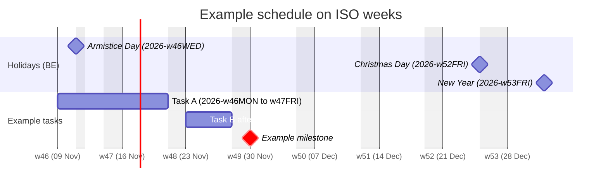
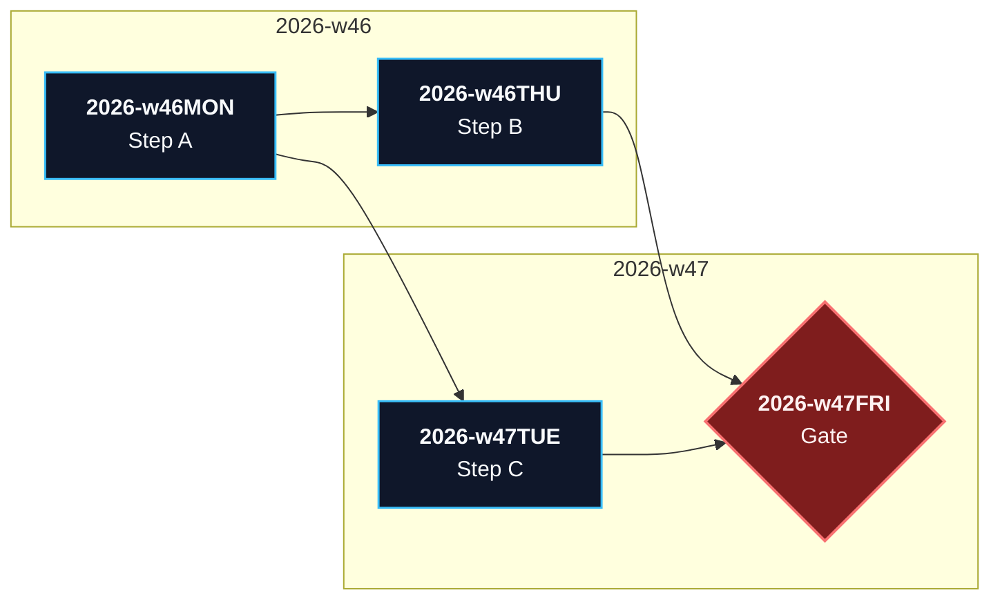
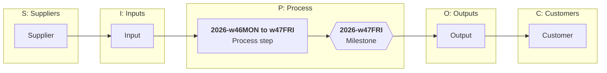
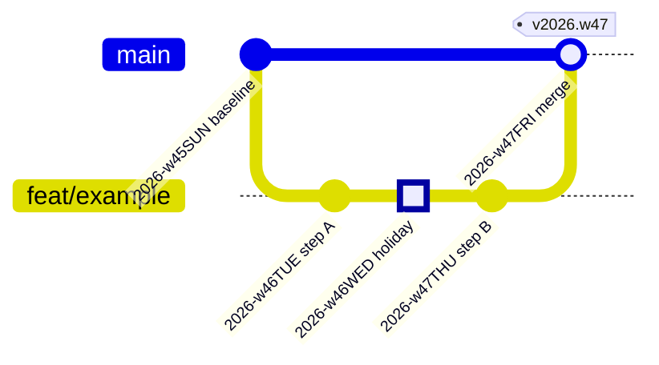
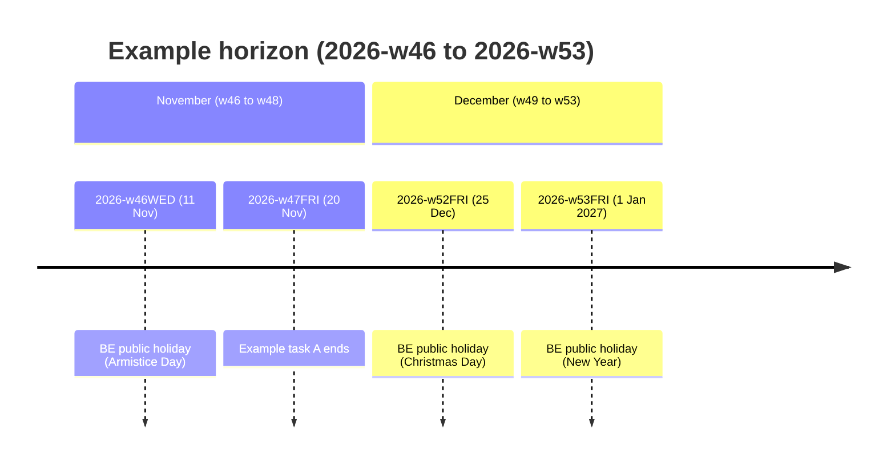

# `w##DDD` week codes and Mermaid schedule patterns

**Owner:** [`wddd.py`](wddd.py), tested by [`tests/test_wddd.py`](tests/test_wddd.py). This is the one GBOGEB owner of
`w##DDD` week codes (AGENTS.md L4). Import it; do not copy it. `actions_metrics.iso_week()` already delegates to it.

**Status:** the repository owner approved this for global roll-out on 2026-11-08, from the merged B1/B2 handover of
that day.
The handover's own schedule (the w46–w53 gates and task bars) is **not** here: it is proposed and is not bound to a
control record yet. The examples below use neutral tasks and the Belgian public holidays only.

## Codes

| Form | Example | Use |
|---|---|---|
| `YYYY-w##DDD` | `2026-w46MON` | Canonical. Store and exchange this form. |
| `w##DDD` | `w46MON` | Display label only. Parsing it needs `iso_year=`. |
| `YYYY-Www` | `2026-W46` | Week key, the same string as `actions_metrics.iso_week()`, so the two join. |

`w##DDD` is a project code on the ISO 8601 week calendar, not ISO 8601 syntax. ISO 8601 writes `2026-w46MON` as
`2026-W46-1`: an upper-case `W` and a numbered weekday (Monday is 1). Of the three forms, only the week key `YYYY-Www`
is ISO 8601.

`YYYY` is the **ISO** year, which can differ from the calendar year near 1 January: `2026-w01MON` is 2025-12-29, and
`2026-w53SUN` is 2027-01-03. Week 53 exists only in 53-week years (2026 has one, 2027 does not).

| Call | Returns |
|---|---|
| `to_w_code(date(2026, 11, 9), with_year=True)` | `'2026-w46MON'` (without `with_year`: `'w46MON'`) |
| `from_w_code('2026-w46MON')`, `from_w_code('w46MON', iso_year=2026)` | `date(2026, 11, 9)`; `ValueError` on a bare code with no year, a conflicting year, an unknown day or a week the year lacks |
| `iso_week_key(date(2027, 1, 3))` | `'2026-W53'` |
| `weeks_in_iso_year(2026)` | `53` |
| `quarter_13w(53)` | `'Q4'` |
| `add_workdays(date(2026, 11, 9), 9, holidays)` | last day of a 9-workday span, the same rule as a Mermaid gantt `9d` under `excludes` |

### Loading it

In this repository, load the file by path as `actions_metrics._load()` and `tools/alkane_dag.py` do:

```python
import importlib.util
spec = importlib.util.spec_from_file_location("wddd", HUB / "mission-control/jade_temple/devops/wddd.py")
wddd = importlib.util.module_from_spec(spec)
spec.loader.exec_module(wddd)
```

From another repository, load it the same way from a pipeline-automation-hub checkout pinned to a commit, and record
that commit SHA with your output. Do not vendor a copy.

### The 13-week quarter (project convention)

ISO 8601 defines weeks, not quarters. The project uses 13-week quarters with week 53 folded into Q4:

| Quarter | Weeks | 2026 (Mon to Sun) |
|---|---|---|
| Q1 | w01–w13 | 2025-12-29 (`2026-w01MON`) to 2026-03-29 (`2026-w13SUN`) |
| Q2 | w14–w26 | 2026-03-30 to 2026-06-28 |
| Q3 | w27–w39 | 2026-06-29 to 2026-09-27 |
| Q4 | w40–w52, w53 | 2026-09-28 to 2027-01-03 (`2026-w53SUN`), 14 weeks in 2026 |

## Mermaid patterns

Mermaid formats axes with d3-time-format. **Use `axisFormat w%V`.** `%V` is the ISO week; `%W` is the Monday-based
week of the calendar year, which reads one lower throughout 2026 (9 Nov shows as `w45` instead of `w46`). Dates inside
Mermaid stay `YYYY-MM-DD`; put the `w##DDD` code in the label.

Holidays are the caller's data. The examples use the Belgian public holidays that fall on workdays in late 2026:
2026-11-11, 2026-12-25 and 2027-01-01 (`2026-w53FRI`). Without 2027-01-01, week 53 counts 5 workdays instead of 4.

### Gantt: workday durations, holidays, Monday ticks



`9d` counts workdays: Task A starts on `2026-w46MON` (9 Nov), skips 11 Nov and the weekend, and ends on
`2026-w47FRI` (20 Nov), as `add_workdays()` computes.

### Dependency DAG grouped by week

Use this when order comes from dependency edges (Kahn layers) rather than durations.



### SIPOC with a dated process column



### gitGraph with week-coded commits and tags



### Timeline for a summary header



### Generating a Gantt from data

A generator that writes the Gantt from task records must:

- take dates from `from_w_code()` on the `YYYY-w##DDD` form, never from a default year;
- write `axisFormat w%V` and take the holiday list from the caller, not a hard-coded one;
- write each dependency as `after <id>` (several: `after a1 a2`) instead of dropping it;
- reject task titles that contain `:`, which ends the title in Gantt syntax.

### Which view fits where

| Pattern | Best for | Where the `w##DDD` code goes | Dependencies |
|---|---|---|---|
| `gantt` | Durations, holiday exclusions, resource windows | `axisFormat w%V` and task labels | `after id`, `crit` styling |
| `flowchart LR` grouped by week | Topological order (Kahn), multi-parent gates | Node labels, subgraph titles | Explicit edges |
| SIPOC (`flowchart LR`, five subgraphs) | Interfaces, input-to-output traceability | Process column | Suppliers and inputs to the schedule |
| `gitGraph` | Release gates, freezes, version lineage | Commit ids and tags | Branches and merges |
| `timeline` | Summary headers in READMEs and dashboards | Period keys | Chronological only |

## Fixes over the B1 handover

1. `axisFormat w%W` labelled every 2026 week one low. Use `w%V`.
2. Codes carry the ISO year (`2026-w46MON`); `from_w_code()` no longer defaults to 2026.
3. The "ISO quarter" is a project convention and is named `quarter_13w()`.
4. The Gantt `excludes` list gains 2027-01-01, which B2's workday count for w53 already assumed.
5. B1's generator (its option F) dropped `depends_on` and hard-coded the 2026 holidays and `%W`. The rules under
   "Generating a Gantt from data" replace it; no generator code is shipped here.
6. The w46–w53 gates and task bars stay out until a control record binds them.
