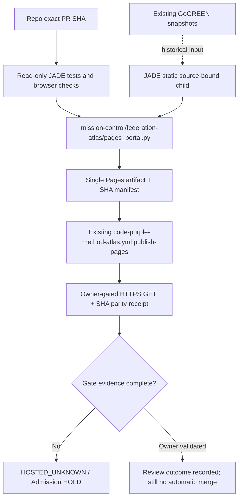

# JADE_CASTE root entrypoint, shared HTML system, navigation and publication proposal

**Status:** draft, soft-adoption; no repository refactor or new hard gate. Architecture anchored in existing Mission Control Pages publisher. Read-only presentation, not a root SSOT.

## Minimum root navigation (preserve existing imports/URLs)

A project root may retain `README.md`, `ReadMe.md`, `index.md`, `GLOB.yaml`, or established manifest names. Never rename automatically. A short root `START_HERE.md` (or an additive README section) must disclose the canonical owner and link:

- **Start / Purpose:** repo role, license/access and main runbook; exact README path and canonical entrypoint.
- **Source and SPINE:** entrypoint modules; semantic SSOT and typed source→derivation→outward views; external ownership arrows marked `reference-only`.
- **Develop / Build / Test:** language and package manifest (`pyproject.toml`, `package.json`, Cargo/go.mod, etc.); exact reproducible commands, OS/runtime matrix, current native workflow checks and test/coverage report.
- **Current status / BD:** current owner issue root, priority next release TODO, open PRs, first-red and GoGREEN positive replay identities.
- **Pages / release:** source-bound published HTTP URL (or `HOSTED_UNKNOWN`/owner-approved `NOT_APPLICABLE`), binary assets/tags and their required SHA/readback.
- **Governance / handover:** applicable MACH IIb/III/IV *proposal*, real effective rules/status checks, latest `DROPIN_NEXT_CHAT.md` and dated restart manifest.

Recommended nav (6–7 items, consistent order): **Overview | Architecture/SPINE | Build & test | Evidence/GoGREEN | Issues/BD | Release & Pages | Handover**. Keep visible focus, semantic landmarks, skip links, per-page breadcrumbs, and an immutable revision marker. Make broken links a publication blocker. Deeper domain pages remain local repo owners' responsibility.

## JADE root markdown pages (W1, 2026-10-31)

The root pages of `mission-control/jade_temple/` (README, `00`–`09`, `CHANGELOG.md`) share one layout. `tools/root_docs.py --check` enforces it in the JADE test suite, and `--write` applies it without touching the body.

- **Line 1 is the H1.** Nothing sits above it. A wave's dated banner goes into `CHANGELOG.md`, newest first, and the README keeps a short *Recent changes* list.
- **Line 3 is the masthead:** `Doc` id, `Status` (ACTIVE, PROPOSAL, REFERENCE or HISTORICAL), `Release`, `Admission` and `Updated` (ISO date). `Release` and `Admission` have one value for all pages, set in `root_docs.py`.
- **The last line is the nav footer:** previous page, index (`00_START_HERE.md`) and next page, in reading order.
- **Every relative link resolves.** A broken link fails the check.
- `DROPIN_NEXT_CHAT.md` is deferred: it is an append-only handover log.

## Portable layout and design tokens

Use the source-owned `site/jade.css` and `site/green_template.html` as a **reference**, not mandatory styling for every repo. User-facing page families: `Overview`, `Repo launch cards`, `Typed SPINE`, `GoGREEN vs EVERRED`, `Governance`, `Pages deploy`, `Recursive restart`.

Use CSS custom properties for background/surface, primary text, muted text, jade-green positive evidence, amber pending, red failed/admission HOLD, neutral gray UNKNOWN. Color never serves as the sole indicator; include text and accessible labels. Layout: responsive grid, fluid type, 44px interactive targets, table overflow in inner scroll region, no document-level overflow. Desktop **1440×1000**, laptop **1280×800**, mobile **390×844**. Satisfy keyboard and `prefers-reduced-motion`; test actual link destinations and static image resolution. Prefer no third-party script/CDN; offline local assets should load from the same served root.

## Pages topology: one authority, many projections

New JADE files reside in `mission-control/jade_temple/`. The built files `site/{index.html,green.html,jade.css,jade.js,jade_data.js,snapshot.json,site-manifest.json,top21_bd_queue.csv}` are exact-byte source-validated by `portal_bridge.py` and are staged **only** at `/jade/`. No separate `deploy-pages` workflow or Pages permissions are introduced by JADE. The existing publisher retains exact-source checkout, Pages artifact, environment restrictions and independent hash readback.

**Manifest contract:** `site/site-manifest.json` contains source JSON SHA256 digests and public asset SHA256. `portal_bridge.stage_jade` rejects modified JSON, unexpected assets, missing static files, incorrect 21/13 populations, or authority-promotion attempts before staging files. `publisher-receipt.json` binds *presentation-head*, not external source repo heads, and explicitly leaves `hosted_http_verified=false`.

**Security:** static CSP blocks external connect and active objects, JS stays origin-local, links use `noopener noreferrer`, imported JSON never gains authority. Public hosting is prohibited for restricted QPS/engineering files or partner confidential input without owner classification and release approval. Secrets and full CI logs are never embedded in a static site.

## Proof ladder for deployment

1. `DoD`: source, tests, hashes and local browser behavior build reproducibly, same bytes on successive generators.
2. `DoV`: exact-PR-head native source/negative/browser runs terminal, job/attempt/artifact and SHA match; no parallel manual edit of generated HTML.
3. `Pages Proof`: after permitted main merge, existing publisher completes and a separately authenticated HTTP GET of `/jade/green.html`, `/jade/site-manifest.json`, `/jade/jade.css`, `/jade/jade.js` and `/jade/jade_data.js` returns expected hashes from matching main SHA. A dynamic Pages workflow marked success is insufficient.
4. `Governance`: independent eligible reviewer, real required checks, stale dismiss, last push, threads and blocked-RED canary; QPS/ABACUS/CODEX authority boundaries unchanged.
5. `Point release`: owner-approved SemVer/tag/notes, all necessary binary manifests and runtime rollout acceptance. No automatic promotion from an HTML dashboard.

**Current local browser limitation:** Chromium `set_content` assembled the exact HTML/CSS/JS assets inline because local HTTP navigation was admin-blocked, and adjusted CSP for inline QA. This validates interaction/rendering but does **not** validate actual served HTTP, production CSP asset fetching or Pages itself. Those remain `UNKNOWN` until native/hosted proof.
