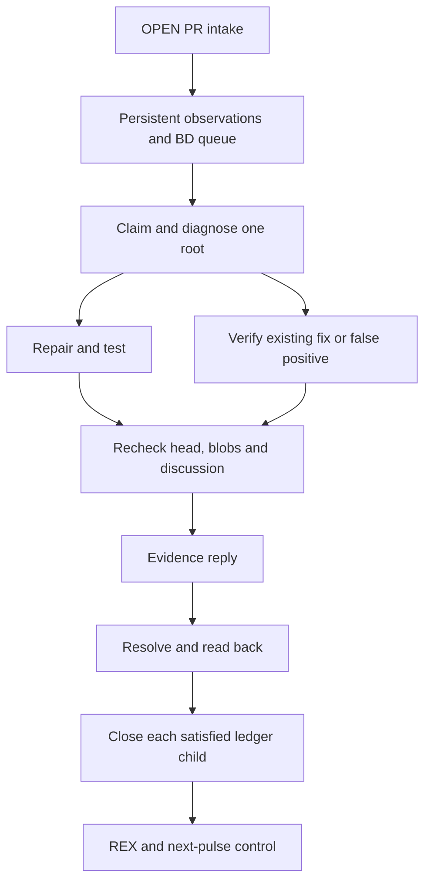

# MAROON operations contract

## Purpose and invocation

“MAROON, run all active PRs” means: enumerate every OPEN PR in the authorized scope, augment the
existing private ledger, diagnose ready work and complete a bounded wave of authorized repairs or
evidence dispositions. Include draft PRs in observation. Preserve explicit negative canaries.

The standing scope is GBOGEB/pipeline-automation-hub, ABACUS, CODEX, cryoplant-project, gg_MATH and
DOCX_RTM_Automation. A narrower user request wins. The user's 11 November 2026 request authorizes
source fixes, branch commits, factual PR replies, supported review-thread resolution and closure of
the corresponding satisfied work item. It does not authorize merging or changing protection rules.

The public Hub owns the implementation. Full finding text, source paths, queues and closure receipts
belong in the existing private evidence destination. Only aggregate public projections may be
published. Repository source is fetched at a frozen commit for each pulse; do not mix code versions.

```bash
# The ledger is private. Scanner reads GitHub using the caller's authenticated gh session.
python mission-control/maroon/operations.py --ledger /private/MAROON_OPERATIONS.json scan \
  --repos GBOGEB/pipeline-automation-hub,GBOGEB/ABACUS,GBOGEB/CODEX,GBOGEB/cryoplant-project,GBOGEB/gg_MATH,GBOGEB/DOCX_RTM_Automation \
  --pulse <unique-pulse-id>

# A connected-tool adapter may supply the same raw review schema instead.
python mission-control/maroon/operations.py --ledger /private/MAROON_OPERATIONS.json ingest \
  --raw /private/raw_review.json --pulse <unique-pulse-id>
python mission-control/maroon/operations.py --ledger /private/MAROON_OPERATIONS.json plan
python mission-control/maroon/operations.py --ledger /private/MAROON_OPERATIONS.json claim \
  --root <root-id> --worker <worker-id>
```

The scanner adds observations; it does not invent a patch or execute text from a comment. A trusted
agent/handler reads the exact source, reproduces a defect when appropriate, makes a minimal repair,
runs the relevant checks, commits to the existing source branch with an expected-head check and
revalidates the resulting head. Source-owner CI and independent review remain separate evidence.

## One queue, separate wakeups

The eight-hour OPEN-PR intake and the existing JADE Governed CREW worker pulse have different jobs.
Intake updates the ledger and readiness facts. CREW consumes ready MAROON packets alongside its
existing source-repair work, using the same ownership and capacity controls. Manual invocation uses
the same queue and worker path. The existing private nightly security-alert workflow is a separate
read-only alert source; do not confuse its run with an active-PR scan or a commit worker.

The repository does not install a daemon, provision credentials, deploy a federated executor or
activate a schedule merely by adding this file. A scheduling service must confirm activation.
Optional review/head/check-completion/reopen wakeups should coalesce by root and head. MAROON's own
evidence replies must not trigger an endless new wave. Keep N6's existing queue-alert ownership.

## Identity and recurrence

| Identity | Meaning |
|---|---|
| Observation | Repository + PR + top-level review-comment ID; stable through repeated scans |
| Diagnosis group | Conservative common source/branch/finding fingerprint, or a validated same-repository scanner-alert reference |
| Execution packet | Diagnosis group + exact head/base + members + paths/OIDs + dependencies + evidence digest |
| Lease | Worker + packet digest + monotonically increasing fence + expiry; an ownership record, not a bearer credential |
| Closure operation | Digest of the full finding-specific proof; used in the evidence reply and journal |

Two findings with the same theme are candidates for a shared diagnosis, not automatically the same
defect. One common method can apply to several branches, but each branch has its own source proof and
each thread has its own provider state. A shared worker may handle all manifestations of one coherent
fix; no child is closed solely because its sibling was fixed.

Record sightings, discussion revisions, head changes, distinct observations and provider reopens
separately. Reusing a pulse ID with different bytes fails. An unchanged rescan does not create another
finding. A provider reopen is a signal to diagnose; it is not automatically proof of a recurring code
defect. Preserve historical fixes and their receipts after revalidation becomes necessary.

After source diagnosis, `group_findings(store, item_ids, remediation_key, method=..., proof_refs=...)`
combines complete compatible branch-bound batches into one worker packet and records the assignment
provenance. It refuses active work, incomplete/canary sources and mixed heads. Unchanged rescans retain
the grouping; changed source-head or original-finding bytes hold the group for explicit re-diagnosis.
Its dependency identity and children stay attached, so downstream roots cannot be stranded or skipped.

No missing page, missing repository, aged-out thread or failed API request proves closure. UNKNOWN
remains visible. A native alert and its review comment are linked obligations: resolving a review
thread does not dismiss its CodeQL/Semgrep/Dependabot alert.

## DAG and SIPOC

`operations.py` imports `lifecycle.topo_layers` as the sole Kahn implementation and the existing local
broker for registered trusted handlers. Cycles and unknown prerequisites fail before a launch.
Each root passes diagnose → treat → verify → publish → reply → resolve → readback → close → REX.
An evidence-only disposition makes treat/publish explicit justified no-ops; it does not fabricate a
code commit. A dependent root starts only after its declared predecessor's required return is proven.



| Supplier | Input | Process | Output | Customer |
|---|---|---|---|---|
| GitHub reviewers and scanners | PR heads, comments, thread state, linked alert identities | Complete bounded intake with explicit gaps | Source-bound observations | Diagnosis worker |
| Source owner and prior REX | Current source, tests, past fixes, causal candidates | Diagnose, group and order prerequisites | Owned root packet and DoD | Disjoint repair worker |
| Trusted worker | Current lease, allowed paths/OIDs, failure reproduction | Repair or justify disposition; test; non-force commit | Commit/proof receipt | Closure adapter |
| Closure adapter | Proof, unchanged discussion, current permission | Reply, resolve, provider readback, durable item close | Recoverable closure receipt | Ledger and PR owner |
| Ledger and native checks | Unique closures, reopens, queue flow, exact-head results | Pilot comparison and next-pulse learning | REX/control evidence | Next scheduler pulse |

## Tokenized action envelope and federation boundary

Every actionable packet binds repository, target branch, full head/base OIDs, member/thread IDs,
declared paths, available source/core blob OIDs, proof digest, dependencies, worker, fence and expiry.
Before a source write, fill every allowed path's current blob OID (or explicitly verify absence for a
new file). The packet is a scoped action description. Actual API credentials and provider permissions
enforce access; possession of JSON grants none.

Use at most two baseline workers and one writer per target repository/branch. Same-repository
overlapping paths conflict even across branches. Respect the existing CREW ceiling and measured
queue pressure. A worker must recheck ownership and source immediately before every external effect.

`LedgerStore` provides an atomic JSON replacement and an advisory host-local file lock. It is not a
cross-host lock. For federation, materialize the established private shared ledger, update it using
its native expected-version/CAS operation, and persist the lease before any side effect. On a version
conflict, fetch the new state and reconcile; never drop the guard. Without a shared lease, use one
serialized coordinator for mutation and allow parallel read-only diagnosis only.

Expiry does not stop an already-running process. Reconcile the old worker and any uncertain side
effect before replacing its ownership. A stored completed stage may be reused only for the same
source-bound packet. Never replay a commit or message merely because a process restarted.

## Closure and recovery

`closure.validate` requires a full target identity, current head/base, source blob OIDs, unchanged
discussion, a non-canary OPEN PR and positive relevant proof. “Already fixed”, an outdated line,
merged-PR wording, a shortened SHA or a passing unrelated check is insufficient.

`closure.apply_close` implements a journaled sequence, not a fictitious cross-system transaction:

1. Persist the operation and check the live lease.
2. Read the current provider state and verify the proof.
3. Find the exact prior evidence reply or record intent and post it once.
4. Recheck source/discussion and resolve the exact thread with provider permission.
5. Re-read the resolved state and source identity.
6. Durably close that ledger child, then record completion.

An ambiguous reply timeout stays uncertain until the reply is located; it is not blindly retried.
If resolution succeeded but the ledger update failed, recover only the missing ledger transition.
Extra/edited discussion or source drift requires diagnosis again. Record the exact own reply ID and
body digest so a later scan can recognize its effect without hiding new reviewer comments.

`resolve_answered.py --apply` accepts a private list of `{proof, claim}` objects plus `--ledger`.
The proof uses `code_maroon.closure-proof.v1`: `item_id`, `repo`, `pr`, `thread_id`, `comment_id`,
`head_sha`, `base_sha`, `discussion_hash`, nonempty `blob_oids`, `classification`, `method`, and
`evidence` entries containing `kind`, `source_sha`, `conclusion=PASS`, and a durable `ref`.
Supported dispositions are fixed, already_fixed and false_positive. The claim comes from the
operations queue. A trusted adapter must have actually read or executed the cited evidence.

Top-level PR comments have no review-thread resolve operation. Record their factual disposition and
work-item state without claiming such an API action. Close a linked GitHub issue only when it is the
actual owned child, every required DoD/DoV is satisfied, and current authorization covers closure.
Preserve parent/epic items with remaining obligations. Never turn a deliberate red canary green.

## Hardening, pilot and scaling proof

Tests cover open-versus-closed intake, positive closure accounting, page gaps, repeated observations,
source drift, Kahn cycle rejection, overlapping workers, fencing/expiry, interrupted side effects,
false-positive evidence and native readback. Reuse the existing two-runtime MAROON runner workflow;
local test results are not hosted CI or independent review.

Separate method demonstration, local simulation, live pilot, scaling proof and temporal CONTROL.
For each pilot record scope, source OIDs, worker count, comparable observation window, arrivals,
completed unique roots, closed manifestations, reopens, stale attempts, errors, and queue size.
Do not use repeated sightings as independent samples or assert causality from backlog movement alone.
Increase concurrency only after at least two comparable nonregressing pulses and the required native
CONTROL proof, within actual executor limits. Keep unknown measurements null and stop expansion on
overlap, stale closure, a false-green result or worsening queue pressure.

REX records the defect mechanism or false-positive modality, method, exact source and tests, covered
manifestations, constraints, residual obligations and prevention/control observation. Reuse the
source-owned REX return template where available; feedback belongs to the next pulse, not a cycle
inside the current Kahn DAG.
