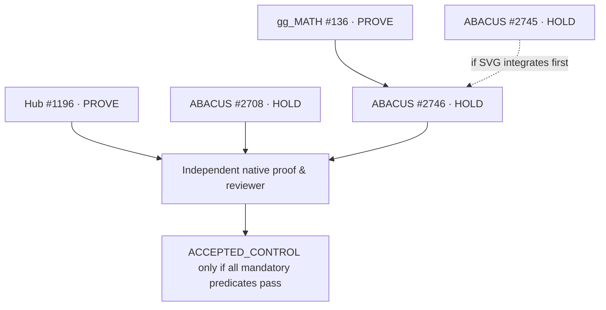

# MIP Perpetual Closure — governed census and disjoint commit pilot

**Status:** `DRAFT_NOT_ADMISSION` — this is an additive evidence/dispatch helper, **not a new authoritative ledger**, merged workflow or CI controller. Initial source base `54e6b01ac7ada5bfad15562b4f99f7381a4fd73f` on `pipeline-automation-hub/master`.

## Entrypoints, source and SSOT

| Object | Existing owner / source | This pilot |
|---|---|---|
| Frozen root SSOT | 28 Oct Mission Control immutable 17-root ledger; six exclusive groups, 16 historical edges | Preserves ID counts in `manifest.json`; **does not reproduce missing historical edge topology** |
| Root/REX knowledge | Hub `mission-control/maroon/`, PR #1247 (`rex.py`, dictionary, pre-push advisory) | Does not copy or replace MAROON's 21-rule corpus or scores |
| Admission rules | Hub #336 / #304 / #951; ABACUS effective protection owner | Does **not** approve PRs or alter rulesets |
| Source owner / repair | Hub #1196; ABACUS #2746, #2745, #2708; gg_MATH #136 | Five exact-head references and eight distinct live root candidates |
| Workflow metrics | Hub source-owned Actions metrics; existing hourly N6 Queue Drain Watch | Consumes future **snapshotted** receipts; does not poll or notify |
| Worker dispatcher | JADE Governed CREW Pulse / owner worktrees | Nine *dispatch specifications*, zero worker activations |
| Current pilot record | `manifest.json` | Review snapshot, **not canonical SSOT** |
| Local output | `report.json` (optional, generated) | Derived; no automatic upload, push or merge |

The GitHub connector cannot create a local Windows worktree. Branch `mip/closure-census-kahn-pilot-20261113` is a **remote Git branch**, not a workstation worktree. For owner-controlled local execution after independent admission, use:

```powershell
git fetch origin mip/closure-census-kahn-pilot-20261113
git worktree add C:\DEV\worktrees\mip-closure-pilot origin/mip/closure-census-kahn-pilot-20261113
Set-Location C:\DEV\worktrees\mip-closure-pilot
python -m unittest discover -s mission-control/mip/closure_pilot -p 'test_*.py' -v
python mission-control/mip/closure_pilot/closure_census.py --self-test
python mission-control/mip/closure_pilot/closure_census.py --out .\mip-closure-report.json
```

**No Docker requirement** for this offline core: Python standard library only. Docker/Playwright/PowerPoint COM belong to the source owners' domain-specific integration and cannot be claimed as satisfied by this script. **LDAB** runner/diagnostic proofs are **UNKNOWN** and must be bound by the existing owner diagnostics, not invented. The notebook, terminal logs, full GitHub Actions receipts and captured XML coverage reports are **not bundled** here.

## Dependency/Kahn layer schedule

The source-proved required edge is `gg_MATH #136 -> ABACUS #2746`. A **conditional** edge `ABACUS #2745 -> #2746` activates only if SVG merges before binary engines. An edge is not equivalent to permission to merge.



Kahn's first eligible parallel layer: `A2708, A2745, H1196, M136`; next `A2746`. **Eligible** means dependency topology permits owner work, not that GitHub runners are authorized. Hub's historical queue threshold `queued>=60 OR running>=20` prohibits new fanout; present queue is not verified by this offline tool.

### Color contract (not source-backed GitHub labels yet)

| State | Hex | Required meaning |
|---|---|---|
| HOLD | `#9C6A13` | Owner decision or mandatory proof absent; **DO NOT MERGE** |
| PROVE | `#7B4DA4` | Native/current-head qualification being established |
| HEAD_STALE | `#786A89` | Prior PASS not valid for the new required source/contract |
| MERGED_NOT_ADMITTED | `#B04957` | Merge recorded but independent closure proof missing/RED |
| ACCEPTED_CONTROL | `#26745C` | Source+exact-head native tests+negative control+approval+owner+recurrence all accepted |

A PR badge is **advisory metadata**. Changing/clearing an owner label or checklist does not waive required checks. Owner sign-off should be an attributable, dated PR comment containing exact SHA, policy version, check IDs and results, offline/unknown evidence, independent reviewer and unresolved exception dispositions. A *break-glass* action is a separately logged policy-authorized exception with scope/expiry; it is **never** `ACCEPTED_CONTROL` by itself.

## Census semantics and negative controls

Run `closure_census.py` against the checked-in manifest. It validates frozen root count/groups/edge-count invariants, unique IDs and path ownership; Kahn-sorts the active dependency DAG and fails closed on cycles. It reports `UNKNOWN` for absent workflow/test/coverage observations. Advisory priority intervals preserve missing factors; no composite admission score is calculated.

**Denominators must never be mixed:** Workflow run is not a job, matrix cell, test, PR check, PR or distinct root. `EVERGREEN` means one historical matching test-ID PASS survives in historical evidence; `CURRENT_HEAD_PASSED` requires exact HEAD and contract match. `NEVERGREEN` is a new *test-level* class: across a fully enumerated, comparable history on stable test ID/version/runner, all actual executions must terminate FAIL or ERROR and at least one has run. **All SKIP** is not NEVERGREEN. Coverage 0% is a *production module* with measured executed lines over a matched source/coverage configuration, not a failed workflow. Missing JUnit and branch/coverage receipts yield UNKNOWN.

Tests contain twelve contracts: cycle rejection, conditional edge, frozen denominator preservation, accepted-without-proof rejection, worker-path overlap rejection, missing inventories remain null, true nevergreen versus EVERGREEN/SKIPPED, and unknown score intervals. Until executed with an authenticated receipt, the *asserted test count is not a pass count*.

### Stats and known evidence

| Item | Count | Evidence quality |
|---|---:|---|
| Frozen seed roots / exclusive groups / historical edge count | 17 / 6 / 16 | Historical user-provided cohort, topology not retrieved |
| Source-owner PRs | 5 | GitHub metadata readback |
| New live semantic candidates | 8 | Native run/review refs in manifest; 2 Hub review-only |
| Disjoint work specifications | 9 | Static path ownership, no executed workers |
| Open reviewer threads, five owner PRs | 38 of 51 | GitHub review-thread readback; all review submissions COMMENTED |
| Native code files implemented in this pilot | 2 Python files | Offline census + tests; no external dependencies |
| New unit tests authored | 12 | **PENDING EXECUTION**; PASS/FAIL unknown |
| Tests executed, pass/fail, code coverage % in new pilot | UNKNOWN | No authenticated execution receipt yet |
| ZERO-covered production modules | UNKNOWN | No matched module-coverage inventory supplied |
| NEVERGREEN native tests | UNKNOWN | No complete per-test longitudinal inventory supplied |
| Historical 21–27 Oct workflow runs | 38,618 | Frozen baseline (not rerun) |

Do not claim 100% coverage, 0 failed tests, or any EVERRED/NEVERGREEN count without the correct evidence population.

### Next scale pilot

1. Validate the **offline 5-owner, 8-root DAG** with every negative test and a reproducible command receipt.
2. In owner worktrees, run four separate test-only or disjoint-source work groups. Never concurrently edit the same path; shared sources have one integrator.
3. Select **two comparable native pulses**, with authenticated worker/verifier attempts, no path/root collisions, exact-head status, independent reviewer and queue-p95 non-regression.
4. Only then propose a bounded `2 -> 4` worker trial as a candidate for **separate authorization**. The offline DAG is an architectural pilot, **not a throughput scale proof**.

## N+1 / N+2 forecasts, immutable when issued

**N+1:** Source-owner repairs may eliminate some of the eight first-red fingerprints. No closure until exact-head native tests and independent evidence.

**N+2:** gg_MATH #136 merge qualification unlocks binary engine pin rebind; owner validation and merged-source test receipts are still mandatory. A 2-to-4 worker scale decision remains HOLD without comparable p95 and queue observations.

**DMAIC trigger:** New semantic first-red, previously accepted root recurrence, unqualified source HEAD change, unmet owner barrier, or a repeated finding on three distinct PRs routes to existing owner triage. No new automated watcher is created by this pilot; N6 retains threshold notifications.

**Release state:** `DRAFT / LOCAL_WORKTREE_NOT_CREATED / TESTS_NOT_EXECUTED / REVIEW_NOT_APPROVED / NO_MERGE / NOT_ADMISSION`.
