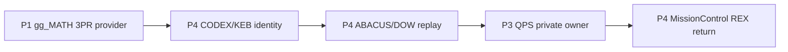

# QPS / gg_MATH MissionControl P4 routing contract

**Status:** PLAN_ONLY_NO_DISPATCH. This extends, but does not replace, the existing H4 repository-function topology. The stable QPS control-plane and volatile `QTG_CURRENT` are not mutated.

The bounded execution DAG is:

MissionControl routes and records the **first missing proof**. It does not run workers, grant GitHub Actions privileges, create CODEX acknowledgements or accept engineering data. Each stage remains blocked until independently acquired source identity, artifact digest, run/job/attempt, reviewer and child-authority evidence exists. The plan is deterministic and hash-bound; no clock-shaped pseudo-proof is emitted.

The live W259 knowledge-only math-method-card route and existing CODEX/ABACUS temporal PCA bindings remain unchanged. H4 W2 and W3 mission gates are not modified, and no new active crew is claimed.

## Next execution after legitimate promotion
1. Pin the exact provider SHA and public synthetic proposal artifact from gg_MATH #52 after terminal native run.
2. Request a separate CODEX/KEB challenge with authenticated run and source SHA.
3. Request ABACUS/DOW independent replay and LDAB fingerprint census on matching SHA.
4. QPS #1919 consumes those receipts under its private SSOT and retains source threshold authority.
5. MissionControl records the return state and reruns the next bounded DAG only after owner control.

Metrics: `planned_stages=5`, `authenticated_stage_receipts=0`, `workers_executed=0`, `qps_dispositions=0` are **initial explicit unknown/not-executed evidence** and must not be called verified worker counts. DoD means planner code/tests pass. DoV requires authenticated cross-repo hop execution and QPS owner disposition.
