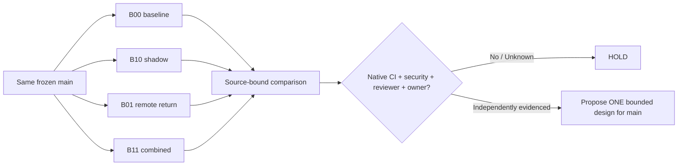

# MCEX-W1 — Four sibling-branch mutation/admission laboratory

**Method name:** `MC.EXPERIMENT.FACTORIAL(W1,4ARMS,2x2)`. **State:** `SOURCE_COMMITTED / NATIVE_QUEUED / CONTROL_HOLD`. This is a decision experiment, not production mutation enablement.

## Frozen source / lineage
All four candidate branches start from `GBOGEB/pipeline-automation-hub master@0b6a6f1a062ecdcba4e532aa101735b54ab09911`. Real GitHub source commits were performed only on their newly created branches, through the owner's connected GitHub service. This exercise does **not** demonstrate that CODEX's gateway dispatched, mutated, committed, merged, or authenticated an owner request. CODEX main `493145eea784d39f57ea64a730af9f3e85586714` is the observed upstream source pin.

- Arm B00: [PR #674](https://github.com/GBOGEB/pipeline-automation-hub/pull/674) — baseline stage-only
- Arm B10: [PR #675](https://github.com/GBOGEB/pipeline-automation-hub/pull/675) — simulated local in-memory CODEX shadow apply
- Arm B01: [PR #676](https://github.com/GBOGEB/pipeline-automation-hub/pull/676) — remote READ_ONLY_RETURN request proposal
- Arm B11: [PR #677](https://github.com/GBOGEB/pipeline-automation-hub/pull/677) — combined in-memory + remote proposal

Shared identical GitHub blob SHA for each `probe.mjs`: `4a56e81fedb73cc3027a0bcc9a41312cc2804291`; each `test.mjs`: `8c4d189d1ac24a8869ca543f83c5f88720f847c8`. Different branch paths, 1 commit each, no cross-arm ancestry. Intended native Node22 cohort: **2 positive fixtures and 20 negative guard fixtures per arm**. A fixture `SIM_PASS` must never be promoted as live CI or human sign-off.

## Guarded factors and limits



A branch/PR is **not a security sandbox** by itself. GitHub Actions run with repository permissions; a permissive token or secrets can escape a branch. Therefore the lab workflows use only `permissions: contents: read`, `persist-credentials: false`, no secrets, no `workflow_dispatch` or GitHub write API, and execute solely an in-memory simulator. Real CODEX remains `mutation_enabled=false`, `enabled_mutation_transports=[]` and `APPLY_BOUNDED_CODEX=false`.

## Forecast versus observation (17 October readback)

| Arm | Planned action offers | Forecast negative rejections | Observed native terminal | Measured test/negative result |
|---|---:|---:|---|---|
| B00 | 2 | 20 | QUEUED [run 39061935570](https://github.com/GBOGEB/pipeline-automation-hub/actions/runs/39061935570) | UNKNOWN |
| B10 | 4 | 20 | QUEUED [run 39061939734](https://github.com/GBOGEB/pipeline-automation-hub/actions/runs/39061939734) | UNKNOWN |
| B01 | 4 | 20 | QUEUED [run 39061942686](https://github.com/GBOGEB/pipeline-automation-hub/actions/runs/39061942686) | UNKNOWN |
| B11 | 6 | 20 | QUEUED [run 39061946675](https://github.com/GBOGEB/pipeline-automation-hub/actions/runs/39061946675) | UNKNOWN |

Factorial action-offer design forecast: local shadow main effect +2 over 2 nominal fixtures, remote read-only return main effect +2, interaction **0**. **These are not observed outcomes, speed gains, reliable coverage, CI acceptance, or value-creation measurements**. Keep all observed metrics null until authenticated GitHub run/job/attempt/artifact receipts exist.

## Next three pulses / DMAIC + MIP

- **P1 — DEFINE/MEASURE:** exact-source baseline, all four sibling branches and expected failure cohort recorded. Completed as source.
- **P2 — ANALYZE/IMPROVE:** obtain terminal native results for run IDs 39061935570 / 39061939734 / 39061942686 / 39061946675, validate job/attempt/checkouts and artifact digest. Fix shared probe root once if a native first-red recurs, not separately in each sibling PR without source ancestry trace.
- **P3 — CONTROL:** compare four matched failure populations, false-green count, emitted plan capability and actual run/queue/resource metrics if observed; choose a **minimal** design that preserves guards. Perpetuate/merge requires independent human approval, security and required exact-head gates, then exact-main readback.

**MIP:** Modernize common denial taxonomy; Innovate an isolated shadow/remote-return scenario; Perpetuate only following terminal native and owner control. Do not claim Six Sigma, true branch coverage across repos, durable cross-run replay protection, or QPS engineering authorization based on deterministic local fixture counts.

## Handover

```text
MC.EXPERIMENT.RESUME(mission="MCEX-W1",mode="VERIFY_COMPARE_CONTROL",base="0b6a6f1a062ecdcba4e532aa101735b54ab09911")
Refresh the four sibling PRs #674 #675 #676 #677 and exact-head runs 39061935570, 39061939734, 39061942686, 39061946675. Read mission-control/side-missions/MCEX_W1/comparison/MCEX_W1_COMPARISON_v1.json from this review PR. Replace forecast-only entries with authenticated run/job/attempt/artifact observations; preserve original baseline/source blob hashes. Compare matched 22-scenario populations, root-first-red propagation and noncompensating review/security/owner gates. No main merge or CODEX mutation promotion without explicit gate receipts; report bounded next 3-pulse recommendation.
```

## Native runner fan-out observation (new W1 finding)

At the four individual PR-head readbacks, **at least five queued workflow runs per arm** were visible: the focused MCEX workflow and four pre-existing hub workflows (Zero-Test Gate Guard, First-Pass Closure Proof, QPS TRIAGE ULTRA Federation Control, W3-16 M03 W0 Recon). Across four arms this is **at least 20 queued workflows** for four focused simulation submissions; it is NOT 20 simultaneously executing workers and the first-page readback may omit additional workflows. **Queue latency p95 and execution time are UNKNOWN.** These pre-existing checks may serve independent controls; do not disable them to speed the lab. Future experiments should first consider one owner-qualified matrix wave or a non-production isolated test repository to reduce queue amplification, while preserving mandatory branch checks and human review.

Any comparison of wall-clock timings across sibling PRs is confounded by runner availability and global queue load. Compare deterministic source-bound guard classifications first; only report throughput benefits on matched timed native populations.
