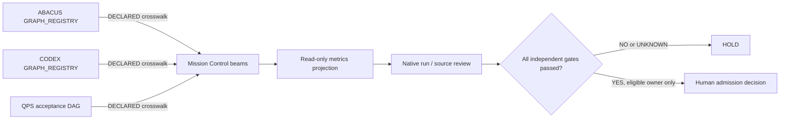

# G3A N+13–N+15 — MASTER_DAGS compatibility bridge (review first)

**Owner:** `GBOGEB/pipeline-automation-hub` Mission Control / federation-atlas. This is an additive, read-only **projection**. It does not replace or rename existing graph registries, source claims, global taxonomy, BD ledger, dashboard publisher, native workflow gates or admission rules. On the audited default branches there is **no verified literal `MASTER_DAGS` file/directory**; `canonical_master_dags_path: null` is intentional.

## Exact source paths (link to existing owners)

- ABACUS runtime / DMAIC / agents: [`triage/GRAPH_REGISTRY.yaml`](https://github.com/GBOGEB/ABACUS/blob/54da377cf82a358ac97903ecde0270c975b8fcc1/triage/GRAPH_REGISTRY.yaml), owner `GBOGEB/ABACUS`.
- CODEX semantic / federation / agents: [`triage/GRAPH_REGISTRY.yaml`](https://github.com/GBOGEB/CODEX/blob/3a9fceda87087bc1f501f359fe2754e24c119575/triage/GRAPH_REGISTRY.yaml), owner `GBOGEB/CODEX`; native continuity [`mission_control/mycelium/continuity`](https://github.com/GBOGEB/CODEX/tree/3a9fceda87087bc1f501f359fe2754e24c119575/mission_control/mycelium/continuity) has its own bounded replay/authorization.
- Mission Control beams: [`CODE_PURPLE_BEAMS_DAG_v1.json`](https://github.com/GBOGEB/pipeline-automation-hub/blob/766fa6ad7b10d7545c0e48c22bb787718f7bb700/mission-control/federation-atlas/CODE_PURPLE_BEAMS_DAG_v1.json); live display owner is [hub #622](https://github.com/GBOGEB/pipeline-automation-hub/pull/622).
- QPS child acceptance: [`federation/acceptance_dashboard/dag.json`](https://github.com/GBOGEB/cryoplant-project/blob/999148f5dd4cfe4c73fa5164e132e4994bcefead/federation/acceptance_dashboard/dag.json). This is a downstream acceptance consumer, not a code recovery admission gate.

The accompanying `G3A_N13_N15_MASTER_DAGS_COMPAT_20261017.json` lists **4 source references, 8 graph families, 3 proposed cross-repository edge mappings**. Each source declaration includes its exact commit and Git blob SHA, but the bridge does not independently fetch or authenticate bytes. All cross-repository links are `DECLARED`, not execution/dispatch/receipt evidence. The candidate execution projection has a topological order with no cycles. Feedback must be unrolled into a later pulse and is **not** inserted as a same-pulse causal edge.

## Replay / checks

```sh
python -m unittest discover -s mission-control/v2 -p 'test_n3_master_dags_bridge.py' -v
python mission-control/v2/n3_master_dags_bridge.py \
  --manifest mission-control/federation-atlas/G3A_N13_N15_MASTER_DAGS_COMPAT_20261017.json \
  --expected-hub-base 296c2dfa6c81849038b3d378d2e179dfdb4ca8a4 \
  --out /tmp/g3a-master-dags-projection.json
```

### Source / review boundaries

- Historical hub [PR #620](https://github.com/GBOGEB/pipeline-automation-hub/pull/620) (N+7..9), [PR #621](https://github.com/GBOGEB/pipeline-automation-hub/pull/621) (N+10..12) are source-history ancestors of this **candidate** N+13..N+15 branch; queued/native results are not inferred to have passed.
- `G3A` is **three gated accepted advances only when separately qualified**; these N+13..N+15 are *proposed source checkpoint labels*, not globally admitted increments. Three measurement pulses do not imply three accepted waves.
- [Hub #622](https://github.com/GBOGEB/pipeline-automation-hub/pull/622) owns the Metric Atlas; it should import a source-verified projection only **after** reviewed schema compatibility, not be replaced by this bridge.
- All native run/job/attempts, human review, security, A10, REX/Crew, branch rules and 14-package decisions stay independent. No main merge or authority transfer is permitted by the bridge.

## DAG and SIPOC



**SIPOC:** Source owners (ABACUS, CODEX, hub, QPS) → source-stamped registry/blobs, PR/runs/ledger → fail-closed graph normalization and declared links → typed graph, JSON projection, view-only dashboard → CODE PURPLE triage and eligible human reviewers. No action is authorized by appearance in the graph.
