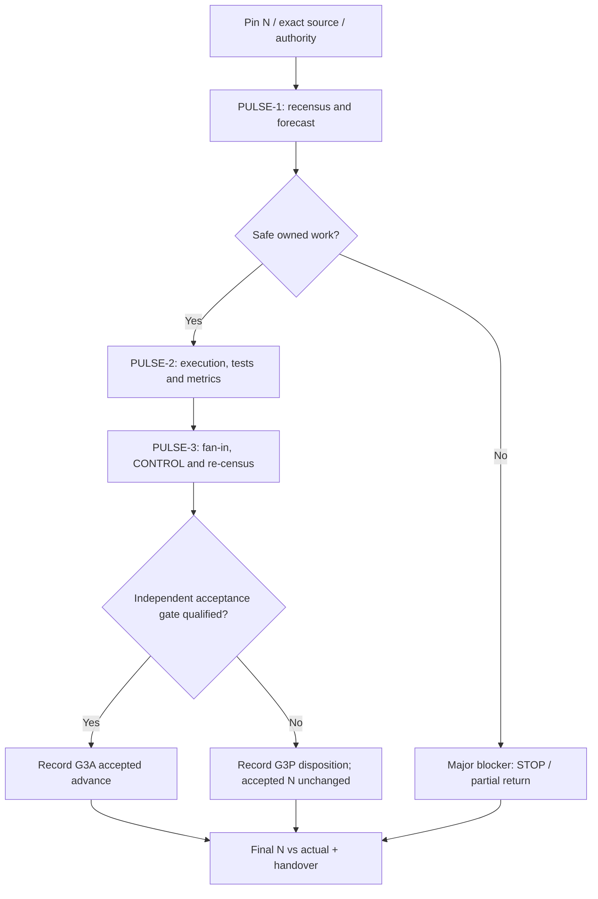

# CODE PURPLE — WAVE, PULSE, ADVANCE and N→N+3 crosswalk

**Scope:** additive MissionControl v2 consumer of the **already-merged CODEX global vocabulary** (`federation/mesh/GLOBAL_ACTION_TAXONOMY_v1.yaml`, `docs/reference/glossary.yaml`). MissionControl's `MC_GLOSSARY_TAXONOMY_v2.json` remains its local namespace authority. No new SSOT, runtime scheduler, permission, security exception or admission authority.

## Clear differences

| Request / token | Unit of accounting | Formal meaning | Credit rule |
| --- | --- | --- | --- |
| **Three waves / 3W** | 3 × delivery package | Distinct bounded engineering outcomes, each with owner, input and fan-in | Wave disposition; **not** three accepted advances |
| **Three measured pulses / 3MP** | 3 × measurement/feedback | Three successive source/evidence/decision receipts; a scoped HOLD may be a terminal pulse | Measured-pulse ordinal; **not** accepted-N credit |
| **MissionControl G3P** | 1 WAVE with exactly 3 PULSE slots | Bounded `N3_CONTINUE` envelope (N+1, N+2, N+3 pulse receipts) | 3 evidenced pulse dispositions or early blocked return |
| **G3A** | 3 × accepted checkpoint | CODEX Governed Three-Advance Mission, targets 3 distinct admissible verification outcomes | `accepted_n` advances **only** when each gate independently qualifies |
| **3PR** | Method phases | Refresh → Probe → Rank | No implicit wave, pulse or acceptance |
| **3PC** | Method phases | Prepare → Prove → Commit | No automatic GitHub merge |
| **3P*** | Historical/contextual | MissionControl `3PSTAR` local display alias **collides** with historical method-profile family selector | Forbidden as new unqualified cross-repo machine token; use `3MP` or qualified `G3P` |

The source lineage may record `pulse_n+3` while `accepted_n` is unchanged, e.g. 3 measured HOLDs. Never silently label that as engineering progress or 3 verified merges. Historical MIP N+5/N+10 counted pulses; no destructive reinterpretation.

## One invocation: default to bounded G3A target over G3P telemetry envelope

An `N3_CONTINUE` operator should treat **"advance from current N to N+3"** as a **target**, not as presumed attainment. It runs no more than three bounded, evidence-producing pulses unless a separate approved charter explicitly allows more. It returns `actual_accepted_n`, `pulse_frontier`, source heads, realized test/coverage numerators, first-red/root accountability and every blocked gate. One pulse may have a measured HOLD; only an independently admitted local gate can advance `accepted_n`.

| Pulse slot | Purpose | Method class | Actual work / evidence |
| --- | --- | --- | --- |
| PULSE-1 / MEASURE | Fresh N, incident and source census | 3PR + DMAIC Define/Measure/Analyze | Record exact branch/main/PR head, native run/job/attempt, baseline denominator, forecast-before-action and root candidates |
| PULSE-2 / IMPROVE | Bounded disjoint execution and actual code usage | 3PC + conditional MIP | Apply only authorized source-owned changes, run functional code and positive/negative tests; measure scope-matched coverage and output artifacts |
| PULSE-3 / CONTROL | Fan-in, convergence, QA and REX | DMAIC Control + 3PR | Check native exact head after fan-in; preserve P0/P1, A10, Safety, governance, review, recurrence; close with ledger and next legal action |

Stop early at a **major blocker**: material security/authority requirement, protected gate/waiver request, source/owner conflict, unreconciled SHA, unauthenticated mandatory proof, exhausted budget or unsafe execution. An isolated noncritical first-red can be investigated by the next safe pulse. Do not invent missing N+2/N+3 receipts when early stopped.

## Executable preflight — no second scheduler

**MissionControl** already has source-bound validators; reuse them instead of creating a competing orchestration implementation:

```bash
python mission-control/v2/validate_mission_control_v2.py
python mission-control/v2/g3p_execution.py --help
python mission-control/gogreen/n3_continuation/protocol.py --help
```

**CODEX** owns the independently governed semantic G3A contract: `docs/automation/G3A_EXECUTION_CONTRACT.md`; its `scripts/g3a_protocol.py` is read-only validation. ABACUS [#2119](https://github.com/GBOGEB/ABACUS/pull/2119) provides a local G3A execution candidate, not global delegated dispatch. MissionControl [#620](https://github.com/GBOGEB/pipeline-automation-hub/pull/620) and [#621](https://github.com/GBOGEB/pipeline-automation-hub/pull/621) contain still-unmerged historical G3P/assessment waves; their N labels and evidence cannot be promoted by this glossary bridge.

## Reusable single-kickoff instruction

```text
N3_CONTINUE — G3A target, G3P bounded observation envelope.
Mission: CODE PURPLE / <mission_id>
Repositories: <owner/repo set>; target owners and path leases: <paths>.
Freeze current N independently: <baseline accepted_n and pulse_n>,
exact main/PR SHA, policy/config SHA, UTC, test/coverage population.
Objective / DoV: <observable functional outputs, first-red root reduction,
measured statement/branch/changed-line coverage and admission checks>.
Resources: at most 4 read-only scouts; ≤2 disjoint source owners;
one serial exact-head testflight; ≤3 pulse slots this invocation.
Permissions: read, diagnose, test; bounded edits/draft PRs only in
source-owner scope. NO main merge, ruleset suspension, A10/security waiver,
independent reviewer self-approval or unauthenticated worker claims.
P1: recensus, freeze forecast, select highest-leverage admissible lane.
P2: implement/test or explicitly HOLD; prove measured source and output.
P3: integrate if admissible, re-census and control/REX with complete ledger.
No routine questions within this live session. If a major global blocker
occurs, STOP and return the achieved frontier. Do not promise background work.
Final return: N, pulse_n actual, accepted_n actual, planned vs observed,
commits and exact SHAs, named tests/coverage numerators/denominators,
root/manifestation ledger, functional artifacts, native run/job attempts,
hold/authority gates, rollback and next legal action.
```

## Minimal return matrix

| Field | Required semantics |
| --- | --- |
| `start_accepted_n`, `target_accepted_n`, `actual_accepted_n` | Never substitute pulse ordinal for accepted checkpoint |
| `pulse_1..3` | Each actual action or HOLD/NOT_RUN; actual observed evidence, exact SHA, timestamp |
| `forecast_vs_actual` | Freeze prediction first, record independent observation or UNKNOWN |
| `test_coverage` | Test counts, statements and branches, changed-line scope with explicit denominator |
| `root_ledger` | Symptom, first-red, candidate root, verified root; unique IDs and downstream consumers |
| `authority` | A10/Safety/governance/review/branch rule states explicitly separate |
| `completed` | Local verified versus GitHub native versus independent admission versus main recurrence, never conflated |

### SIPOC

| Supplier | Input | Process | Output | Customer |
| --- | --- | --- | --- | --- |
| Source owner, GitHub, canonical CODEX glossary | Pinned N, source/config SHA, work budget and permissions | Refresh/probe/rank, bounded prepare/prove/commit, CONTROL | Pulse ledger, optional G3A accepted advance and scoped tests | ABACUS, CODEX, QPS, MissionControl, reviewer |

### Dependency DAG



**Admission:** this crosswalk is documentation and machine-contract compatibility only. The proposed branch is subject to native tests, independent review, and owner-controlled merge. It does not upgrade any historical pulse to an accepted advancement.
