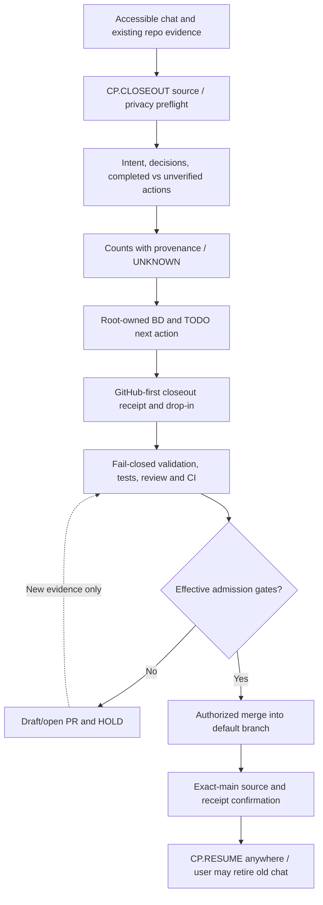

# CP.CLOSEOUT — Chat/session retirement and governed GitHub custody

**Status:** additive consumer of [CP_HANDOFF_RESUME_V1.json](CP_HANDOFF_RESUME_V1.json), [GITHUB_FIRST_PROFILE_V1.json](GITHUB_FIRST_PROFILE_V1.json), existing MissionControl glossary and method registry. This is a **chat instruction macro**, not an executable ChatGPT function, a transcript-export API, a GitHub merge permission or an automatic chat-deletion operation.

## Copyable operator commands

Full accessible-session closeout, default when user asks to finish a chat:

```text
CP.CLOSEOUT(scope="CURRENT_CHAT",mode="GITHUB_FIRST",depth="LOSSLESS_INTENT",metrics="FULL_AVAILABLE",target="GOVERNED_MAIN")
```

Short alias: `CP.CLOSEOUT!`. Continue elsewhere: `CP.RESUME(source="GITHUB_FIRST",mode="VERIFY_REFRESH_EXECUTE")`.

**Intent:** finish bounded admissible work; document who asked for what and why; preserve what ran and what failed; measure only accessible conversations and GitHub receipts; carry TODO, root-owned BD queue, source state, decisions, predictions and exceptions forward. Publish through the **existing** source-owning PR where sensible, not a duplicate federation SSOT.

## Required actions, in order

1. **Establish authority and input population.** Identify accessible chat messages, attached exports/archives actually available, and current GitHub repository, default ref, issue/PR ancestry and effective policy. Declare whether chat is `FULL_EXPORT_VERIFIED`, `VISIBLE_CONTEXT_PARTIAL`, `GITHUB_ONLY` or `UNKNOWN`. The assistant normally cannot inspect every historical or hidden message or tool event.
2. **Finish or dispose of available work.** Resolve safe, disjoint TODOs that fit existing owner permissions. Do not run unapproved merges or replace authoritative source. Mark prohibited, infeasible and unverified work explicitly. Use current GitHub as the authoritative source for source/CI facts.
3. **Write the golden-thread narrative.** Mission / original request → prompt/intent evolution → major decisions and rejected alternatives → implementations/commits and evidence → result and blockers → why each next action matters. Include important requests and changed goals, not an invented transcript.
4. **Produce source-scoped statistics.** Attempt counts of user prompts, assistant replies, tool calls, linked PRs, CI runs, tests and coverage. Each has distinct source, eligible population, interval, proof and numerator/denominator. `FULL_SESSION` counts stay **null/UNKNOWN** unless a complete, independently validated export is actually supplied. A visible-fragment count is not a full-chat count. Do not invent tokens, timestamps, runtime, exact message lengths, or complete prompt-category shares. A prompted assistant cannot retroactively measure thinking time.
5. **Classify intent and insights.** Record explicit user goals, intent categories, scope changes, unimplemented visions, practical learning, repeated roots, orphan branches, duplicate effort, evidence quality, time/queue/cost where measured, and measured versus suggested process improvements. Distinguish qualitative judgments from quantitative metrics.
6. **Converge TODO and BD.** Reuse the existing repository's issues/root ledger and add pointers; do not silently close open engineering defects. Each queue item has stable ID, owner, severity, failure root or unproven symptom, current state, next action, dependent gate, Definition of Verification (DoV). Separate independent roots from propagated CI manifestations.
7. **Write minimal GitHub closeout pointers.** Proposed per-chat path `mission-control/v2/handoff/chat-closeouts/<session-alias>/`: `CLOSEOUT.md` (narrative), `RECEIPT.json` (machine data), `DROPIN.md` (self-contained new-chat command). Use only a SHA-256 verified fallback archive if essential original non-GitHub bytes are available and authorized. Do not commit raw private transcripts or credentials into a public or uncontrolled repo.
8. **Validate and seek governed admission.** Open/update the source-owned PR, run schema/negative tests and required native CI, request eligible review and security disposition. Distinguish `EVIDENCE_CAPTURED`, `COMMITTED_TO_PR`, `NATIVE_VERIFIED`, `MERGED_TO_DEFAULT`, `EXACT_MAIN_VERIFIED`. Only the last means main custody is verified. Retain `MERGE_ADMISSION=HOLD` if independent conditions fail. Do not archive/delete any chat on behalf of the user.
9. **Return a compact receipt and drop-in.** Report GitHub PR/source SHA, attempted/completed/blocked work, accessible versus absent session data, timestamp boundaries if available, metrics scope, open issues, and one next owner action. If the user requested a complete transcript export, explain that the operational handover is not the same thing.

## Evidence-labeled metric dictionary

| Metric | Required denominator / provenance | Never infer |
|---|---|---|
| Total prompts / messages | Eligible **complete exported** message population + export digest + declared normalizer/version | From summary length or GitHub commit count |
| Excerpt prompt count | Precisely bounded available excerpt; label `CONTEXT_PARTIAL` | Complete-session denominator |
| Prompt taxonomy and frequency | Auditable per-message labels and explicit single- vs multi-label method | Category percentages from impression |
| Date/time, duration, velocity | Actual message or event timestamps, timezone, origin + eligible interval | Assistant compute/wall time from conversational ordering |
| Tokens | Tokenizer name/version and export bytes actually processed | Exact tokens from character estimates |
| GitHub PR/commit/run counts | Named repo, queried population/time, exact head, query pagination state | Whole-programme count from a shortlist |
| Tests/coverage | Native exact head + job/attempt + tested file/branch population + k/d | Unmatched scope improvement |
| BD burndown | Persistent root IDs; separately occurrences, tasks and confirmed closures | Summing repeated first-reds into unique causes |
| Efficiency | Native queue/start/complete timestamps, work budget/worker identity | Estimate without instrumentation |
| Chat custody | PR URL + SHA; then authorized merge+exact default SHA+CI receipt | PR committed = merged to main |

All incomplete denominators are `null` or `UNKNOWN`, not measured zero. Freeze forecasts before subsequent work; journal new observations append-only.

## Minimal non-sensitive per-chat receipt contract

Schema: `code_purple.chat_closeout_receipt.v1`. Required blocks `session`, `narrative`, `statistics`, `lineage`, `work`, `bd_queue`, `custody`, `controls`. The supporting validator `validate_chat_closeout.py` rejects false full-session totals, fake main publication, missing DoV, unsafe waiver, malformed SHA and duplicate BD identities. It **does not** authenticate GitHub API evidence by itself.

An eligible normalized transcript for local extraction (optional, not committed) has shape `{"schema":"code_purple.normalized_chat_export.v1","complete":true,"messages":[{"role":"user","content":"..."}]}`. Run the validator with `--export /path/to/normalized_export.json` to verify export-derived message counts and SHA-256; do not publish the raw export. Real ChatGPT native exports may require a separate normalization step—do not treat arbitrary JSON as complete.

### Cutoff / closure rules

- `CLOSEOUT_READY` means enough operational context is preserved to continue; it does **not** mean technical/engineering DoD.
- `EXACT_MAIN_VERIFIED` requires actual merge evidence, default SHA and exact-main validation separate from PR-head tests.
- If no raw complete export exists, `COMPLETE_VERBATIM_TRANSCRIPT=false` and global prompt count is `UNKNOWN`. A non-sensitive GitHub closeout can still be operationally sufficient.
- A chat is only retired by the user's own action after they confirm the next chat can load the GitHub pointers and required non-GitHub originals are safely retained.

## Source-to-consumer sequence



## New-chat invocation

```text
CP.RESUME(source="GITHUB_FIRST",mode="VERIFY_REFRESH_EXECUTE")
Read the frozen per-chat CLOSEOUT.md, RECEIPT.json and DROPIN.md from the linked exact GitHub PR/head; follow existing canonical CP_HANDOFF_RESUME_V1.json and domain authorities. Refresh default/PR SHAs, native run/job/attempts, security and independent review before doing anything. Restore original intent and BD queue; distinguish historical and current, local and native, PR and main, candidate pulses and accepted advances. Continue only the next source-authorized work; do not reinterpret UNKNOWN as PASS.
```
