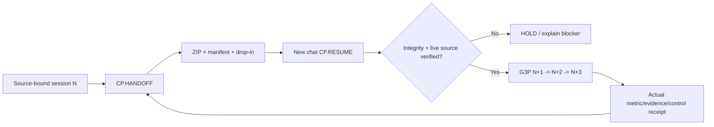

# CODE PURPLE / Mission Control - Lossless Cross-Chat Call Protocol

**Status:** proposed Mission Control v2 consumer, not a replacement for the existing
glossary, 3PR/3PC/MIP/DMAIC methods, canonical BD/REX or GitHub authority.

The **canonical** session closeout moniker is **CP.CLOSEOUT()**, as defined in
[CHAT_CLOSEOUT_OPERATOR_V1.md](CHAT_CLOSEOUT_OPERATOR_V1.md) and
[CHAT_CLOSEOUT_PROFILE_V1.json](CHAT_CLOSEOUT_PROFILE_V1.json).
**CP.CLOSE()** is the expanded GitHub-first nine-artifact implementation alias. It wraps the existing
CP.HANDOFF transport with a source-controlled narrative, prompt-statistics provenance,
canonical BD projection, owner TODO, deterministic hashes and an independent PR-to-master
gate. See [closeout/README.md](closeout/README.md). A main merge is never implied
by successful chat capture or local QA.

The user-facing pair is **`CP.HANDOFF()`** (freeze current session) and
**`CP.RESUME()`** (restart in a different chat with a supplied archive). A
separate **`G3P.EXECUTE(N,N+3)`** command requests one governed G3P wave,
containing three pulses. These are *instruction macros*, not Python-importable
tool calls, scheduled automations, authenticated connectors or background jobs.

## Exact invocation

```text
CP.HANDOFF(scope="CURRENT_SESSION", mode="LOSSLESS_INTENT",
           artifact="ZIP+DROPIN+STATE+MANIFEST",
           horizon="G3P:N_TO_N_PLUS_3")
```

Produce `START_HERE`, complete intent/action/evidence lineage,
source-bound current GitHub checkpoint, historical-vs-live and
implemented-vs-verified-vs-merged classifications, canonical source/authority
pointers, root/BD blocker queue, planned-vs-actual numerator/denominator
ledger, independent security/A10/review states, G3P/DMAIC/SIPOC/DAG,
standalone drop-in, machine state JSON, inner SHA-256 manifest and outer ZIP
digest. Verify all entries/CRC. Do not claim archive completeness for prior
attachments or verbatim messages whose bytes are not available.

```text
CP.RESUME(bundle="CODE_PURPLE_G3P_LOSSLESS_HANDOVER_20261017.zip",
          mode="VERIFY_REFRESH_EXECUTE", horizon="G3P:N_TO_N_PLUS_3")
```

In the *new conversation*, attach the actual bundle and paste its drop-in.
The receiver verifies inner/outer hashes, reads `START_HERE` then the
current state and full handover, independently refreshes default branches,
PR heads, actual rules and native run/job/attempt receipts and only then
chooses a safe source-owner action. Historical receipts are immutable.
No path to source bytes means no invented recovery.

## Call lifecycle / evidence progression



`CP.HANDOFF` does not itself close work. `CP.RESUME` does not itself
execute GitHub code. `G3P` is an envelope for up to three bounded source-
bound pulse decisions, each possibly containing several jobs/tests or a
recorded HOLD. A global major blocker stops the following pulse slots as
`NOT_RUN_GLOBAL_BLOCKER`; it does not silently supply PASS.

## What the function preserves and what it cannot guarantee

**Required:** intent, authority, scope, inputs, actual commits, exact PR SHA,
runs/job IDs/attempts, tests and numerators/denominators, outcome date, edges,
first-red/root versus manifestations, successful checks, outstanding queues,
decisions, negative controls, assumed and unverified states, and next action.

**Conditional:** original predecessor ZIP/attachments and artifact bytes only
if actually available and safe to include. A prior archive named in source
history is a pointer, not an embedded verified byte copy.

**Excluded:** hidden model reasoning, unexported verbatim conversation data,
credentials, unauthorized private security evidence, guessed future CI
results, nonexistent reviewer approvals, synthetic queues or root closure.

## Governance

Authority stays with Mission Control, CODEX/KEB, ABACUS/DOW and QPS child as
defined in their domain. The invocation macros do not grant waiver,
force-merge, branch-ruleset relaxation, QPS acceptance or independent human
review. An actual native workflow may continue on GitHub without the chat,
but its current and future results must be read back; no assistant claims to
work asynchronously merely because the command was invoked.

## Versioning and where used

- Machine contract: `CP_HANDOFF_RESUME_V1.json` (non-authoritative
  consumer/transport convention).
- Canonical Mission Control v2 glossary: `../MC_GLOSSARY_TAXONOMY_v2.json`.
- Canonical method profile registry / G3P envelope:
  `../MC_METHOD_PROFILE_REGISTRY_v1.json`.
- Operator method: `../G3P_EXECUTION_OPERATOR.md`.
- CODE PURPLE instance: Mission Control #607 G3P session 2026-10-17;
  the separately provided handover ZIP is the frozen execution checkpoint.

Do not move this protocol to another global SSOT. Later `V2` changes must
be additive, preserve old invocation meaning and publish a backward
compatibility receipt.

## 18 October 2026 — W4 published core-handover method

The additive [ABACUS W4 GitHub-first crosswalk](ABACUS_W4_GITHUB_FIRST_CROSSWALK_20261018.md) points to the **existing** ABACUS V2 message template, native nine-cell byte receipts and review-only continuation PR. Use it through `CP.HANDOFF/CP.RESUME`, not as a new method registry, BD queue, authenticated dispatcher or authority bypass. `MERGE_ADMISSION=HOLD` until effective admin rules and independent native evidence are verified.
