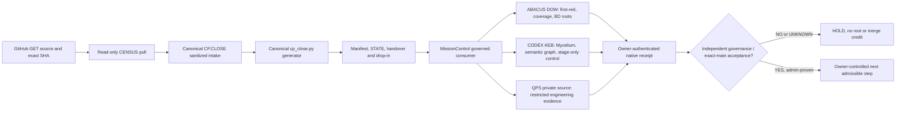

# CP.FED.CENSUS W4 — public-safe operational lossless handover

**Canonical producer:** `mission-control/v2/handoff/closeout/cp_close.py` and `CP_HANDOFF_RESUME_V1.json` in this repository. **Source input:** `intakes/CP-FED-CENSUS-W4-20261018.json`. This appendix is a curated source-linked narrative, not a second SSOT and not a verbatim chat transcript.

## W4 native GET-only CENSUS re-entry (newer than the initial frozen capture)

At **2026-10-18T15:10:42.787707Z**, native GitHub runner [39139236501](https://github.com/GBOGEB/pipeline-automation-hub/actions/runs/39139236501), attempt 1, completed the four-repository public source census. Exact source snapshot [CENSUS_PULL_NATIVE_20261018.json](CENSUS_PULL_NATIVE_20261018.json) is an unchanged byte copy of provider artifact `12141162352` (`SHA-256 78e54ba29f51ce9d34157b8c502e043fc1f95fbf41ac9e10b0f7b9364719592e`). **This observation supersedes the earlier count for operational re-entry, without rewriting the older frozen snapshot.**

| Source-object metric | Earlier dated capture | Later native PULL | Movement |
| --- | ---: | ---: | ---: |
| Four public repositories / ordinary open issues | 82 | **83** | +1 |
| Four public repositories / open PRs | 23 | **25** | +2 |
| 0–6-day open issues | 30 | **31** | +1 |
| 7–13 / 14–29 / 30+ issues | 1 / 23 / 28 | 1 / 23 / 28 | Unchanged |
| ABACUS issues / PRs | 38 / 16 | 38 / 16 | Unchanged |
| CODEX issues / PRs | 11 / 2 | 11 / 2 | Unchanged; main SHA advanced |
| hub issues / PRs | 32 / 5 | **33 / 7** | +1 / +2 |
| gg_MATH issues / PRs | 1 / 0 | 1 / 0 | Unchanged |

The newer native snapshot records CODEX `main` as `d2523f7ce938ef3bbd71cef32959d5b3897c4a04` versus the earlier captured `926bfd646df6bf09dd92faad6f8806e1a61d1ec1`. The hub's own new handover PR is part of the observable PR population. **No claim of +1 new engineering BD root or +2 successful workers is made**; native observations are non-atomic.

**Canonical packet QA:** Native exact-head [39139236501](https://github.com/GBOGEB/pipeline-automation-hub/actions/runs/39139236501) ran the unchanged `cp_close.py` generator, **36 existing contract tests and 10 new CENSUS negative tests**, SHA-256 manifest and ZIP CRC/replay; both runner jobs PASS. Its immutable [canonical nine-file ZIP](https://github.com/GBOGEB/pipeline-automation-hub/actions/runs/39139236501) is separately committed under this handover record. Further head commits require a fresh parity readback for current-PR-head credit. This remains a *draft packet*, not admitted `master` custody.

## Decision and current source

- **Date-only observation:** 2026-10-18; GitHub reads were not atomic. Refresh before any write, closure, merge, or worker launch.
- **MissionControl authority:** `GBOGEB/pipeline-automation-hub:master` at `91ea7f23edc9cd7ab984b8a2730650609eddb55c` when captured. Hub `master` REST protected flag: false; admin control https://github.com/GBOGEB/pipeline-automation-hub/issues/336 OPEN.
- **ABACUS `main`:** `585dd7476d3b3c629f864c37ec7d7526a648b4c0`; active ruleset 24494381 has approval count 0, last-push false, resolved review threads false, six bypass actors. **P0 HOLD**.
- **CODEX `main`:** `926bfd646df6bf09dd92faad6f8806e1a61d1ec1`; REST protected false, repository ruleset list empty at readback. **P0 HOLD**.
- **gg_MATH `main`:** `7ce2e3832357c0b87ab17ff439f4d6e84c0292a4`; no active local PR.
- **Restricted QPS source:** fifth repo checked via authenticated reader, but SHA, titles, issues and private engineering content are intentionally excluded from this public repository. Authoritative QPS C2 child evidence stays in its restricted source. DO NOT fill missing fields with zero.

## Live CENSUS versus causal BD

| Public source repo | Ordinary OPEN issues | Open PRs | Age 0–6 / 7–13 / 14–29 / 30+ days |
| --- | ---: | ---: | --- |
| ABACUS | 38 | 16 | 19 / 1 / 8 / 10 |
| CODEX | 11 | 2 | 6 / 0 / 1 / 4 |
| MissionControl hub | 32 | 5 | 5 / 0 / 14 / 13 |
| gg_MATH | 1 | 0 | 0 / 0 / 0 / 1 |
| **Public population (4 repositories)** | **82** | **23** | **30 / 1 / 23 / 28** |

The fifth restricted repository is excluded in this public artifact. See `CENSUS_PUBLIC_20261018.json` for exact public source heads. **Ordinary issue lifecycle != distinct BD causal-root census != PR status != worker acceptance**. The canonical BD SSOT is `mission-control/federation-atlas/CODE_PURPLE_BD_QUEUE_v1.json` (19 item identities) owned by this hub; `CP.CLOSE` generates only a subset, never new roots. ABACUS engineering root ownership remains with https://github.com/GBOGEB/ABACUS/issues/1929.

### Source-owned TODO / DoV truth

| Priority | Owner and authoritative issue | Verified progress | Pending acceptance (do not check until evidenced) |
| --- | --- | --- | --- |
| P0 | ABACUS https://github.com/GBOGEB/ABACUS/issues/1860 | 1 / 12 checklist boxes | Effective required checks, >=1 eligible independent approval, last-push + threads; exact-current-main B0/security + canary |
| P0 | CODEX https://github.com/GBOGEB/CODEX/issues/977 | 0 / 7 checklist boxes | Real ABACUS-local principal, exact-head disjoint dispatch, approved owner lease, native REX; CODEX stays stage-only |
| P0 | MC admin https://github.com/GBOGEB/pipeline-automation-hub/issues/336 | OPEN | Effective protected master required status and RED canary, not merely workflow-side FAIL |
| P1 | MC Golden Graph https://github.com/GBOGEB/pipeline-automation-hub/issues/604 | 0 / 12 checklist boxes | Native Mycelium/brower/Golden Thread crosswalk with current-head artifacts, no new SSOT |
| P1 | ABACUS BD https://github.com/GBOGEB/ABACUS/issues/1929 | OPEN | Causal-root fingerprint, matched scope and source-owner accepted closure, distinct from 38 issue objects |
| P1 | ABACUS dashboard https://github.com/GBOGEB/ABACUS/issues/1885 | OPEN | Source-reproduced internal-link check, matched denominators and postrepair main acceptance |
| P1 | hub BD https://github.com/GBOGEB/pipeline-automation-hub/issues/85 | OPEN | CPQ-010/011/013/015/016/018 remain in canonical queue with their own source event history |
| P1 | Restricted QPS source authority | **RESTRICTED / owner-local** | Owner-only evidence; no private counts, titles or source hashes copied to the public handover |

### Recent native receipts — historical, NOT current-main acceptance

- ABACUS security nine-cell exact PR head `43f20c25a1b922ec61f037eca47abfc28fecb3a9`, https://github.com/GBOGEB/ABACUS/actions/runs/39065792654: 9/9 terminal successful jobs and nine GitHub artifact ZIP digests. This is a bounded PR testflight, not an ABACUS main success or root closure.
- ABACUS P1→P3 measured 3/3, 9/9, 0/9 different-scoped source tests; the frozen P3 forecast was **MISS**. Later corrected testflight 9/9 does not erase failure or demonstrate statistical stability.
- Current ABACUS main has hundreds of queued/incomplete workflow observations in recent provider sampling. **Latest complete current-main B0, same-source statement/branch/diff coverage and accepted formal merge remain UNKNOWN** without a terminal comparable native source receipt.
- CODEX current Mycelium PR heads https://github.com/GBOGEB/CODEX/pull/1092 and https://github.com/GBOGEB/CODEX/pull/1093 are draft/open at their own exact SHAs; a staged remote edge is not an authenticated worker launch.
- QPS hub current G3C https://github.com/GBOGEB/pipeline-automation-hub/pull/708 and browser https://github.com/GBOGEB/pipeline-automation-hub/pull/668 are still open. Browser screenshots/PAGES on current `master` remain separate obligations.

## Federation owner routing / DAG



**SIPOC:** Source GitHub and domain SSOTs → fresh read-only GET/census, evidence validation and canonical `CP.CLOSE` → source-bound hashes, DAG/BD projections and `CP.RESUME` → MissionControl/CODEX/ABACUS/QPS owner consumers. Workers are *role leases* until authenticated run/job/REX identities exist. No JSON receipt grants an executor additional authority.

## Pull → qualify → publish route (one owner per concern)

1. **PULL:** Refresh HEAD of each accessible repository, open ordinary issues and PR separately; record matching SHA, source age, classifications and unknowns. Private engineering source stays private. Never use undocumented writes to turn a projection into BD SSOT.
2. **QUALIFY:** Run `python mission-control/v2/handoff/closeout/cp_close.py --intake mission-control/v2/handoff/closeout/intakes/CP-FED-CENSUS-W4-20261018.json --bd mission-control/federation-atlas/CODE_PURPLE_BD_QUEUE_v1.json --out /tmp/cp-fed` followed by `--check`. Verify manifest hashes and the negative/contract tests.
3. **PUBLISH CANDIDATE:** A draft PR on THIS repository `master` with generated native action ZIP and exact-head evidence. ABACUS and CODEX receive *links to the canonical PR*, never duplicate snapshots or silent source mutations. Public source here excludes private QPS payloads.
4. **ACCEPT / RELEASE:** Authorized administrators verify effective branch rules and a negative RED canary; an independent reviewer qualifies the current PR head, security and CI. Only then may an authorized owner merge serially and recensus exact `master`.
5. **RE-ENTER G3P:** Up to three bounded actual pulses of refresh, first-red repair, exact-head proof and CONTROL, with separate denominator, forecast, owner lease, and HOLD if incomplete. Three pulses are not a Six Sigma guarantee.

## Definition of Verification and forbidden promotions

- `CENSUS_PULL=VERIFIED` only for exact enumerated populations; GitHub search issues must exclude PRs and use the same timestamp/scoping rules.
- `ROOT_CLOSED` requires owner-approved deduplicated fingerprint non-recurrence with comparable native receipts. Ordinary issue closure changes the *issue* denominator only.
- `MERGE_ADMISSION=HOLD` until effective rules, statuses, security, review and threads proven. Current matched main/PR coverage, remote Crew run IDs, accepted REX, private child engineering returns: **UNKNOWN** unless independently sourced.
- `CP.CLOSE` has sanitized operational fidelity only. Without an authorized complete transcript export, full-message counts and verbatim session reconstruction are UNKNOWN. The date-only, non-atomic snapshot is not live authority.

## Copy-ready restart

```text
CP.RESUME(source="GITHUB_FIRST",mode="VERIFY_REFRESH_EXECUTE",horizon="G3P:N_TO_N_PLUS_3")
Read GBOGEB/pipeline-automation-hub:master/mission-control/v2/handoff/closeout/records/CP-FED-CENSUS-W4-20261018/
Verify the exact GitHub PR source SHA, canonical CP.CLOSE manifest and native artifact, then fresh-pull five repo heads and issue/PR denominators (private data kept private). Compare the frozen 2026-10-18 census, preserve UNKNOWN. Reconcile #1860/#1929, CODEX #977, MC #85/#336/#358/#604 and private QPS C2. Do 3 bounded pulses, no new authority. P0 HOLD unless actual admin/reviewer checks prove otherwise.
```
