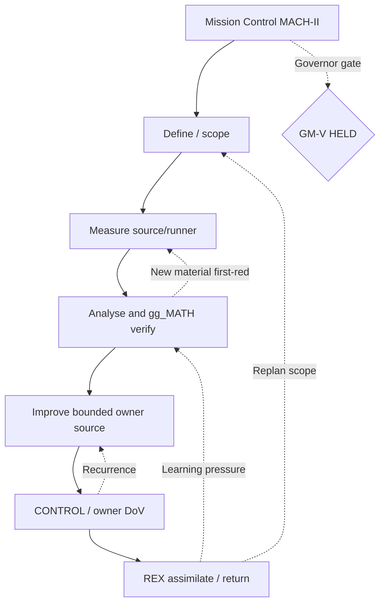

# MISSION CONTROL MACH-II · GM-I to GM-V

> **Additive mission upgrade**, not GM-VI, a new governor, Mycelium SSOT or QPS engineering acceptance. Source: `MACHII_MISSION_MANIFEST.json` and original canonical `GRAND_MISSION_REGISTRY.json` at frozen default SHA.

## Charter, escalation and MIP per mission

| GM | Source disposition | Original frontier target | MACH-II priority |
|---|---|---:|---|
| GM-I | HOLD_EXTERNAL_OR_HABITAT_GATE | 1 | COOLPROP_DARKLAND_MACH_II |
| GM-II | CONTROL | 2 | TWO_OUTPOST_MATH_MACH_II |
| GM-III | RECON_CONTROL | 4 | HETEROGENEOUS_RECON_MACH_II |
| GM-IV | ACTIVE_8_OF_8 | 8 | EIGHT_FRONTIER_REPEAT_CONTROL_MACH_II |
| GM-V | HELD | 16 | CLOUD16_READINESS_MACH_II |

### GM-I — COOLPROP_DARKLAND_MACH_II

Upgrade CoolProp independent CHECK to durable recurrence CONTROL and close the licensed local HEPAK 2.0-4.5 K stable source/receipt gap without replacing the certified domain authority.

**Modernise:** Reuse existing QPS property_router + hepak_bridge and local Python/Excel call; no rewritten EOS or licensed binary

**Innovate:** Paired pre/post source SHA256 attestation, local XLA/XLAM Python COM and direct licensed callable with identical receipt semantics; diagnose phase validity

**Perpetuate:** Pin 8 governed state identities, source hashes, run/attempt identity, one-repeat provenance and QPS child disposition

**Owner-gated DoV, all required:**
- [ ] QPS owner HEPAK source SHA256 before=after
- [ ] Licensed local HEPAK property vector true >0-step
- [ ] QPS Zod+manifest+RTM raw vs derived digest
- [ ] Boundary 2.0K and lambda marked governing only with provider receipt
- [ ] Explicit ACCEPT/REJECT/DEFER by QPS child owner

**Noncompensation:** CoolProp governing 2 K HE-II replacement; Licence-free Python EOS claim; Promote a source-code SHA as a licensed binary SHA

### GM-II — TWO_OUTPOST_MATH_MACH_II

Turn engineering and gg_MATH twin outposts into matched-source, repeated and independently scored method-provider federation.

**Modernise:** Typed methods, exact-source mathematical provider envelope, stable metric identity and units

**Innovate:** Rolling N+2 predeclared forecasts; independent reference kernels, PCA/BT only when identifiable; graph and nested DOEs

**Perpetuate:** Source-bound return checks, historical forecast-error calibration and regression invariants

**Owner-gated DoV, all required:**
- [ ] Two source-owned repo readers with independent receipt
- [ ] Comparable metric denominator, independent trials and confounder register
- [ ] MIP adoption feedback from consumer
- [ ] CONTROL survives a fresh-source repeated flight

**Noncompensation:** PCA/BT promotion from n=5 or disconnected comparisons; Confidence interval from dependent job repeats

### GM-III — HETEROGENEOUS_RECON_MACH_II

Turn heterogeneous external repository exploration into governed ADAPT/EXTRACT/REFERENCE/PARK decisions with bidirectional Mycelium provenance and REX return.

**Modernise:** Typed repo capability and edge semantics with source/licence/consumer ownership

**Innovate:** Nonlinear search/backtrack/revisit with bounded hypothesis tests; no synthetic admission

**Perpetuate:** Reusable negative controls, attested adapter reuse, and archived rejection rationale

**Owner-gated DoV, all required:**
- [ ] Four frontier owner and source SHA hooks
- [ ] Each accepted source asset has an owner/consumer/copyright disposition
- [ ] REX event knows occurred-at and recorded-at
- [ ] At least one repeated CONTROL with a changed source

**Noncompensation:** Undisclosed external auth; Auto-promote upstream clone to mission authority

### GM-IV — EIGHT_FRONTIER_REPEAT_CONTROL_MACH_II

Prove sustained 8-frontier safe federation, crew availability and root-leverage with controlled path-disjoint waves and repeated return receipts.

**Modernise:** Map all eight named slots and their candidate identities, owners and path leases

**Innovate:** Resource-aware scheduler proposals using actual runner queue p95 and source-identified cross-repo blocker leverage

**Perpetuate:** Repeat-control at distinct current heads, duplicate root/fan-out suppression, crew return and feedback aging controls

**Owner-gated DoV, all required:**
- [ ] Eight named slot identities
- [ ] Zero invented canonical child bindings
- [ ] Two independent repeat-control series at pinned new source heads
- [ ] Measured nondegrading proof yield and queue p95 with comparable sample
- [ ] Governor owner-admin disposition before GM-V

**Noncompensation:** 8 named slots imply 8 authorized workers; Backfill historic GM-IV with new child claims

**GM-IV wave (`gm4_frontier.py`, read-only):** `GM4_SLOT_MAP.json` maps F01–F08 from the canonical registry and `GM_IV_ACTIVE8_GOVERNOR_CONTRACT.json` (repository, pinned target SHA, class, source owner, crew pool) with `assigned_worker`, `child_binding` and `authorized_workers` all `null`. Each slot leases read on its own repository and write only on `gm4_returns/<slot>/`; disjointness is decided by the federation-atlas `broker.conflicts` owner and path safety by gogreen `_validate_path_lease`, not copies. `gm4_returns/<slot>/series_<X>.json` holds one API-readback return receipt per slot per series, bound to the hub head SHA and the blob OIDs of both sources at that SHA. Run, job, root and owner disposition stay `null` and are listed as `not_verified`; independence of the series, queue p95 / proof yield (owner: `grand-missions/measure_gm_iv_runtime_capacity.py`) and the Governor disposition are `NOT_VERIFIED`.

### GM-V — CLOUD16_READINESS_MACH_II

Specify elastic 16-frontier readiness and stress/adversarial scheduling without initiating a new mission or child dispatch.

**Modernise:** Formal capability/runner ledger and distinct owner/worker demand

**Innovate:** 16-slot shadow scheduler simulation, boundary stress and resource-constrained policy sensitivity

**Perpetuate:** Governor-reviewable Go/HOLD receipt and mission end/return plan; no automatic transition

**Owner-gated DoV, all required:**
- [ ] GM-IV post-active8 repeated accepted CONTROL
- [ ] At least 16 eligible frontier owners and measured runner capacity, not names alone
- [ ] QPS HEPAK dependency effect isolated and correctly classified
- [ ] Formal separate Governor launch grant

**Noncompensation:** Create GM-VI or child PR automatically; Synthetic capacity and inferred security waiver

## Nonlinear DMAIC: universal typed Mycelium vs runnable subset



Feedback edges, rejected findings, irregular and nonsequential transitions are legal in the **universal reference graph**; only `SIPOC_DEPENDENCY` edges must form an executable acyclic DAG. An operational pulse can return to ANALYSE or MEASURE without replaying identical deterministic CI failures.

## Typed Mycelium interface

Source: `MACHII_MYCELIUM_GRAPH.json` uses existing CODEX `code-purple.mycelium.graph.v2`: node IDs, ownership, layers, binding classes, explicit `source_ref` and 5 runnable SIPOC layers across GM I-IV. All edges remain `DECLARED`; no `RECEIPT_BOUND`, `ACCEPTED` or `dispatch_authorized` claims. The native CI workflow checks this projection against the pinned CODEX `mycelium_continuity.graph.validate_graph` provider itself, not a copied fork.

## SIPOC / gated job handoff

| Supplier | Input | Process | Output | Customer | DoV |
|---|---|---|---|---|---|
| Source owner / Scout | exact repo, default branch, PR head | read + match first red | scoped typed source atom | Mycelium | exact-SHA/job/attempt |
| gg_MATH | independent trials, units, matched denominators | estimator selection & CI | calibrated / ineligible diagnosis | U05/U06 | method provider receipt |
| QPS local HEPAK | licensed stable XLA/XLAM | Python→Excel COM eight states | raw values + stable provenance | QPS owner | independent child acceptance |
| Doctor / Dockmaster | executed vs zero-step native job | one source-owned disjoint fix | new head + native proof | Governor | no unchanged SHA rerun |
| REX/KEB | accepted source receipt | learn/update/assimilate/repair | append-only return intent | Golden Thread | no fabricated k/e clock |

## DMAIC/MIP mathematical gates

Let `N` be the exact, *independent and comparable* opportunity population, `d` owner-attributed defects, `r=d/N`, DPMO `10^6r`. The one-sided 95% zero-defect bound is `1e6 (1-0.05**(1/N))` **only** under an IID/fixed independent trial assumption. Approximately 881 thousand zero-defect independent opportunities are required for an upper bound below 3.4 DPMO; this is *not* Six Sigma certification. With repeated jobs from the same source root, effective independent trial count is unknown.

Velocity `(r_N-r_(N-1))/Δt`, acceleration, rolling MAD and forecasts require matched denominator, clock spacing, source/run identity and comparable scopes. A zero numerical slope can mean a blocked queue, saturation, stable operating condition or no observation: do not default to `STABLE`. Use `UNKNOWN`, `CENSORED_OR_BLOCKED`, `UNDERPOWERED_<5`, `INCOMPARABLE`, `CONVERGING_DESCRIPTIVE_<20`, `DIVERGING_DESCRIPTIVE_<20`, and only independent reviewed `CONTROL`.

Bradley–Terry needs identifiable, connected pairwise comparison graph; PCA needs independent rows, eigengap/condition, invariant measured features and aligned subspace/orientation. Do not perform either on the five mission names or correlated job attempts and call it prediction. gg_MATH remains mathematical provider.

## Current target source and first-red routing

- COOLPROP is **ACHIEVED as an independent check**, not current GM-I external runtime blocker. Existing [QPS CoolProp M01](https://github.com/GBOGEB/cryoplant-project/blob/4782b8ab418f8645ff409a1297ce2d84a8bdcaf8/docs/qps_recon/M01_COOLPROP_CONTROL_STATE.yaml) records source-bound test result and local HEPAK execution.
- Remaining HEPAK engineering **HOLD**: stable local licensed HEPAK source, exact two-phase/HeII values and QPS owner acceptance. Source-owner draft [QPS #1952](https://github.com/GBOGEB/cryoplant-project/pull/1952) provides opt-in local SHA-stable staging and mock-only safety QA; real Windows license/operator receipt is separate.
- GM-IV's 8 named frontier candidates are not eight accepted child bindings or eight running workers; GM-V remains `HELD` with zero executable nodes.
- [ABACUS #1860](https://github.com/GBOGEB/ABACUS/issues/1860) A10/Safety/independent review/effective rule gates remain noncompensating.

## Wave/pulse and resource framework

| Wave | Parallel source-owned lane | Task lease | DoD | Independent DoV / recuperation |
|---|---|---|---|---|
| N13-P1 | Hub mission registry extension | Only `mission-control/v2/mach2/**` | 5 GM + 15 MIP declared axes | Pin canonical source digest + mission-state invariants |
| N13-P2 | Mycelium typed scheduler lens | Hub graph + external CODEX validator | 44 nodes/89 edges, 20 runnable proposals | CODEX exact-provider native validation and no dispatch promotion |
| N13-P3 | QPS HEPAK local-source lane | Only `tools/hepak_bridge/hepak_mach2_*` | 14 isolated adversarial tests and bounded licensed-local script | QPS owner local source/receipt fingerprint and child disposition |
| N13-P4 | HTML/metrology/REX control | Hub landing and gg_MATH method contract | 6-tab launch, statistical warnings, digest parity | 3 viewport QA and terminal exact-head CI, then freeze source |

**Recuperation between waves:** re-resolve branch/PR SHA, intake actual run/job/attempt, first failing step and runner capacity; attribute root to source owner; run one disjoint correction on a new SHA only; recensus, update metric numerator/denominator and REX. Replan worker width rather than synthetically treating queued jobs as errors or throughput.

## Golden Thread / narrative hook for each mission

Return envelope fields: `mission_id`, `MACH-II scope`, `crew_role`, `source_owner_repo`, `head_sha`, `run_id`, `run_attempt`, `job_id`, `root_id`, `observed_at`, `recorded_at`, `evidence_class`, `MIP_facet`, `DoD`, `DoV`, `BD_delta`, `REX_action`, `source_digest`, `owner_disposition`, `next_guarded_transition`. `event_sequence_e` may be proposed for observation, but semantic generation `k` changes only upon accepted owner SSOT delta. Every FROZEN forecast remains immutable when scored after its horizon.

**No automatic promotion:** `MERGE_ADMISSION=HOLD`; no authority transfer, new crew dispatch, security waiver, GM-V launch, Six Sigma certificate, QPS engineering formal credit or owner acceptance claimed.

## Local reproducibility

```bash
python -m unittest discover -s mission-control/v2/mach2 -p 'test_mach2.py' -v
python mission-control/v2/mach2/mach2.py --out out/mach2_generated_projection.json
python mission-control/v2/mach2/browser_qa.py out/mach2_browser_qa
python mission-control/v2/mach2/gm4_frontier.py status
python mission-control/v2/mach2/gm4_frontier.py observe --series B --hub-sha <40-hex hub head>
```

Native workflow cross-validates pinned CODEX Mycelium graph and browser screenshot hashes; do not call a static source assertion a native pass.
