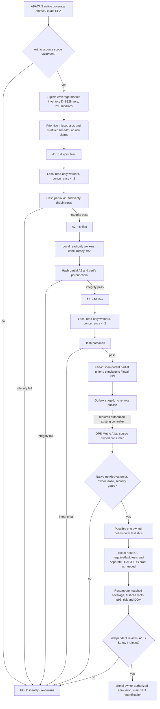

# N6 — scalable asynchronous census DAG, SIPOC and LDAB/LLDB boundaries

## Provider and consumer authority

- Existing `pipeline-automation-hub/tools/metric-atlas/metric_atlas/census.py` owns `qps-metric-census/v1` request routing and `qps-metric-receipt/v1` native validation. Maximum 3 physical repo lanes. `CODEX` owns federation semantics; `gg_MATH` remains the advanced mathematical engine; QPS/cryoplant engineering acceptance cannot be inherited.
- `ABACUS/scripts/bandit_disjoint_census.py` owns full/configured Bandit finding partitions and file-exclusive B2/B3/B4/B5 write lanes; its fingerprints are **not** coverage arcs.
- `ABACUS/scripts/bd_ldab_join_census.py` owns the controlled BD–LDAB *observation join*. LDAB is evidence/diagnostic observability, **not** evidence of a debugger launch merely because the source surface exists.
- `CODEX/scripts/qps_federated_lldb_exec.py` and `ABACUS/scripts/w84_validate_lldb_dap_federation.py` own LLDB/DAP runtime proof contracts; real session/runner/step receipts are mandatory before promoting an executed debug claim.
- N6 implements only a **local read-only census adapter**. `native_ci_jobs_dispatched=0`, `source_writers_dispatched=0`, `authority_transfer=false`.

## Hierarchical DAG

**Solid** edges = executed local read-only census checks A1–A3; **dotted** edges = proposed external integrations requiring native/owner execution. This is an evidence DAG, not a graph of confirmed first-red causality.

## SIPOC

| Supplier | Input | Process | Output | Customer |
|---|---|---|---|---|
| Native ABACUS B0 | Exact-head ZIP; 299 module/8,328 arc census; coverage tool configuration | Verify archive SHA, schema, branch arcs and module sums | Immutable source-pinned census catalog | Local producer / methods reviewer |
| N6 planner | Catalog, explicit 8/16/32 caps, sample seed | Deterministic targeted + breadth selection, unique file ownership | Three disjoint slice IDs, read-only worker ceiling 2 | N6 local async readers |
| N6 reader | Selected module source arcs | Source/arc revalidation; hashed partial chain | 3 partials + NDJSON event/diff streams | Central N6 local fan-in |
| Local fan-in | Predecessor-linked partials | Reject duplicates, drift, forged native jobs, altered numerator/denominators | `census_rollup.json`, `FEDERATION_OUTBOX.json` | Existing Metric Atlas controlled owner |
| Existing native owner | Source lease, checks and full CI | Distinct native test experiment, BD first-red, LLDB as warranted | Run/job/attempt test/coverage/debug receipts | Source owner, MIP/DMAIC/G3A |
| Independently authorized reviewer | Native receipts, merge gate and security results | Reconcile DOV/DoD and formally review | HOLD or separately authorized admission | Mission Control and protected main |

## Non-equivalent scale denominators

| Unit | Measured value | Cannot be treated as |
|---|---:|---|
| Eligible branch arcs (canonical native B0) | 8,328 | Test cases or jobs |
| Measured coverage file modules | 299 | All eligible repository source files |
| N6 sample files | 8 → 16 → 32 | Git branch count or active source writers |
| Local concurrent checksum readers | 2 | GitHub runner capacity |
| External QPS census max fanout | 3 source repos | Three source-committing workers |
| N6 native runs newly launched | 0 | New test coverage uplift |
| N6 confirmed unique first-red roots | UNKNOWN | Number of missed branches |

## Partial publish / event contract

`census_request.json` binds exact head, tool/source artifact hash, scope and slice ownership. Each `partial_Ai.json` binds source/manifest identity, strictly allowed per-file arc counters, and a SHA-256 of all stable receipt fields; the next packet carries the predecessor digest. Duplicate identical partial is idempotent; a conflicting duplicate, overlap, unknown module, changed scope/denominator or extra native-claims field aborts the fan-in. `census_events.ndjson` and `census_module_diff.ndjson` are append-only local review projections. Publication through an Actions artifact or approved repository publisher must be a **separate owner-authorized operation** and must not claim a native receipt from `qps-metric-receipt/v1` without real native IDs/outputs.