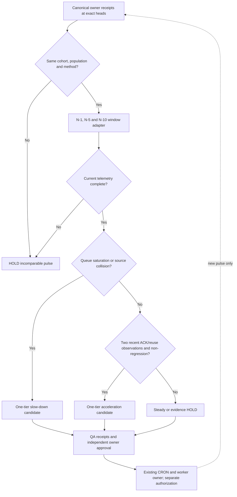

# W381 — adaptive pulse tempo with non-compensating source gates

**Purpose.** Recommend bounded census-topic capacity and delta-poll tempo from *existing* canonical owner metrics; never run a new scanner, schedule a CRON, issue a GitHub side effect, or transform a self-declared ACK into an authenticated one.

Canonical data owners are unchanged:
- queue depth and p95 job waiting: `mission-control/jade_temple/devops/actions_metrics.py`, with `gogreen/bd_queue_wave.py` percentile semantics;
- unique causal roots and first-red history: `mission-control/qps-triage-ultra/p-process/everred/harvest.py` and `mission-control/gogreen/scale_dock.py`;
- source packet and controller receipt: `tools/metric-atlas/metric_atlas/topic_exchange.py`;
- temporal pulse lineage: `mission-control/jade_temple/tools/rolling5.py`;
- topic-bounded execution planning: `topic_wave.py`, `topic_wave_scale.py`, `topic_wave_train.py`.

The new `adaptive_pulse_tempo.py` **consumes prequalified values**. Caller must bind each input to a fixed cohort, method, population, producer head and receipt SHA. It does not independently authenticate those receipts. A field named `OWNER_RECEIPT_REFERENCED` is a pointer, not proof. Even a nominally healthy proposal has `execution_authorized=false` and `merge_admission=HOLD`.

## Temporal comparisons and scale rules

Input windows are N, N−1, N−5 and N−10, indexed by strictly consecutive pulse IDs and monotonically increasing UTC times. All eleven samples must use the same method version, cohort digest and population digest; otherwise compare no samples and reject source drift. Missing window or missing current telemetry remains HOLD, not a measured zero.

- **Deccelerate candidate:** current queue p95/depth exceeds configured source-owned limit, workers reach their cap, or source-scope collisions appear. Reduce at most one declared tier (12 → 6 → 3) and double the candidate delta-poll interval, subject to governance.
- **Accellerate candidate:** all 11 comparable pulses, no queue/root regression against N−1, N−5 and N−10; recent two pulses report at least one controller-ACK and packet reuse; and current queue, worker and collision limits are healthy. Increase at most one tier (3 → 6 → 12) and propose halving the delta-probe interval.
- **Hold or steady:** incomplete history, missing values, absent ACK/reuse, worsening root/queue trend, or upper capacity limit. No change to CRON without independent owner authorization.

The thresholds `max_queue_p95_s`, `max_queue_depth`, and `max_running_jobs` are supplied by the owner operating policy; the planner does not invent universal fleet thresholds.

## Typed wave graph

The feedback edge is temporal, not a legal same-pulse dependency cycle. The planner is one pure source-safe function with a bounded 3/6/12 tier set, not a second Metric Atlas dispatcher.

## W381 disjoint owner lanes

- **L-A causal event ledger**: PR #1109, source `topic_exchange.py` and its native tests. No direct stage→ACK, decreasing timestamps or post-invalidation ACK.
- **L-B source-scope lease**: PR #1110, `topic_wave_scale.py`, same producer+scope cannot be a second independent topic even with a different topic ID.
- **L-C pulse tempo**: this branch, `adaptive_pulse_tempo.py`, its own tests and CI; source read-only, no dependency on mutation to L-A or L-B.
- **L-D integration/QA**: only after exact-head PASS and independent review of A+B+C, requalify a combined branch and run a measured single-topic controller-ACK/no-ACK pilot.

## Method evidence and honest denominators

Prior *synthetic* planned-topic capacity progressed 3 (W378 P0) → 6 (W378 P1) → 12 (W380 P2). This is not observed native source coverage or achieved efficiency. Historical single-job log timestamp spans of approximately 9–16 seconds are not GitHub queue waiting times. W381 shall compare canonical queue p95, runner occupancy, source reads and ACK rate only from matched owner populations with positive provenance. The default operational result today is HOLD because 11 comparable authenticated owner pulses, queue p95 and production ACK proof have not yet been supplied.

### Negative tests

`python -m unittest discover -s tools/metric-atlas/tests -p 'test_adaptive_pulse_tempo.py' -q` and an optimized `python -O` replay, plus branch-aware >=85% *new module only* coverage on Python 3.11/3.12. Tests use clearly synthetic SHAs, do not launch native workers and do not record scans avoided. Under any test result the module returns `execution_authorized=false`.

**Release:** no direct changes to the Electrical ICD's Table 19/20, SLDs or Annex. No acceptance of HP4, PVPS, photovoltaic, PFC or EDG discrepancies is implied.
