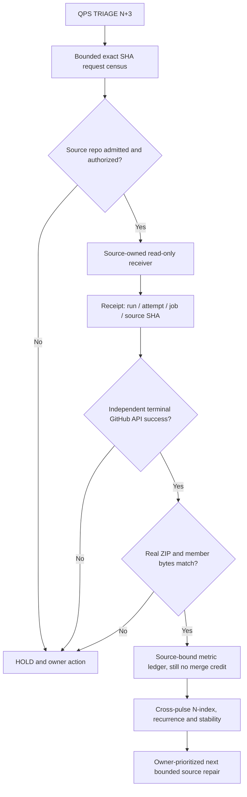

# QPS TRIAGE N3 — native terminal + artifact evidence fan-in

**Authority:** read-only. This is an additive verification contract, not an
admission gate replacement or source-owner delegation. Canonical Mission
Control #530 alone owns the formal ZIP verifier; #531 owns six-repository
producer breadth; #533 remains the Method Atlas visualizer.

## Why N3 exists

The reusable source receiver writes a `SUCCESS` metadata receipt *before its
GitHub job ends*. Counting that JSON directly as a completed receiver would
produce false green, even if the job later failed in upload or cleanup.

N3 therefore introduces three **independent evidence depths**:

| Depth | Required evidence | State if missing |
|---|---|---|
| D0 Request | Exact repo/SHA, wave, selector, request ID | HOLD_SOURCE |
| D1 Receipt | Run ID, attempt, job ID, route, target/execution SHA | HOLD_RECEIPT |
| D2 Native terminal | Fresh authenticated GitHub run + job API, terminal SUCCESS, same source/attempt | HOLD_NATIVE |
| D3 Artifact bytes | Read actual ZIP and sole route JSON member; member equals supplied receipt | HOLD_ARTIFACT |

A receiver receives **no cross-repo test/coverage credit** at D3. Those
measurements need independent native test logs and scope-bound coverage
numerators/denominators.

## Physical scale and N-index

Three eligible producer repositories: ABACUS, CODEX, cryoplant-project.
Two routes each, maximum 6. Until ABACUS #2126 is admitted, only CODEX and
private QPS are eligible for source-owner dispatch, at most 4 routes.

N2 baseline: controller #633 merged; 48 native regressions passed.
Native receiver job receipts: **0 observed**. Not an assertion that
no remote runs exist anywhere; it is the bounded evidence denominator.

N3 completion is **at least one independently authenticated native receiver
tuple** then ZIP byte verification. The four-route pilot DoV is 4/4 tuples,
then stability recheck with fresh source HEAD and run attempts.

## Operator CLI — no secrets stored

Use the Mission Control Python environment (Python 3.9+) with
`PYTHONPATH=tools/metric-atlas`:

```bash
python -m metric_atlas.postflight \
  --manifest requests.json \
  --receipts receiver-receipts.json \
  --output postflight-dryrun.json
```

That is a **local consistency** audit: native terminal statuses remain HOLD.
After independently downloading the exact receiver ZIPs and authenticating
`gh auth status` for all requested source repositories:

```bash
python -m metric_atlas.postflight \
  --manifest requests.json \
  --receipts receiver-receipts.json \
  --zip-map artifact-paths.json \
  --verify-native \
  --output postflight-native.json
```

`artifact-paths.json` maps literal
`GBOGEB/CODEX|<run_id>|native_checks` keys to local ZIP paths.
The CLI independently obtains each GitHub run/job through
`gh api repos/<repo>/actions/runs/<run_id>` and
`gh api repos/<repo>/actions/jobs/<job_id>`.

**Do not** hand-author terminal status or pretend that an enqueued event
or a synthetic fixture is authenticated native evidence. If `gh` lacks
private QPS read permission, that route is HOLD_NATIVE_LOOKUP_DENIED.

The ZIP check validates size, CRC, path traversal, sole member name,
actual bytes, JSON identity, SHA256 of archive and member. It does not
turn local ZIP integrity into formal #530 canonical verification.

## DAG and SIPOC



| Supplier | Input | Process | Output | Customer |
|---|---|---|---|---|
| CODEX / QPS / ABACUS source owner | current SHA, approved route | Disjoint census | Native run/job receipt | N3 fan-in |
| GitHub Actions API | exact run/attempt/job terminal state | Independent join | Authenticated job outcome | Metric Atlas |
| Actions artifact provider | raw downloaded ZIP bytes | CRC, SHA256, source identity | Byte-integrity receipt | #530 / auditor |
| Mission Control | fixed population, prior N observations | N-to-N+i comparison | Growth, unknowns, roots, stability | Next-wave owner |

## N+4 promotion criteria

Before expanding beyond 2 source owners / 4 jobs, require 4/4 native
terminal tuples with ZIP proofs, reproducible request/source matching and
no accidental duplicate counting. Retry a failed native job only with its
source owner; never mask P0/P1 security or effective required GitHub rules.

No worker-hours, PCA, BT, statement/branch coverage gains, or QPS owner
acceptance are inferred by this N3 source-only implementation.
