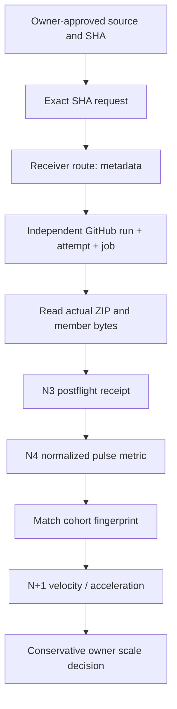

# QPS TRIAGE N4 — Native evidence penetration metric contract

Owner: Mission Control / [QPS #636](https://github.com/GBOGEB/pipeline-automation-hub/issues/636).
Related: merged [#633](https://github.com/GBOGEB/pipeline-automation-hub/pull/633), merged
[#647](https://github.com/GBOGEB/pipeline-automation-hub/pull/647), canonical
[#530](https://github.com/GBOGEB/pipeline-automation-hub/pull/530).

**Status: new metric source; no native receiver jobs or cross-repo execution
claimed by this document.** Scope: exactly three eligible producers and at
most six disjoint `native_checks` / `coverage_catalog` receiver routes.

## Data lineage (DAG)



Never credit a receiver-generated `SUCCESS` field without authenticated,
terminal native job proof. A local valid ZIP is not formal #530 acceptance.

## Metrics and denominators

| Metric | Definition | Missing-value rule |
|---|---|---|
| Source eligibility | Exactly 3 physical repositories | Never change when private source unreadable |
| Planned routes | Distinct source/repo x route pairs, maximum 6 | Invalid duplicates fail closed |
| Terminal penetration | Terminal native run/job proof / planned routes | `null` for 0 planned |
| Byte-verified penetration | Independent local ZIP+member proof / planned routes | 0 if routes planned but no proof |
| Artifact yield | Byte-verified routes / terminal native jobs | `null` when no terminal jobs |
| N-to-N+1 throughput | Δ byte-verified routes / Δ pulse index | `null` without matched history |
| N20 | Mean of the last 20 matched fractions | `null` for fewer than 20 comparable observations |
| Stability | Rolling median absolute deviation (last five) | `null` for fewer than five |
| Worker-hours / coverage / PCA / BT / sigma | Not measured by this data source | Always `null` |

N-index labels are *within identical source-route cohort keys*. A
four-route pilot and six-route scale-up have different fingerprints; never
interpret the change of denominator as growth in verified penetration.

## SIPOC

| Supplier | Input | Process | Output | Customer |
|---|---|---|---|---|
| Repo source owner | Approved receiver, SHA | Disjoint metadata route | Native receipt | N3 verifier |
| GitHub Actions | Native run, job, attempt | Independent proof | Terminal outcome | N3 verifier |
| Artifact service | Actual ZIP | CRC, member identity, SHA256 | Byte receipt | #530 verifier |
| N3 verifier | Per-route dispositions | N4 normalize | Evidence penetration, unknowns | Mission Control |
| Next-wave maintainer | Matched temporal series | N5 decision | Bounded request proposal | Source owners |

## Execution

With Python 3.9+, after importing the actual N3 postflight JSON:

```python
import json
from metric_atlas.pulse_metrics import summarize, compare_pulses

a = json.load(open("postflight-N4.json"))
n4 = summarize(a, pulse_index=4)
print(n4)
# Compare only after a second *actual* observation on the same route cohort.
# compare_pulses([n4, n5])
```

This model has 10 regression cases: no false native proof, denominator
integrity, duplicate route rejection, independent ZIP byte checks, matched
cohort math, N20 UNKNOWN and duplicate-pulse guard.

### Baseline and scale boundary

N2 authenticated controller test growth 39 -> 48 (+9/+23.08%) is a
**controller-owned** test count, not remote receiver throughput. Actual
source-owned remote receipts independently validated in the available ledger:
**0/4**. Operator approval / private QPS access remain external.

Keep at most 2 source repositories / 4 read-only routes until they are
authorized and native-proven. Security P0/P1, A10 and repository required
checks remain untouched. No admission or QPS engineering credit.
