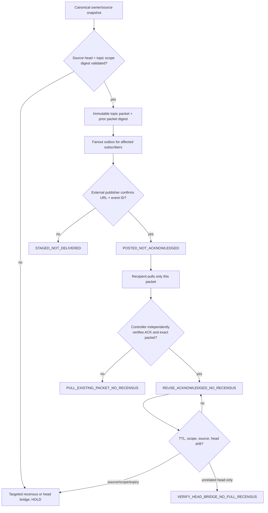

# W377 - Topic-bound census exchange, ACK reuse and first-red tax

**Review-only implementation**: `tools/metric-atlas/metric_atlas/topic_exchange.py`. This extends the canonical Metric Atlas census/adaptive-census pipeline; it is *not* a second metric owner, GitHub scheduler, message broker, CI admission controller, or owner-engineering authority. The user Skill `QPS Electrical ICD` consumes the method; `census.py` and `adaptive_census.py` retain population, measurement and partial-union authority.

## Attack vectors and disjoint work ownership

| ID | Attack vector / first missing proof | Exclusive owner lane | Invariant / coverage |
|---|---|---|---|
| AV-01 | Unverified source revision / KKS alias | A: QPS source extractor | No owner source writes, per-row Annex, EDB701 and EDB700 digests |
| AV-02 | Shared wall penetration mistaken for TP | B: W364 ICD diagram generator | Individual machine-local TPs, green downstream U, 3 SVGs/viewer/hash parity |
| AV-03 | EDG counted as fifth compressor | A: QPS engineering model | Alternative 350 kW route, no added normal load; RFI OPEN |
| AV-04 | HP4/PFC2/HARMONIC feeder collision | A: QPS source crosswalk | Annex rows 85/92/93 remain conflicts until owner disposition |
| AV-05 | Source/head/scope drift or expiry | E: Metric Atlas topic exchange | SHA40/SHA64, scope digest, bounded UTC TTL, targeted recensus |
| AV-06 | Duplicate/forged recipient acknowledgment | E: Metric Atlas topic exchange | Unsubscribed, cross-packet, unsupported and unverified ACK do not credit reuse |
| AV-07 | Concurrent writer / replay / chain tampering | E: Metric Atlas topic exchange | Compare-and-swap expected tail, exact replay idempotent, conflicting replay FAIL |
| AV-08 | Wide PR recensus repeated unchanged | C: GOGREEN first-red owner | Cache by (topic, scope SHA, source SHA, PR head); pull existing packet, not full census |
| AV-09 | Aggregator RED counted as independent root | C: EVERRED owner | Job/step first-red evidence, deduplicated root; unavailable logs remain UNKNOWN |
| AV-10 | Coverage denominator inflation | D: Metric Atlas/adaptive-census | Per source module + branch arc; count actual native runs separately from local tests |
| AV-11 | Published != delivered != acknowledged | F: owner-controlled publisher | Outbox staged by default; GitHub comment/artifact ID shows POSTED, not receiver ACK |
| AV-12 | Foreign/private source leak | F: PUB-R07/DMS publisher | Only source-safe hashes, topic and PR links in public Git; restricted originals outside Git |
| AV-13 | Wrong branch or wrong exact-head checks | G: CI/QA owner | Two-version tests, Python -O safety, exact-head native result and eligible independent review |
| AV-14 | Unapproved correction/waiver/merge | H: engineering owner + governance | `authority_transfer=false`, `merge_authorized=false`, W376 and PUB-R07 HOLD |

Exclusive lanes prevent duplicate canonical writers. One worker may read several topics, but one topic/source row belongs to one source-writing lane; fan-in is a separate coordinator. Default concurrent **source-writers = 0**, native workers = 0 in this offline implementation, and existing Metric Atlas source-facing dispatch remains capped at **3 physical repositories**.

## Partial event exchange: identity, push, pull and ACK



Packet identity: `topic`, producer repo and **40-hex exact head**, 64-hex *scope content*, *source bytes* and owner receipt digests, strictly increasing sequence and predecessor packet digest, UTC issued/expiry (max seven days), 1-8 distinct subscriber repos, explicit non-authority flags. SHA256 is an *integrity* check, not a cryptographic proof that the sender is authorized.

Staged packet `qps.topic-census.packet.v1` is NOT a sent notification. Publication `qps.topic-census.publication.v1` is independently observed URL+external ID and means **posted**, not receiver read/ACK. ACK `qps.topic-census.ack.v1` must bind the exact packet, publication, recipient, recipient head, external proof URL/ID and a controller-verified readback. The library validates shape/digest, but a controller must verify external origin before setting `CONTROLLER_READBACK_VERIFIED`; do not treat a self-reported flag as authentication.

A consumer with a verified acknowledgment and unchanged source/head/scope/TTL can reuse; unacknowledged consumers pull the *existing packet* without asking its source owner to scan again. A new source or scope digest or expiry triggers **only that topic's** recensus. An unrelated repository-head update with unchanged source/scope requires a cheap head bridge, *not* a full census. CI is a different authority domain: an ACK NEVER substitutes for new exact-head checks or an independent review.

Append-only ledger `qps.topic-census.ledger.v1`: events STAGED, PUBLICATION_POSTED, RECIPIENT_ACK, SOURCE_DRIFT and INVALIDATED. Events are hash-linked, exact duplicate replay is a no-op; a conflicting duplicate or stale expected-tail CAS fails. Pure functions only: no scheduler, polling, Web API calls or hidden background actions.

## Canonical system ownership and adaptation

| Role | Existing owner | W377 interface |
|---|---|---|
| Metric census and source fanout | `tools/metric-atlas/metric_atlas/census.py`, `dispatch.py` | Packet metadata as fan-out outbox, **no** new dispatch implementation |
| Partial/cumulative measured arcs | `metric_atlas/adaptive_census.py` | Hash-bound topic receipt can reference its rollup, not alter its counters |
| First-red and EVERRED | `mission-control/gogreen/red_trace`, `.../p-process/everred/harvest.py` | `ci.first-red` notifications are observations only |
| Portfolio statistics | `mission-control/gogreen/scale_dock.py` | Read accepted source-bound receipts; no replicated metric definitions |
| Electrical ICD engineer evidence | `cryoplant-project/triage/w363,w364,w376` | `electrical.icd.feeders` topic links an already verified source reconciliation |
| Publisher and issue register | `PUB-R07` and owner DMS | Authenticated external issue/ACK needed; no automatic owner approval |

## Metrics and stop rules

Track **per topic and receiver**, not only per PR: `source_reads`, `targeted_census_runs`, `packet_reuses`, `pulls_without_recensus`, `duplicates_suppressed`, `unverified_acks`, `source_invalidations`, `ack_lag`, `queue_depth`. The denominator for reuse is the number of *eligible, stable, acknowledged* topic/recipient pairs, not all repository files or all PRs. Never claim reduced cost without comparable job time/scan read counts.

Stop: malformed source SHA; changed evidence/scope; missing authenticated ACK; stale lease; expired packet; cross-SHA CI; red governance; no independent review. No bulk reruns for the same first-red until upstream source changed or incident state is verified.

## Tests

```bash
python -m unittest discover -s tools/metric-atlas/tests -p 'test_topic_exchange.py' -q
python -O -m unittest discover -s tools/metric-atlas/tests -p 'test_topic_exchange.py' -q
python -m coverage run --branch --include='*/topic_exchange.py' -m unittest discover -s tools/metric-atlas/tests -p 'test_topic_exchange.py' -q
python -m coverage report --include='*/topic_exchange.py' --fail-under=95
```

**Local evidence 2026-10-28:** 42/42 source-safe synthetic tests pass; Python -O replay succeeds; 99% branch-aware statement/branch coverage of the *new module only*. GitHub exact-head tests and external recipient ACK remain NOT PROVEN until native readback. Separate from Engineering/SCK CEN acceptance.

### Partial-census publication contract

A scoped PR/issue lifecycle delta invalidates only `ci.first-red.<repo>.<pr>` for that PR head; an Annex/A1 SLD change invalidates only `electrical.icd.feeders`; new PDF/SVG lineage invalidates the corresponding `electrical.icd.artifact-qa`. The fan-in consumer accepts unchanged, source-bound packets without repeating their source reads, but never silently transfers a published packet to a different repository head.

**Initial real publication state:** code and tests committed on a review branch. No receiver has yet independently acknowledged a topic; active *production* anti-recensus credit = **zero**. This document is the implementation handover, not an authenticated external message-broker deployment.
